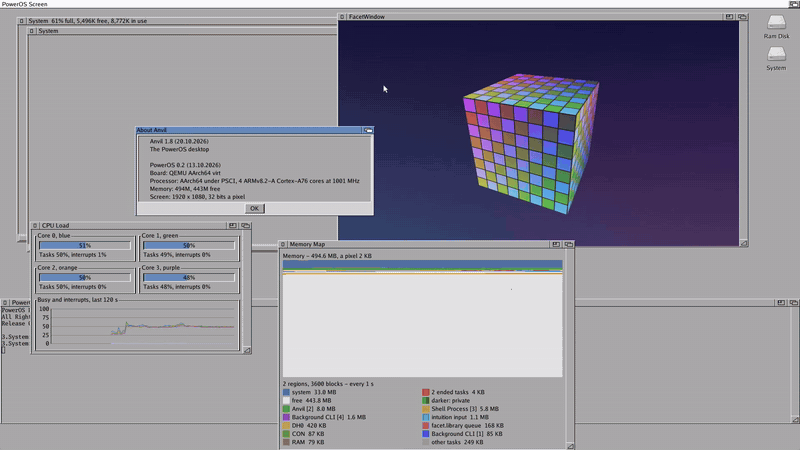
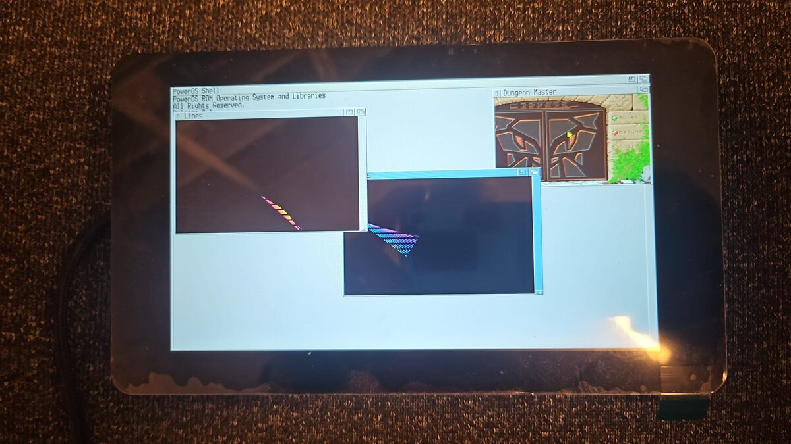
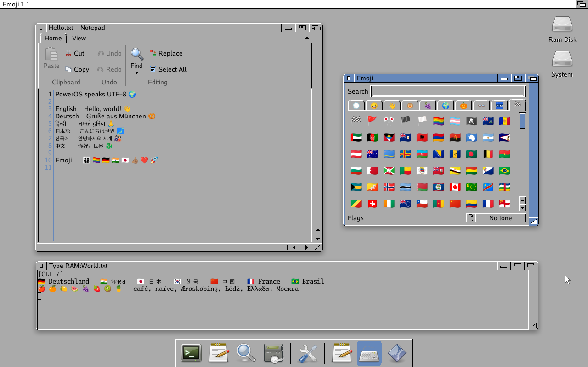
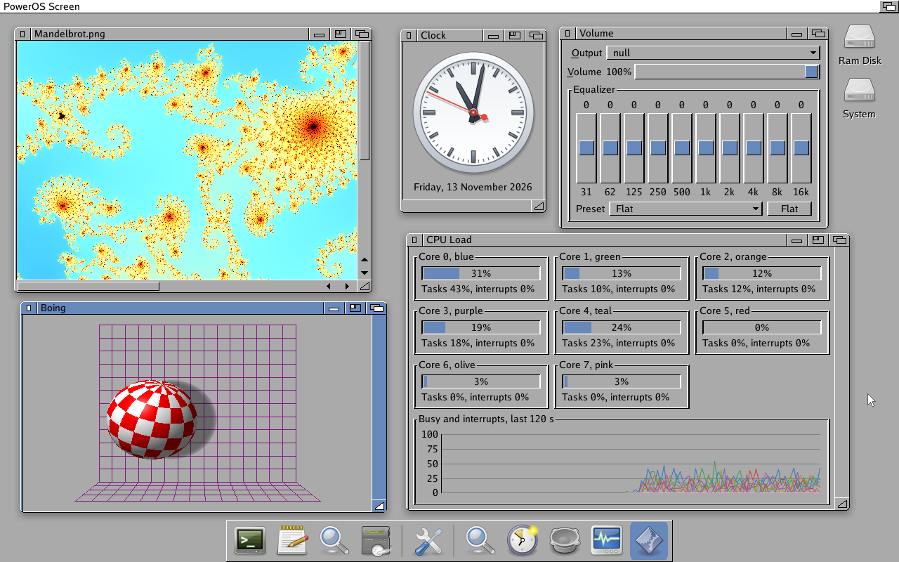
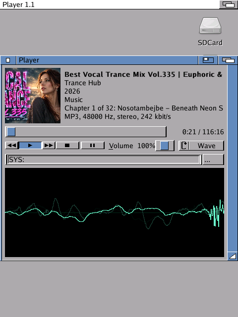
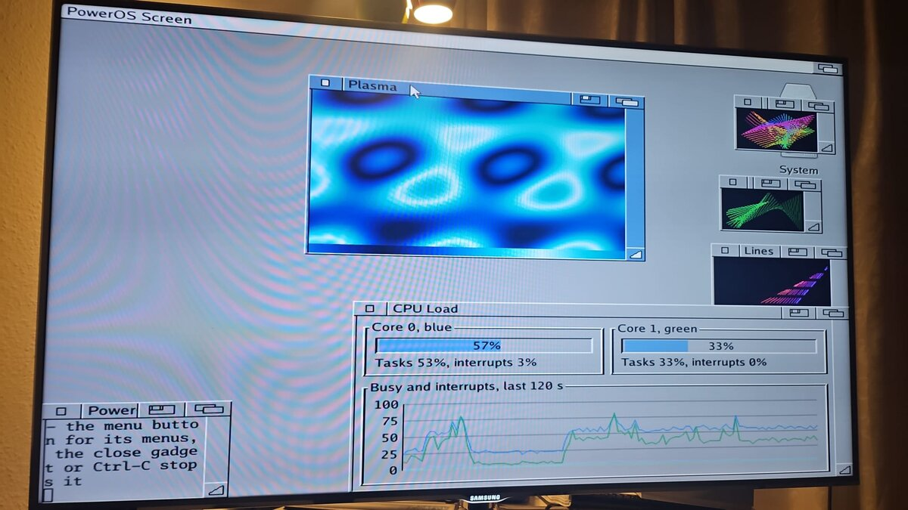
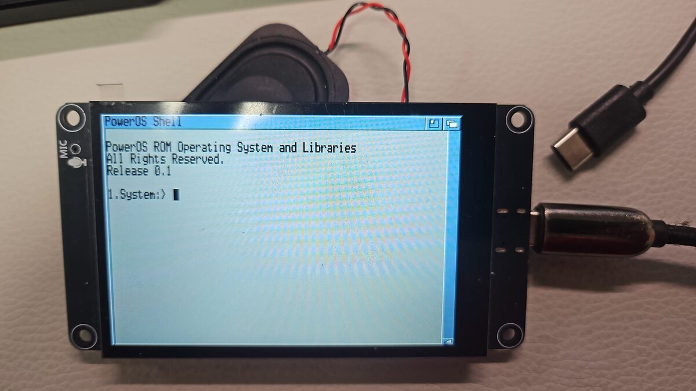
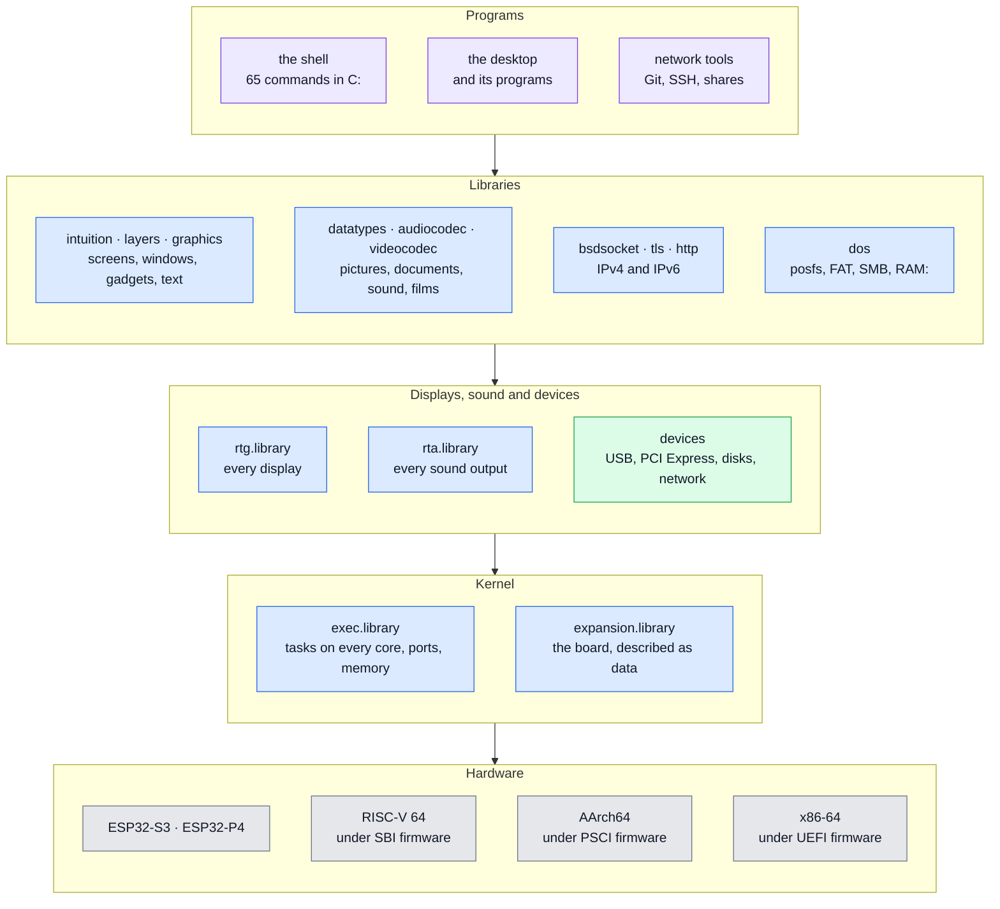

# PowerOS

PowerOS is an operating system for Espressif's ESP32 microcontrollers and
for 64-bit RISC-V, AArch64 and x86-64 machines, written in Zig. It boots
straight from an ESP32's ROM loader, from a RISC-V machine's SBI firmware,
from a Raspberry Pi's bootloader or from a PC's UEFI firmware, and brings
up a complete little system: a
multitasking kernel with libraries and devices, a DOS with file systems
and a shell, a TCP/IP stack, and a windowed desktop on the board's
display. Programs are loaded from disk at run time and built against a
separate SDK.

**Status: release 0.21** ([the archives to
download](https://github.com/cycl0ne/poweros_esp32/releases/latest)). It runs on two ESP32-S3 boards, on two
ESP32-P4 boards, on StarFive's VisionFive 2 (RISC-V 64), on Raspberry Pi's
Compute Modules 5 and 4 and a Raspberry Pi 4 Model B (AArch64), in Espressif's QEMU, in QEMU's RISC-V 64 and
AArch64 `virt` machines and in its x86-64 q35 machine.

[](docs/screenshots/README.md#four-cores-the-desktop-on-aarch64)

[](docs/screenshots/README.md#on-the-board)

<p>
<a href="docs/screenshots/README.md#every-script-text-in-utf-8"></a>
<a href="docs/screenshots/README.md#eight-cores-the-desktop-on-x86-64"></a>
<a href="docs/screenshots/README.md#music-sysprogramsplayer"></a>
</p>
<p>
<a href="docs/screenshots/README.md#on-the-board"></a>
<a href="docs/screenshots/README.md#on-the-board"></a>
</p>

## Contents

| | |
|---|---|
| [Screenshots](docs/screenshots/README.md) | four cores on AArch64, text in every script and the emoji picker, eight cores on x86-64, the desktop at rest and at work, the Player, the shell, Notepad, HDToolBox, CPU load, drawing, a game, fonts, menus, gadgets, on the boards |
| [What PowerOS is - and what it is not](#what-poweros-is---and-what-it-is-not) | the idea, and what is in it |
| [Quick start](#quick-start) | boards, building, [QEMU the first time](#first-time-in-qemu), flashing, [onto a card or an SSD](#onto-a-card-or-an-ssd) |
| [Writing programs](sdk/docs/guides/programs.md) | examples: hello in the shell, a window, buttons |
| [Debugging](sdk/docs/guides/debugging.md) | what a failure prints, from an address to a line, the ROM debugger, `s3>`, memory debugging, JTAG |
| [The SDK](sdk/) | the package a program builds against |
| [Autodocs](sdk/docs/README.md) | every call, and every module by kind |
| [Guides](sdk/docs/README.md#guides) | how the calls work together: [exec](sdk/docs/guides/exec.md), [dos](sdk/docs/guides/dos.md), [posfs](sdk/docs/guides/posfs.md), [utility](sdk/docs/guides/utility.md), [intuition](sdk/docs/guides/intuition.md), [desktop](sdk/docs/guides/anvil.md), [icons](sdk/docs/guides/icons.md), [fonts](sdk/docs/guides/fonts.md), [styles](sdk/docs/guides/styles.md), [motion](sdk/docs/guides/motion.md), [datatypes](sdk/docs/guides/datatypes.md), [network](sdk/docs/guides/network.md), [USB](sdk/docs/guides/usb.md), [disks](sdk/docs/guides/rdb.md), [installing](sdk/docs/guides/install.md), [Modbus](sdk/docs/guides/modbus.md), [sound](sdk/docs/guides/audio.md), [displays](sdk/docs/guides/rtg.md), [locale](sdk/docs/guides/locale.md), [commodities](sdk/docs/guides/commodities.md) |
| [Wi-Fi](docs/esp32s3wifi.md) | the ESP32-S3's radio's device, and how it is built |
| [USB Wi-Fi](docs/aic8800.md) | the AIC8800 stick's device, and how it is built |
| [posfs](docs/posfs.md) | the PowerOS file system: its format on the medium, field by field, and how it works |
| [Colours](docs/colors.md) | the palette the pictures are painted in, how a picture is built up, and examples; [the palette page](docs/malkasten.html) to read without the network |
| [Porting](docs/porting.md) | the checklist for a new CPU, firmware or board: every place a machine has to be named, and what each of the five chips does there |
| [Example programs](src/disk/c/) | every command on the disk, built the same way |
| [Repository layout](#repository-layout) | where things are |
| [License](#license) | MPL-2.0 for the system, MIT for the SDK and programs |

## What PowerOS is - and what it is not

- **It is** a desktop-style operating system small enough to read: kernel,
  DOS, file systems, network, graphics and windows in well under a
  megabyte of code, on a microcontroller that costs a few euros. It is
  built from small modules that talk through message ports and jump
  tables; a library or a device can be replaced, loaded from disk or
  patched at run time.
- **It is** made for the ESP32 family, and runs on 64-bit RISC-V machines
  under SBI firmware, on AArch64 machines under PSCI firmware and on
  x86-64 machines under UEFI firmware too. It
  drives the hardware itself, register by register: on an ESP32 everything
  between power-on and the desktop is in this tree, on the others
  everything after their firmware hands over.
- **It is** young. 0.21 works end to end, but the API may change before
  1.0, and not every part has run on every board.
- **It is not** a Linux, a POSIX system or an RTOS in the usual sense:
  programs use the system's own API - libraries opened by name, tag lists,
  messages - with no `libc` and no `fork`.
- **It is not** an AmigaOS clone or emulator. It takes AmigaOS's ideas -
  exec's libraries, devices and message ports, dos with handlers and
  packets, screens, windows and gadget classes - and builds them anew for
  this machine: no BCPL pointers or strings, 32- and 64-bit data,
  retargetable true-colour graphics, boards described as data. It runs no
  Amiga software.
- **It is not** a protected system. All tasks share one address space; it
  is a machine for one person at a time.
- **It does not (yet)** have Bluetooth.

### What is in it



Each layer uses the ones below it. exec, utility, expansion, dos, rtg,
rta, graphics, layers, intuition, keymap and motion are in the ROM; the
other libraries are loaded from `LIBS:` when first opened. Every call of
every module is in [the SDK's documentation](sdk/docs/README.md).

| | |
|---|---|
| **Kernel** | tasks on every core, message ports, memory, libraries and devices; tag lists, hooks, dates and time zones, UTF-8 strings; the board's parts, described as data ([exec](sdk/docs/guides/exec.md), [utility](sdk/docs/guides/utility.md)) |
| **Files** | processes, handlers and the shell's arguments; posfs - journaling, copy-on-write, checksummed, with snapshots; FAT32 and exFAT on cards and sticks; `RAM:` and `PIPE:`; SMB 2 and 3 shares as volumes; partitions from an RDB or a GPT on any drive ([dos](sdk/docs/guides/dos.md), [posfs](sdk/docs/guides/posfs.md), [disks](sdk/docs/guides/rdb.md)) |
| **Screens** | one interface for every display, from a 3.5" panel to an HDMI monitor; screens, windows and gadgets in styles; animations; 3D in Vulkan's model, on the cores or a GPU ([displays](sdk/docs/guides/rtg.md), [intuition](sdk/docs/guides/intuition.md), [styles](sdk/docs/guides/styles.md), [motion](sdk/docs/guides/motion.md)) |
| **Text** | UTF-8 everywhere; bitmap and outline fonts - TrueType, OpenType, variable fonts, colour emoji - shaped with ligatures, kerning and marks, and fallback fonts, so Devanagari, Chinese, Japanese, Korean and emoji show in any font ([fonts](sdk/docs/guides/fonts.md)) |
| **Languages** | 47 countries and 33 languages besides English: dates, numbers, money and sorting as each country has them; programs translated through catalogs, German complete and the others as drafts; a keymap for every European layout and for Devanagari ([locale](sdk/docs/guides/locale.md)) |
| **Sound** | up to sixteen streams mixed into an output, each output with its own volume and a ten-band equalizer; recording; WAV, MP3, FLAC and Ogg Vorbis, from files or internet radio ([sound](sdk/docs/guides/audio.md)) |
| **Video** | films in MP4, MOV and Matroska - H.264, H.265, VP9 and AV1 - with their sound and subtitles, on the chip's own decoder where it has one |
| **Network** | TCP/IP with IPv4 and IPv6, TLS 1.3 and 1.2, HTTP, WPA2 Wi-Fi, a packet filter; a shell over Telnet or SSH; a git client that clones, fetches, commits and pushes; SMB shares ([network](sdk/docs/guides/network.md)) |
| **Devices** | USB hosts up to SuperSpeed with keyboards, mice, sticks and disks, serial and Ethernet adapters, Wi-Fi sticks, speakers and headsets; PCI Express; NVMe, SD cards and flash; Ethernet up to 1000 Mbit/s; I2C, RS-485 and Modbus ([USB](sdk/docs/guides/usb.md), [Modbus](sdk/docs/guides/modbus.md)) |
| **Desktop** | the desktop with icons and a dock; requesters; datatypes for pictures, text, Markdown, HTML, animations and sounds; commodities, hotkeys and filters on the input ([desktop](sdk/docs/guides/anvil.md), [icons](sdk/docs/guides/icons.md), [datatypes](sdk/docs/guides/datatypes.md), [commodities](sdk/docs/guides/commodities.md)) |
| **When something fails** | a Guru and a ROM debugger on the serial port, memory debugging, the system log, and a failed program held for Suspend, Kill or Reboot ([debugging](sdk/docs/guides/debugging.md)) |

The programs on the disk:

- **`SYS:Programs`** - MultiView, Notepad, Sheet, Terminal, Player,
  Movie, FontView, Battery, Prefs, Volume, and Boing and Cobra, a
  bouncing ball and a ship in space
- **`SYS:System`** - Shell, HDToolBox, Shares, Update, CPULoad, NetLoad,
  MemMap, Clock, and SystemScan on the 64-bit machines
- **`SYS:Commodities`** - Exchange, Blanker, FKey, Emoji, AutoPoint,
  ClickToFront, MouseBlanker, NoCapsLock and NumericPad
- **`C:`** - 65 commands, test programs in `C:test` and network tools in
  `C:net`; scripts, redirection, line editing and file name completion
- **Installing** - the Installer and `C:Install` put the running system
  onto a card or an SSD, and `C:Update` brings it up to date from a
  release package, with a way back
  ([installing](sdk/docs/guides/install.md))

Under all of it the hardware, driven from this tree register by register.
A board is data - its parts and their wiring in `src/boards/<board>/` -
so a chip is brought up once and every board of it follows. What each
board runs is in [Boards](#boards).

| Chip | Machines |
|---|---|
| ESP32-S3, two Xtensa LX7 cores | Waveshare 7B, ES3C35P, Espressif QEMU |
| ESP32-P4, two RISC-V 32 cores | Olimex ESP32-P4-PC, Elecrow CrowPanel Advanced 10.1", esp-emulator |
| RISC-V 64 under SBI firmware, StarFive's JH7110 | VisionFive 2, QEMU's `virt` |
| AArch64 under PSCI firmware, Broadcom's BCM2712 and BCM2711 | Compute Module 5, Raspberry Pi 4 Model B, Compute Module 4, QEMU's `virt` |
| x86-64 under UEFI firmware, as many cores as the machine has | a PC, QEMU's q35 |

## Quick start

### Boards

| `-Dboard=` | Board | State |
|---|---|---|
| `waveshare_7b` (default) | Waveshare ESP32-S3-Touch-LCD-7B: 7" 1024×600 RGB panel, GT911 touch, 16 MB flash, 8 MB PSRAM, microSD slot on SPI, RS-485, CAN, battery charger | runs: panel, touch, Wi-Fi, the card slot; its flash disk holds the shell, the network and the card ([what a disk holds](#what-a-disk-holds)); not yet tried on the board: RS-485, the battery's voltage, a USB host on its USB-C socket; CAN not driven |
| `es3c35p` | LCDwiki ES3C35P: 3.5" 480×320 QSPI panel, touch, ES8311 audio codec, SD card slot | runs: panel, touch, speaker, card; its flash disk holds the shell, the network and the card ([what a disk holds](#what-a-disk-holds)); not yet tried on the board: audio.device 2's streams, recording from the microphone, playing into a file, the battery's voltage, a USB host |
| `qemu` | Espressif QEMU's ESP32-S3, with display, keyboard and a mouse with a wheel, an RS-485 port on its second serial port, and a USB controller with what `-Dusb` plugs in | runs, USB devices plugged in and out while it does (`-Dusb`, `-Dusb-disk`); sound into an output that goes nowhere |
| `esp32p4_emu` | Espressif's esp-emulator running an ESP32-P4 on the boards' v1.x ROM: both cores, UART0, 32 MB PSRAM (`./zig build emu`) | the shell on UART0, dos with the flash disk and its RISC-V commands, a Guru with the ROM debugger; `-Dselftest` checks the chip; no screen |
| `olimex_p4pc` | Olimex ESP32-P4-PC: ESP32-P4NRW32 (16 MB flash, 32 MB PSRAM), console on the chip's USB port, 10/100 Ethernet (IP101GRR), HDMI, a MIPI-DSI connector (here Olimex's MIPI-LCD2.8, 480×640), four USB host ports, ES8311 audio, microSD | runs: the USB console, Ethernet, the desktop on the DSI panel or over HDMI, in the largest of 1360×768, 1280×720, 1024×768 and 800×600 the monitor names ([photo](docs/screenshots/README.md#on-the-board)), both cores, PSRAM at 200 MHz, the 2D engine and the JPEG codec, USB keyboards, mice and sticks through its hub, the microSD card, sound on the jack (the codec's one output on both sides) - the [Player](docs/screenshots/README.md#music-sysprogramsplayer) on its panel; an AIC8800 USB Wi-Fi stick, joined to WPA2 networks; the battery once its solder jumpers are closed; not yet tried on the board: recording, playing into a file, DVI to a monitor without HDMI's block |
| `crowpanel_p4` | Elecrow CrowPanel Advanced 10.1": ESP32-P4NRW32, console on UART0 through a CH340K, 1024×600 MIPI-DSI panel, GT911 touch, ESP32-C6 for Wi-Fi, two speakers on NS4168 I2S amplifiers, two PDM microphones, SD slot | runs: the shell on UART0, the desktop on its panel with touch, both cores, PSRAM at 200 MHz, the 2D engine and the JPEG codec, stereo on its speakers; not yet tried on the board: audio.device 2's streams, playing into a file, the UART1 and UART3-IN connectors |
| `qemu_virt` | QEMU's RISC-V 64 `virt` machine under OpenSBI: four harts, 512 MB, a 16550 console; with QEMU's options a 1920×1080 display (`virtio-gpu-device` or `ramfb`), an xHCI controller and NVMe drives on its PCI Express | runs (`./zig build virt`): the shell on the serial console, four cores, dos started from an NVMe SSD, a work disk that keeps what is saved to it beside it, a whole system installed onto a second SSD in one command (`C:Install`), from the running system or from a release package on a stick; with `-device virtio-gpu-device` or `-device ramfb` the desktop, with `-device qemu-xhci` USB keyboards, mice and sticks, a stick at SuperSpeed, a disk over UAS on streams, with more `nvme` devices more SSDs; sound through QEMU's USB speaker on the host's sound (`-Daudio` names QEMU's backend, `wav,path=out.wav` a file, sample for sample), which every virt step plugs in and its system disk prefers, pulled out and put back as it plays; with `-device usb-net` the network, through `usb/ecm.device` (the display steps plug one in) |
| `visionfive2` | StarFive VisionFive 2 (v1.3B): JH7110 with four U74 RISC-V cores, 8 GB LPDDR4, HDMI, two gigabit Ethernet ports, four USB-A on a VL805 on PCI Express, an M.2 slot, microSD; started by the board's own OpenSBI and U-Boot | runs: the console on the debug UART, the desktop over HDMI at 1920×1080, four cores, all of its RAM, starting from the microSD card, the first Ethernet port at 1000 Mbit/s, USB keyboards and mice, an NVMe SSD in the M.2 slot, the random number generator, reboot, the four cores as the 2D engine, facet.library's 3D in a window at 60 frames a second, sound over HDMI; not yet tried on the board: a system installed onto its card or an SSD (`C:Install`), sound through a USB speaker or headset, USB 3 devices at SuperSpeed, a disk over UAS; not driven yet: the second Ethernet port, the eMMC socket |
| `qemu_virt_a64` | QEMU's AArch64 `virt` machine with four Cortex-A76 cores and a GICv2, as the Raspberry Pi CM5's BCM2712 has them, everything below 4 GiB: 512 MB, a PL011 console; with QEMU's options a 1920×1080 display (`virtio-gpu-device` or `ramfb`), an xHCI controller and NVMe drives on its PCI Express | runs (`./zig build virt64`): the shell on the serial console, four cores, dos started from an NVMe SSD, a work disk beside it, the ROM debugger with breakpoints, watchpoints and steps; entered at EL1 or, with `virtualization=on`, at EL2 (`./zig build virt64-el2`); with `-device virtio-gpu-device` or `-device ramfb` the desktop and facet.library's 3D, with `-device qemu-xhci` USB keyboards and tablets, with more `nvme` devices more SSDs, with `-device usb-net` the network, through `usb/ecm.device` (the display steps plug one in); sound through QEMU's USB speaker, as on `qemu_virt`. The CM5 is `rpi_cm5` |
| `qemu_q35` | QEMU's x86-64 q35 machine started by its UEFI firmware: 512 MB, a 16550 console on port 0x3F8, the framebuffer its firmware lights on whatever display the machine is given, and what `-device` adds on its PCI Express | runs (`./zig build q35`): the shell on the serial console, every core the machine has (the step gives it eight; 16 and 32 run on the same image), dos started from an NVMe SSD with a work disk beside it, its controller on an MSI-X vector of its own (64 MiB read in 8 ms, which is the emulator's own file cache answering and says nothing about a disk), PCI Express from the firmware's tables with everything left where the firmware placed it, a Guru with the core's registers and a backtrace; with the machine's window (`./zig build q35-display`) the desktop at 1920×1080 on the framebuffer the firmware lit, drawn into where it stands, with a USB keyboard and a tablet on `-device qemu-xhci`; the same on a virtio GPU where the machine has one (`./zig build q35-virtio`, `-device virtio-gpu-pci`), which is the same display driver over virtio's PCI transport; Ethernet from an Intel 82576 on PCI (`networks/intelnet.device`, `-device igb`, which both q35 steps give it) at 1000 Mbit/s on its own MSI-X vector, its address read from the controller, the link negotiated by its PHY, DHCP and IPv6 autoconfiguration, the controller working a packet's checksums out both ways so that the sockets library need not, and 128 MiB pulled through it with nothing dropped and nothing damaged; the date from the machine's own battery-backed clock; the machine turned off - by `C:Shutdown`, or by its power button, which stops the drives first so that what they hold is written out; sound from the machine's own high definition audio controller (`rta-hda`, `-device ich9-intel-hda -device hda-output`, which both q35 steps give it), its codec read for what it has and a sink made for each way out of it, a tone played and read back from the emulator's WAV backend as 2.000 seconds at 439.5 Hz with nothing dropped |
| `rpi_cm5` | Raspberry Pi Compute Module 5 on its IO board: BCM2712 with four Cortex-A76 cores and a GIC-400, up to 16 GB, eMMC, the console on the RP1's UART0 (pins 8 and 10 of the 40-pin header); started by the bootloader in its EEPROM, in the order its `BOOT_ORDER` setting gives - the SSD, the eMMC, or over USB with `rpiboot` | runs: the shell on the console, four cores, all of RAM, dos with the disk image the bootloader loads; the console on its interrupt, an MSI-X message from the RP1 that the board routes to the GIC; USB on the two USB 3 sockets, the RP1's DWC3 controllers through xhci.device (a mouse and a hub found); an NVMe SSD in the M.2 slot, PCI Express port 1 through pci.library, read at 432 MiB/s on its INTx line, dos started from its posfs `DH0:` (System) with `DH1:` (Work) beside it, and the kernel from the SSD's own boot partition, which `C:Install` writes beside them - the whole machine on the one medium, with the eMMC behind it in the boot order as the way back in; Wi-Fi from the module's CYW43455 (`networks/cyw43455.device`, WPA2, joined at the start); the date from its RTC through the VideoCore's firmware; the cores at 2.4 GHz, asked of the same firmware, on a supply that holds them there - PoE+ here (`CpuClock` says the clock, the chip's temperature and what holds the cores back); the chip's temperature through thermal.resource (`Temperature`), the IO board's fan turned as it asks - in Linux's steps, at speeds this fan turns at; HDMI 0 driven by the kernel - the HVS, a pixel valve and the HDMI controller - in the monitor's mode from its EDID, as HDMI with its infoframes (DVI to a monitor without HDMI's block), 1920×1080 and 2560×1440 at 60 Hz shown, and the display brought up where the firmware set none up at all - a machine starting from its own medium reaches the driver in the first second after the power comes on, before the firmware has set up any display, so the driver starts the HVS's clock itself - with the pointer and a dragged icon each in a plane of its own, the picture mirrored either way, the monitor put to sleep and woken, and its brightness set over DDC/CI; a monitor plugged in after the start or swapped while it runs; 4K at 60 Hz sent scrambled to a monitor that says it takes it (not tried yet: no such monitor here); the monitor's speakers in stereo at 48 kHz through `rta-hdmi` and audio.device; facet.library's 3D at 60 frames a second, in a window and on a screen of its own - there its pictures read by the display as they were drawn, nothing copied; Ethernet from the RP1's MAC (`networks/emac.device`) at 1000 Mbit/s, 200 MiB read from a NAS at 105 MiB/s and written at 95; a system installed onto the SSD in one command (`C:Install`), the boot pair on it, and the machine starting from the medium with no host attached; not driven yet: the RP1's GPIO, message-signalled interrupts on the M.2 slot, and - much later - HDMI 1 |
| `rpi_cm4` | Raspberry Pi Compute Module 4 on Waveshare's CM4-NANO-B: BCM2711 with four Cortex-A72 cores and a GIC-400, eMMC, Ethernet, HDMI, USB 2.0, no serial pins; started by the bootloader in its EEPROM from the eMMC, or from a PC over USB-C with `rpiboot` | runs: the kernel's lines on the picture the firmware lit, four cores, dos from the eMMC - eight lines on both clock edges at 52 MHz, 32 MiB written on posfs in 0.5 s and read in 0.45 s - the system put on it by `C:Install`, brought up to date by `C:Update` and a new kernel tried once with `C:Reboot TRYBOOT`; the desktop on HDMI through the chip's video scaler in the mode the firmware lit, sound over HDMI at 48000 Hz stereo; H.265 in the chip's own block (4K at 32 frames a second, 1080p at 112), H.264 and JPEG through the VideoCore's firmware; Ethernet and the USB port; random numbers from the chip's generator; not yet tried on the module: the kernel linked at 2 MiB and the 128 MiB disk image |
| `rpi4b` | Raspberry Pi 4 Model B: BCM2711 with four Cortex-A72 cores and a GIC-400, 1 to 8 GB, microSD, gigabit Ethernet, two micro-HDMI ports, four USB-A on a VL805 on PCI Express, the console on the PL011 (pins 8 and 10 of the 40-pin header); started by the bootloader in its EEPROM from the card or, with none in, from a USB stick | runs (a 1 GB board): the start from a USB stick (`./zig build stick -Dboard=rpi4b`) with the system in RAM, the console, four cores (at 1.8 GHz from the board's revision 1.4 on, 1.5 GHz before), the desktop on the first HDMI port in the mode the firmware lit, Ethernet's link at 1000 Mbit/s with a NAS's share read over it (smb-handler); the USB-A ports - PCI Express through pci.library, the VL805 through xhci.device with the code the VideoCore's firmware loads into it - with a mouse and a USB stick at SuperSpeed; sound over HDMI through `rta-hdmi` and audio.device; films through the VideoCore's H.264 decoder (`videodec.resource`), 1280×720 at 60 frames a second; not yet tried on the board: the microSD card; not driven yet: a system on the stick itself |

`C:ShowConfig` lists what the running board has, and `ShowConfig DEVICES`
every device by what it speaks - serial lines, block devices, network
devices, ... (`SPEAKS=serial`) - with its units on this board, none of
them opened or loaded to find out.

You need Linux or macOS, `esptool` (v5) to flash, and for the emulator
Espressif's QEMU; for the 64-bit machines `qemu-system-riscv64`,
`qemu-system-aarch64` and, with x64 UEFI firmware beside it,
`qemu-system-x86_64`, on the VisionFive 2 the U-Boot it comes with, and
on the Compute Module 5 its own bootloader or Raspberry Pi's `rpiboot`. Always build with the `./zig`
wrapper: it fetches the Espressif Zig toolchain (`0.16.0-xtensa`) into
`toolchain/` on first use, and it holds the build cache to a size. The
compiler's cache keeps every step it has ever built - a changed source
leaves the old entry behind, and a test binary alone is a quarter of a
gigabyte - so the wrapper runs `scripts/prune-cache.sh` before the build
and drops the oldest entries once `.zig-cache` passes 64 GiB. What goes
is built again when it is next needed; `ZIG_CACHE_LIMIT=120G` moves the
limit, `ZIG_CACHE_NO_PRUNE=1` leaves the cache to grow, and the script
takes any cache of its own:

```sh
scripts/prune-cache.sh --dry-run                      # what would go, and why
scripts/prune-cache.sh --limit 32G                    # this tree's cache, now
scripts/prune-cache.sh --dir ~/.cache/zig --limit 8G  # the global one
```

```sh
./zig build                  # the kernel and a flash disk: zig-out/bin/flash.bin
./zig build help             # every step and every option of this build, with what each is for
./zig build test             # the host tests and the checks of generated files
./zig build check            # the kernel and the disk of -Dboard= compile, nothing installed
./zig build check-all        # test, and every board's kernel and disk
./zig build qemu             # boot in QEMU on the serial console (quit: Ctrl-A X)
./zig build qemu-display     # the same with the display in a window
./zig build emu              # the ESP32-P4 kernel in esp-emulator (quit: Ctrl-C)
./zig build virt             # the RISC-V 64 kernel in QEMU's virt machine (quit: Ctrl-A X)
./zig build virt-display     # the same with its display, a USB keyboard, a tablet and network
./zig build virt-ramfb       # the same with the ramfb as its display
./zig build virt64           # the AArch64 kernel in QEMU's virt machine (quit: Ctrl-A X)
./zig build virt64-display   # the same with its display, a USB keyboard, a tablet and network
./zig build virt64-ramfb     # the same with the ramfb as its display
./zig build q35              # the x86-64 kernel in QEMU's q35 machine under UEFI (quit: Ctrl-A X)
./zig build q35-display      # the same with its window on the firmware's framebuffer, a keyboard, a tablet and network
./zig build q35-virtio       # the same with a virtio GPU as its display
./zig build flash-all -Dport=/dev/ttyACM0   # kernel and a fresh disk onto a board
./zig build stick -Dboard=qemu_q35          # a bootable USB stick's image in release/, for a UEFI machine
./zig build stick -Dboard=rpi4b -Dboot=...  # the same for a Raspberry Pi 4B, with its firmware's files
./zig build package -Dboard=visionfive2     # a release package in release/package-visionfive2/
./zig build serve -Dboard=visionfive2       # hand that package out over HTTP (quit: Ctrl-C)
./zig build archive -Dboard=visionfive2     # what that board is handed over in
./zig build release -Ddisk-tree=false       # every board's archive and package, in release/
./zig build sums                            # release/SHA256SUMS over the archives that are there
```

Fetched once into `toolchain/`, pinned and checked, never committed:

| Script | For |
|---|---|
| `scripts/build-qemu.sh` | QEMU with the 1024×600 display, keyboard, mouse and wheel, and the USB controller, at 240 MHz (an older QEMU runs too, without what it lacks - run the script again for the wheel and USB) |
| `scripts/fetch-wifi.sh` | the radio's vendor libraries for `DEVS:networks/esp32s3wifi.device` |
| `scripts/fetch-aic8800.sh` | the AIC8800 USB Wi-Fi stick's firmware, which `DEVS:usb/aic8800.device` loads into it (the ESP32-P4's disk) |
| `scripts/fetch-fonts.sh` | the fonts in `FONTS:` (Spleen, Go, Liberation, Noto Sans Devanagari, Noto Sans CJK and Noto Color Emoji on the 64-bit machines' disks), and a font only the host tests read (Source Sans 3) |
| `scripts/fetch-emoji.sh` | Unicode's list of the emoji and the CLDR's names for them, made into `LOCALE:Emoji` - the emoji in their groups and order, and what each is called in the disk's languages (on the 64-bit machines' disks) |
| `scripts/fetch-certs.sh` | Mozilla's root certificates, made into the trust store `SYS:Certificates/Roots` |
| `scripts/fetch-cyw43455.sh` | the Compute Module 5's radio firmware, which `DEVS:networks/cyw43455.device` loads into it (the AArch64 disk) |
| `scripts/fetch-vpu.sh` | the JH7110's video decoder firmware, which `videodec.resource` loads (the RISC-V 64 disk) |
| `scripts/fetch-amdgpu.sh` | an AMD graphics device's video decoder firmware and its security processor's table of contents, which `amdgpu.resource` loads (the x86-64 disk) |
| `scripts/fetch-pciids.sh` | the PCI ID Repository's list, `DEVS:pci.ids` on the 64-bit machines' disks, which `C:PCIInfo` names vendors and devices from - the host's copy where it has one, the current list otherwise: not pinned |
| `scripts/fetch-icons.sh` | the pictures of the disk's icons (Tango, public domain), drawn at the boards' sizes |
| `scripts/fetch-novnc.sh` | noVNC, the VNC client that runs in a browser, which `scripts/qemu-web.sh` serves beside a QEMU machine to show its display in a browser tab |
| `scripts/fetch-esp-emu.sh` | Espressif's esp-emulator, which runs the ESP32-P4: both cores, its interrupt controller, UART0 on the terminal, the system timer, flash, PSRAM, the Ethernet MAC and a GDB stub, from the chip's own ROM; no display. With it the v1.x chips' ROM (Espressif's ROM ELFs), which `./zig build emu` boots |

Without them the disk has everything but that part. On an ESP32 board
the serial console is the chip's USB port (e.g. `tio /dev/ttyACM0`); the
display comes up with the desktop, which S:Startup-Sequence starts at its end
before it puts its own shell window away - `SYS:System/Shell` opens
another. A desktop that cannot start leaves that shell on the display.

### First time in QEMU

From a fresh clone to the desktop in a window:

```sh
scripts/build-qemu.sh        # once: QEMU with the display, into toolchain/qemu
scripts/fetch-icons.sh       # optional: the desktop's icons
scripts/fetch-fonts.sh       # optional: the fonts
scripts/fetch-emoji.sh       # optional: the emoji's list and names
./zig build qemu-display     # the first run also fetches the Zig toolchain
```

`scripts/build-qemu.sh` needs a C compiler, git, Python 3, ninja,
pkg-config and the development files of glib, pixman, SDL2, libgcrypt and
libslirp:

```sh
# Debian, Ubuntu
sudo apt install build-essential git python3 python3-venv ninja-build pkg-config \
    libglib2.0-dev libpixman-1-dev libsdl2-dev libgcrypt20-dev libslirp-dev
# Arch
sudo pacman -S --needed base-devel git python ninja glib2 pixman sdl2 libgcrypt libslirp
```

The terminal QEMU runs in is the serial console: `s3>` there is the ROM's
debug shell, `newshell` starts a shell, Ctrl-A X quits. `qemu-display`
forwards host ports 2323 and 2222 to the machine's Telnet and SSH
(`C:net/ShellServer`).

### Archives to download, and a release

`./zig build archive -Dboard=<board>` packs what a machine needs to run
the system without building it, and `./zig build release
-Ddisk-tree=false` packs every board's, into `release/`:

| For | `poweros-<board>.tar.gz` holds |
|---|---|
| QEMU's `virt` machines | the kernel, the system disk, a blank work disk and `run.sh` ([qemupackage](tools/qemupackage/README.md)) |
| the ESP32 boards | the kernel, the flash disk and `flash.sh` ([espackage](tools/espackage/README.md)) |
| the VisionFive 2 and the Compute Module 5 | the kernel, the disk image, `config.txt` and `write.sh` ([bootpackage](tools/bootpackage/README.md)) |

The newest release's archives are on GitHub, with `SHA256SUMS` beside
them:

```sh
curl -LO https://github.com/cycl0ne/poweros_esp32/releases/latest/download/poweros-rpi_cm5.tar.gz
curl -LO https://github.com/cycl0ne/poweros_esp32/releases/latest/download/SHA256SUMS
sha256sum -c --ignore-missing SHA256SUMS
tar -xzf poweros-rpi_cm5.tar.gz && poweros-rpi_cm5/write.sh --help
```

Each script has `--help`, and `--print` to show what it would do. The
firmware of the Compute Module 5's radio and of the VisionFive 2's video
decoder is not in the archives: `scripts/fetch-cyw43455.sh` and
`scripts/fetch-vpu.sh` fetch it for a build of one's own.
`-Ddisk-tree=false` keeps the `disk/` tree, the builder's own files, off
the images.

### Onto a card or an SSD

The 64-bit machines' disk image lives in RAM; a microSD card or an NVMe
SSD keeps the system.

- **From the host:** `system-rv64.bin` and `system-a64.bin`, which the
  virt boards' builds make, are a whole installed disk to write with
  `dd`.
- **From the machine:** `SYS:Installer` in a window, or `C:Install` in
  one command:

  ```
  Install                                        the units it can go onto
  Install nvme.device                            a system onto unit 0, after one question
  Install nvme.device FROM WORK:package FORCE    from a release package, asking nothing
  ```

- **Up to date:** `C:Update` or `SYS:System/Update` takes only what
  differs from a package on a stick, a share or at an `http://` address;
  `BOOT` writes the kernel too, and `CHECK` only says what would change.
  Where the firmware starts from either of a pair of partitions,
  `C:Reboot TRYBOOT` tries a new kernel once and `Update CONFIRM` keeps
  it.
- **A package:** `./zig build package -Dboard=<board>` gathers one into
  `release/package-<board>/`, and `./zig build serve -Dboard=<board>`
  hands it out over HTTP - in QEMU's network at `http://10.0.2.2:8080/`.

The [install guide](sdk/docs/guides/install.md) has the details, and the
[disks guide](sdk/docs/guides/rdb.md) the partitions.

### Build steps and options

| Command | What it does |
|---|---|
| `./zig build -Dboard=es3c35p` | any step for another board |
| `./zig build flash` | the kernel only; the disk is kept |
| `./zig build flash-disk` | a fresh, empty file system on the board's disk |
| `./zig build qemu-disk` | QEMU on an image whose disk keeps what is written |
| `./zig build fd` | regenerate the SDK's interfaces from its `.fd` files |
| `./zig build autodoc` | regenerate the SDK's autodocs from the doc comments |
| `./zig build modchart` | regenerate the charts of which module uses which (`sdk/docs/modules.md`) |
| `./zig build stick -Dboard=qemu_q35` | the medium a UEFI machine starts from, into `release/stick-<board>.img`: a GPT with an EFI System partition holding the loader and the kernel, and a PowerOS container with the system on a posfs partition, which the machine runs from and installs itself from ([the install guide](sdk/docs/guides/install.md#the-medium-a-machine-is-first-reached-with)) |
| `-Dstick-size=320` | how many mebibytes that medium's EFI System partition is |
| `-Dstick-ram` | the system on that medium as a disk image beside the kernel too, which the loader reads into RAM: for a machine whose USB controller the system does not drive |
| `./zig build archive -Dboard=olimex_p4pc` | what that board is handed over in, into `release/` |
| `./zig build release` | every board's archive and package at once, into `release/`, after `check-all` has passed |
| `./zig build sums` | `release/SHA256SUMS` over the archives in `release/`, in the form `sha256sum -c` and `C:Hash CHECK` read |
| `./zig build posfsck -- [--data] flash.bin` | check the posfs volumes of a flash dump or a card's image on the host ([posfs guide](sdk/docs/guides/posfs.md#checking-a-volume)) |
| `-Ddisk-tree=false` | leave the `disk/` tree in this root off the disk images: what `archive` and `release` want for something to hand out, since those files are the builder's own |
| `-Dboot=/boot/firmware/bcm2712-rpi-cm5-cm5io.dtb` | a file this tree does not hold in a release package's `boot/` and in `SYS:Storage/Boot`, under its own name or the one before a `=`: what a board's firmware reads besides the kernel |
| `-Dserve-port=8080` | the port `./zig build serve` hands a package out on |
| `-Dextra=c/hello=path/to/hello.seg` | put a file built elsewhere on the disk images; with a chip before the path (`rv64sbi:c/hello=...`) on that chip's only, with `system:` in the 64-bit machines' release packages and on their system disks, not in the disk image in RAM - room for files that image and the flash disks cannot hold |
| `-Dgames` | put what `games/` in the tree's root holds in the `Games` drawer of the 64-bit machines' release packages and system disks: `games/x/x.a64psci.seg` is `SYS:Games/x/x` on the AArch64 one's, any other file on all of them |
| `-Dsets=base,gui,net` | the sets of programs and files on the board's disk for this build, in place of the ones the board names ([what a disk holds](#what-a-disk-holds)); `all` for every one |
| `-Ddh0-size=8192` | `DH0:` that many KiB, the rest of the flash disk left for partitions made later (HDToolBox, `C:RDB ADD`) |
| `-Drdb-size=1024` | the flash disk's partition table area before `DH0:`, in KiB (default 64): room for file systems kept in the table (HDToolBox, `C:RDB ADDFS`) |
| `-Dnet=none` | the `qemu*` and virt display steps without a network, or another QEMU network backend (`tap,ifname=tap0,script=no,downscript=no`) |
| `-Dnet-dump=net.pcap` | every frame of the `qemu*` and virt display steps' network, for Wireshark |
| `-Dtelnet=2323` | forward that host port to the machine's port 23 (`C:net/ShellServer`) |
| `-Dssh=2222` | forward that host port to the machine's port 22 (`C:net/ShellServer SSH`); qemu-display forwards 2222 itself |
| `-Drs485=tcp::5020,server,nowait` | the `qemu*` steps' RS-485 port (`rs485.device`) on that QEMU serial backend |
| `-Dslip=tcp::5021,server,nowait` | the `qemu*` steps' UART1 (`serial.device` unit 1, a SLIP line) on that QEMU serial backend; not with `-Drs485` |
| `-Dusb=usb-hub,usb-kbd,usb-mouse` | the `qemu*` steps' USB devices, QEMU's names (`usb-tablet`, `usb-serial` on a pty, `usb-net` on a network of its own, 10.0.3.0/24, too); an item with `=` is a property of the one before (`usb-kbd,id=kb1`, for `device_del kb1` in the monitor) |
| `-Dusb-disk=stick.img` | a USB stick in the `qemu*` steps, its contents that image |
| `-Daudio=pa,out.frequency=48000` | the virt steps' USB speaker on that QEMU audio backend - its driver and options, `wav,path=out.wav` for a file, `none` for nothing (default: the first QEMU has, at 44.1 kHz); at 48000 QEMU does not resample the speaker's 48 kHz |
| `-Dcores=1` | the cores the kernel runs on: 1 or 2, up to 4 on a 64-bit board (default: what the board says - two on the ESP32 boards and in `qemu`, four on the 64-bit boards) |
| `-Dselftest` | the ESP32-P4's boot task checks the chip (its blocks, DMA, PSRAM, the flash) and runs test tasks on both cores, rather than the shell |
| `-Dmemdebug=true` | memory debugging on from exec's start, so the blocks the system makes as it comes up are walled too (`C:MemDebug` and `s3> memdebug` switch it while running) |
| `-Dlogdebug` | the log keeps its debug lines from exec's start, and the cold start names each module as it starts it: what a boot that stops before the picture is read with (`Log LEVEL debug` switches it while running) |

## Repository layout

### What a disk holds

`src/disk/` is everything that can go on a disk. What a board's disk
holds is that board's choice: a flash has room for what the board is
meant to do. Every program and file is in one set, and a board names its
sets in `src/boards/<board>/disk.zig`:

| Set | What is in it |
|---|---|
| `base` | what a shell needs: `C:`, `S:`, locale.library, the keymaps, the fonts |
| `languages` | what the system speaks besides English: `LOCALE:`'s languages, countries and catalogs |
| `gui` | the desktop: anvil.library, the gadget and image classes, the datatypes of pictures and text, the programs with windows |
| `net` | bsdsocket.library and what speaks over it, the network drivers, `C:net` |
| `wifi` | the radios' drivers and what joins a network with them |
| `media` | sound and film: the codecs, Player, Movie |
| `storage` | cards, sticks and SSDs: the partition table, the file systems beside the flash's own, HDToolBox, the install |
| `usb` | usb.library, the host controllers and the class drivers |
| `3d` | facet.library, its drivers and what draws with it |
| `modbus` | modbus.library and the RS-485 line |
| `commodities` | commodities.library and `SYS:Commodities` |
| `dev` | Git |
| `tests` | `C:test` and `SYS:Tests`, and the example library and gadget they open |

The two ESP32-S3 boards' flash holds what starts the board and no more -
`base`, `net`, `wifi`, `storage` and `usb`: the shell on the panel, in
English, the network over the radio, the card in the slot and USB. The
desktop, sound and the other languages are to come onto the card as
packages. The ESP32-P4 boards hold every set but `dev` and `tests`. The
two emulators' disks have `tests`, and are where the test programs are
run; QEMU's ESP32-S3 keeps the desktop for them and leaves sound, the
languages and Git off. The 64-bit machines' disks hold every set. `-Dsets=` names other sets for one
build, and what a chip cannot run is on none of its disks whatever the
sets say.

A file is on a disk when its set and the set of every drawer it lies in
are among the disk's: `System/NetLoad` is in `net` and lies in a drawer
of `gui`, and needs both. The `disk/` tree and `-Dextra` are the
builder's own files and go on whatever the sets are.

The 64-bit machines' display drivers are files on their disks as well,
in `DEVS:gfxdrv/`, each built for the chips that have its display:
rtg.library loads the one for a display its ROM has no driver for.

Two modules of the 64-bit machines' ROM are files on the flash boards'
disks instead, in `base`: `HANDLERS:pipe-handler`, which dos loads when
`|` in a shell first opens `PIPE:`, and `LIBS:motion.library`, loaded
when something first animates. battery.resource is in the ROM of the
boards that have a battery to measure.

The sets are not closed over what their programs open. When something on
a disk opens a library the sets leave off, the build says so after the
disk is made - which library, its set, and who opens it - and goes on:
most such opens are for one feature of a program that runs without it.
When a disk is full, `mkfs` says how many bytes the volume has, how many
the files take, and which ten are the largest.

```
src/arch/      the chips (esp32s3, esp32p4, rv64sbi, a64psci, x64uefi): boot, exceptions, clock, MMU, memory, interrupts
src/rom/       what is in the ROM: libraries, devices, handlers, resources, shell, and the groups a board's ROM is put together from (modules.zig)
src/boards/    one folder per board: its parts and wiring, the groups and drivers in its ROM, and the sets its disk holds
src/disk/      what goes on the disk: commands, test programs, disk-loaded
               libraries, devices and handlers, startup scripts (a package)
sdk/           the SDK: types, constants, jump tables, autodocs, tools (a package)
build/         the build's files, which build.zig calls into: boards, tools, disk images, fetched files, kernels, emulators, releases, tests
tools/         build helpers: mkfs, mkpackage, serve, ressize, ramimage, padimage, mkicon, the autodocs, the module charts, checks
release/       what a release is made of, written by the packaging steps and kept out of the repository
scripts/       the QEMU build and its patches, the pinned fetches (Wi-Fi libraries and firmware, fonts, certificates, icons, esp-emulator, noVNC), a serial terminal, the display in a browser and pictures of it
```

## License

Copyright (c) 2026 Claus Herrmann and the PowerOS contributors.

- **The system** - everything outside `sdk/` and `src/disk/` - is under
  the [Mozilla Public License 2.0](LICENSE): a changed file stays under it
  and its source is published with what ships it; new files of one's own,
  such as a driver or a board, may be under any license.
- **The SDK** (`sdk/`) and **the disk's programs** (`src/disk/`) are under
  the [MIT license](sdk/LICENSE), so a program built against the SDK is
  its author's to license as they like.
- The patches in `scripts/qemu/` change QEMU and are under QEMU's
  license, GPL-2.0-or-later.
- `C:test/BsdSockTest` (`src/disk/c/test/bsdsocktest/`) is Thomas Dye's
  bsdsocktest in Zig and under its license,
  [GPL-3.0-only](src/disk/c/test/bsdsocktest/LICENSE); the disk image
  holds it as a program of its own.

Every source file names its license in its first line
(`SPDX-License-Identifier`).
