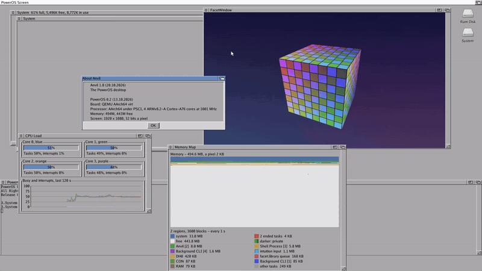
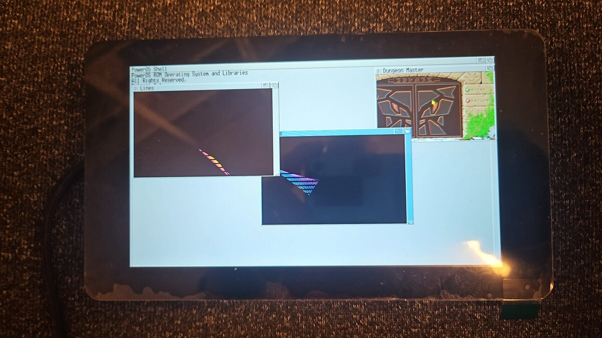
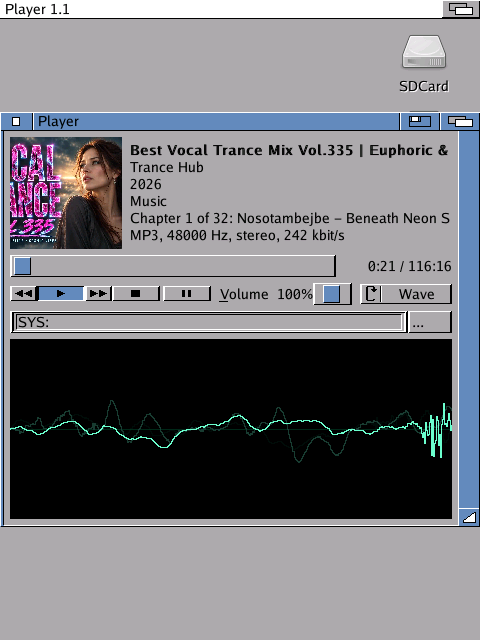
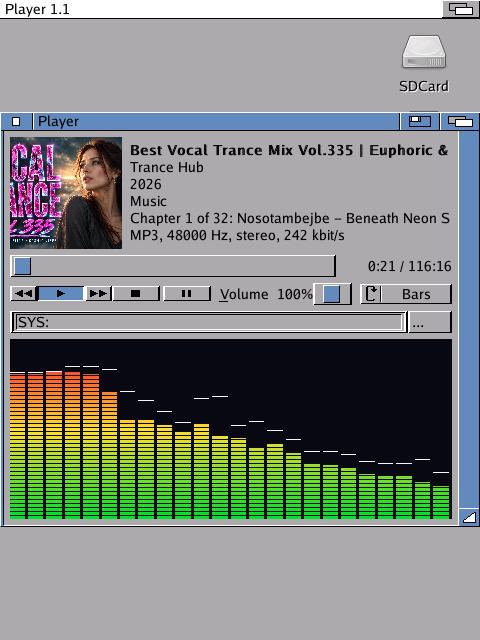
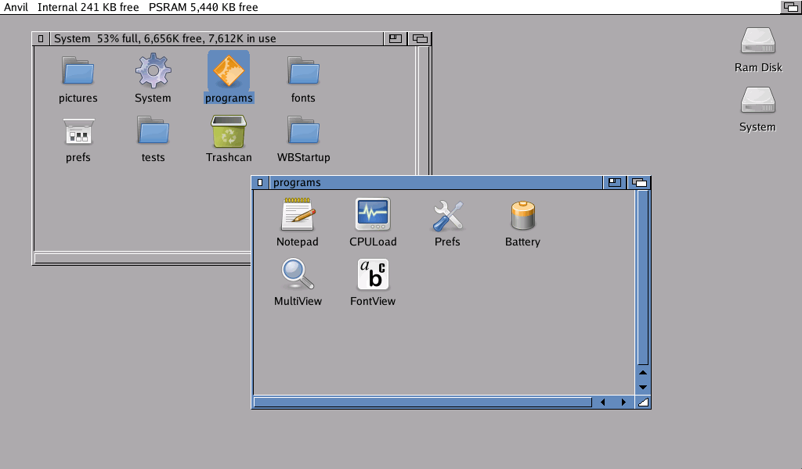
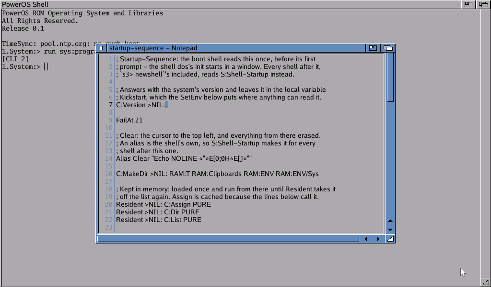
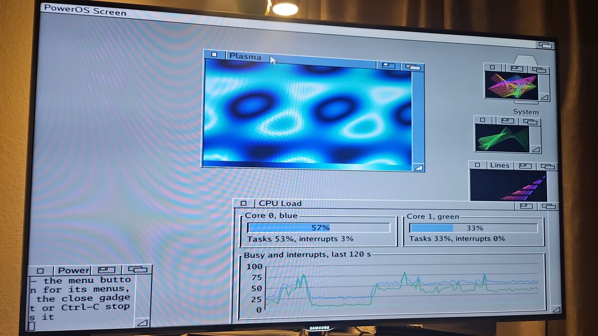
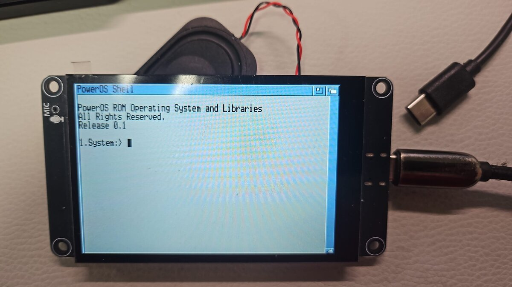
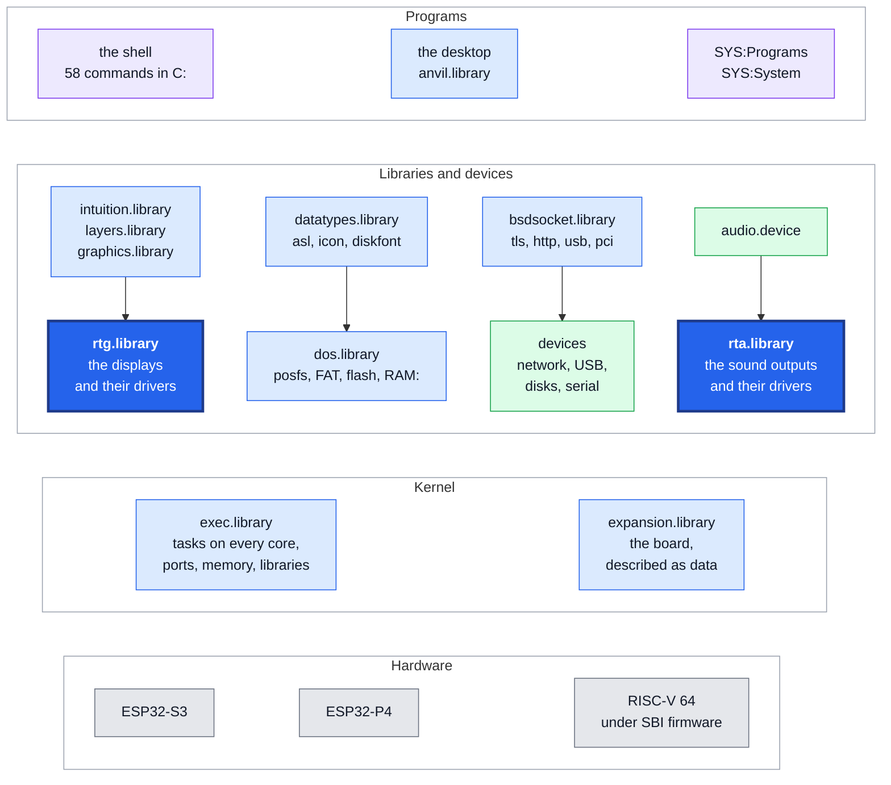

# PowerOS

PowerOS is an operating system for Espressif's ESP32 microcontrollers and
for 64-bit RISC-V machines, written in Zig. It boots straight from an
ESP32's ROM loader, or from a RISC-V machine's SBI firmware, and brings up
a complete little system: a multitasking kernel with libraries and
devices, a DOS with file systems and a shell, a TCP/IP stack, and a
windowed desktop on the board's display. Programs are loaded from disk at
run time and built against a separate SDK.

**Status: release 0.2.** It runs on two ESP32-S3 boards, on two
ESP32-P4 boards, on StarFive's VisionFive 2 (RISC-V 64), in Espressif's
QEMU and in QEMU's RISC-V 64 `virt` machine.

[](docs/screenshots/README.md#four-cores-the-desktop-on-aarch64)

[](docs/screenshots/README.md#on-the-board)

<p>
<a href="docs/screenshots/README.md#music-sysprogramsplayer"></a>
<a href="docs/screenshots/README.md#music-sysprogramsplayer"></a>
</p>
<p>
<a href="docs/screenshots/README.md#the-desktop-anvil"></a>
<a href="docs/screenshots/README.md#notepad-sysprogramsnotepad"></a>
</p>
<p>
<a href="docs/screenshots/README.md#on-the-board"></a>
<a href="docs/screenshots/README.md#on-the-board"></a>
</p>

## Contents

| | |
|---|---|
| [Screenshots](docs/screenshots/README.md) | four cores on AArch64, the Player, the shell, Notepad, HDToolBox, CPU load, drawing, a game, fonts, menus, gadgets, on the boards |
| [What PowerOS is - and what it is not](#what-poweros-is---and-what-it-is-not) | the idea, and what is in it |
| [Quick start](#quick-start) | boards, building, [QEMU the first time](#first-time-in-qemu), flashing, [the RISC-V machines](#the-risc-v-machines) |
| [Writing programs](sdk/docs/guides/programs.md) | examples: hello in the shell, a window, buttons |
| [Debugging](sdk/docs/guides/debugging.md) | what a failure prints, from an address to a line, the ROM debugger, `s3>`, memory debugging, JTAG |
| [The SDK](sdk/) | the package a program builds against |
| [Autodocs](sdk/docs/README.md) | every call, and every module by kind |
| [Guides](sdk/docs/README.md#guides) | how the calls work together: [exec](sdk/docs/guides/exec.md), [dos](sdk/docs/guides/dos.md), [posfs](sdk/docs/guides/posfs.md), [utility](sdk/docs/guides/utility.md), [intuition](sdk/docs/guides/intuition.md), [desktop](sdk/docs/guides/anvil.md), [icons](sdk/docs/guides/icons.md), [fonts](sdk/docs/guides/fonts.md), [styles](sdk/docs/guides/styles.md), [motion](sdk/docs/guides/motion.md), [datatypes](sdk/docs/guides/datatypes.md), [network](sdk/docs/guides/network.md), [USB](sdk/docs/guides/usb.md), [disks](sdk/docs/guides/rdb.md), [Modbus](sdk/docs/guides/modbus.md), [sound](sdk/docs/guides/audio.md), [displays](sdk/docs/guides/rtg.md), [locale](sdk/docs/guides/locale.md) |
| [Wi-Fi](docs/esp32s3wifi.md) | the ESP32-S3's radio's device, and how it is built |
| [USB Wi-Fi](docs/aic8800.md) | the AIC8800 stick's device, and how it is built |
| [posfs](docs/posfs.md) | the PowerOS file system: its format on the medium, field by field, and how it works |
| [Example programs](src/disk/c/) | every command on the disk, built the same way |
| [Repository layout](#repository-layout) | where things are |
| [License](#license) | MPL-2.0 for the system, MIT for the SDK and programs |

## What PowerOS is - and what it is not

- **It is** a desktop-style operating system small enough to read: kernel,
  DOS, file systems, network, graphics and windows in well under a
  megabyte of code, on a microcontroller that costs a few euros. It is
  built from small modules that talk through message ports and jump
  tables; a library or a device can be replaced, loaded from disk or
  patched at run time.
- **It is** made for the ESP32 family, and runs on 64-bit RISC-V
  machines under SBI firmware too. It drives the hardware itself,
  register by register: on an ESP32 everything between power-on and the
  desktop is in this tree, on a RISC-V machine everything after its
  firmware hands over.
- **It is** young. 0.2 works end to end, but the API may change before
  1.0, and not every part has run on every board.
- **It is not** a Linux, a POSIX system or an RTOS in the usual sense:
  programs use the system's own API - libraries opened by name, tag lists,
  messages - with no `libc` and no `fork`.
- **It is not** an AmigaOS clone or emulator. It takes AmigaOS's ideas -
  exec's libraries, devices and message ports, dos with handlers and
  packets, screens, windows and gadget classes - and builds them anew for
  this machine: no BCPL pointers or strings, 32- and 64-bit data,
  retargetable true-colour graphics, boards described as data. It runs no
  Amiga software.
- **It is not** a protected system. All tasks share one address space; it
  is a machine for one person at a time.
- **It does not (yet)** have Bluetooth.

### What is in it



Each layer uses the ones below it; libraries are blue, devices green.
Two libraries stand between the hardware and everything a program shows
and plays:

**rtg.library** keeps the displays. Each is a board of a driver, and
graphics.library, layers and intuition draw into its buffers without
knowing what panel is behind them, so one program draws on a 3.5" SPI
panel and on a 1080p monitor alike. A board's engine takes the fills,
copies, blends and scales: the ESP32-P4's PPA and 2D-DMA, the
VisionFive 2's four cores ([displays guide](sdk/docs/guides/rtg.md)).

| Driver | Display |
|---|---|
| `rgb` | the Waveshare 7B's 1024×600 RGB panel |
| `dcs` on `qspi` | the ES3C35P's 480×320 SPI panel |
| `dsi` | the ESP32-P4's MIPI DSI panels, and HDMI through the Olimex's LT8912B |
| `fb` | the VisionFive 2's HDMI at 1920×1080, QEMU virt's virtio GPU (`virtio-gpu-device`, the pointer the host's own) and its `ramfb` |
| `qemu` | Espressif QEMU's display |

**rta.library** keeps the sound outputs and ways in. Each is a sink or a
source of a driver, made from the parts the board's description names,
or when a USB speaker is plugged in. `audio.device` mixes up to sixteen
streams, each in its own form, rate, volume and pan, into one sink; the
output preferred takes over when it is plugged in, each keeps its own
volume (`C:Audio`, Prefs, `SYS:Programs/Volume`) - a USB speaker's at
its own control - and its own ten-band equalizer, with presets by name
(`C:Audio`, Prefs, `SYS:Programs/Volume`, the Player), a click plays at
once as a trigger, and unit 1 records (`C:Record`). `LIBS:audiocodec.library`
decodes WAV, MP3, FLAC and Ogg Vorbis as they play - a chained Ogg
stream song by song, each with its own rate and tags - from a file or
from a program's own reader - `SYS:Programs/Player`'s internet stations,
kept on its Radio page or found in radio-browser.info's list, with the
station's picture and the song's when the station names one; the Player
reads and writes M3U playlists and reads PLS, and draws the sound as a
plasma, its wave, the spectrum's bars, left against right or a meter
for each side, in its window or over the whole screen; `C:Play` plays a
file or a station's address in the shell, each title said as it changes
([sound guide](sdk/docs/guides/audio.md)).

| Driver | Output |
|---|---|
| `es8311` | the ES8311 codec, and its microphone input |
| `i2samp` | I2S amplifiers, as the CrowPanel's two speakers |
| `hdmi` | the VisionFive 2's HDMI port, 48000 Hz stereo |
| `uac` | USB speakers and headsets (`DEVS:usb/uac.device`) |
| `file` | a WAV file, written in time |
| `null` | in the emulators, an output into nothing that keeps time |

The libraries: exec, utility, expansion, dos, rtg, rta, graphics,
layers, intuition, keymap and motion are in the ROM, the rest are loaded
from `LIBS:` when first opened. Every module, with its reference, is in
[the SDK's documentation](sdk/docs/README.md).

| Area | Libraries |
|---|---|
| Kernel | `exec` tasks on every core, ports, memory, libraries and devices; `utility` tag lists, hooks, dates; `expansion` the board's parts |
| Files | `dos` processes, files, handlers, the shell's `ReadArgs`; `rdb` partitions on any drive; `compression` DEFLATE, zlib and gzip |
| Languages | `locale` countries' dates, numbers and money, languages' words and order of letters, programs' texts translated in catalogs |
| Displays | **`rtg`**; `graphics` drawing; `layers`; `intuition` screens, windows, gadgets, styles; `keymap`; `motion` animations and timers |
| Sound | **`rta`**; `audiocodec` WAV, MP3, FLAC, Ogg Vorbis |
| Desktop | `anvil` the desktop; `asl` requesters; `icon`; `datatypes` pictures, text, animations and sounds by what is in them, from a file or from memory; `iffparse`; `diskfont` and `truetype` fonts; `facet` 3D in Vulkan's model, on the cores |
| Network | `bsdsocket` TCP/IP, IPv4 and IPv6; `tls` 1.3 and 1.2; `http` HTTP/1.1 requests, connections kept; `crypto`; `wpa` WPA2; `filter` a packet filter |
| Buses | `usb` the USB host stack; `pci` PCI Express; `modbus` RTU and TCP |

Beside them:

- **File systems:** posfs, journaling, copy-on-write, checksummed, with
  snapshots ([posfs guide](sdk/docs/guides/posfs.md)); FAT32 and exFAT
  on cards and sticks; the flash file system (`DH0:`), `RAM:`, `PIPE:`;
  a share on an SMB 2 or 3 server, read and written as a volume, signed
  and encrypted, mounted at boot from its file in `DEVS:Shares/` and
  connected again after a server restart (`C:net/MountShare`,
  [network guide](sdk/docs/guides/network.md#a-share-as-a-volume-smb-handler));
  partitions from an RDB or a GPT on any drive, laid out in
  `SYS:System/HDToolBox` ([disks guide](sdk/docs/guides/rdb.md)).
- **Devices:** timer, serial, console, input from keyboards, mice and
  touch, flash, SD card, NVMe, I2C, RS-485, clipboard; USB hosts on the
  ESP32s' OTG and on xHCI, there up to SuperSpeed (5 Gbit/s), bulk
  streams and links resting in U1 and U2, a device plugged in or pulled
  out told to the windows that ask, with class drivers for keyboards,
  mice, sticks and disks (Bulk-Only and UAS), serial and Ethernet
  adapters, Wi-Fi sticks, and on xHCI speakers and headsets
  ([USB guide](sdk/docs/guides/usb.md)); Ethernet up to 1000 Mbit/s, the
  ESP32-S3's Wi-Fi and SLIP, and a shell over Telnet or SSH
  ([network guide](sdk/docs/guides/network.md)).
- **The shell:** 58 commands in `C:`, test programs in `C:test`, network
  tools in `C:net` - among them a git client that clones, fetches,
  commits and pushes over HTTPS and SSH (`C:net/Git`,
  [network guide](sdk/docs/guides/network.md#git-cnetgit)); scripts,
  output and errors redirected apart, line editing and file name
  completion, files hashed and checked against a list of digests
  ([dos guide](sdk/docs/guides/dos.md)).
- **Languages:** 21 countries and 9 languages besides English in
  `LOCALE:`, the one chosen on Prefs' Region page with the time zone,
  or in `ENV:Sys/locale.prefs`; dates, dos's
  error texts and the shell's messages in it - German shipped - and a
  program's own texts from its catalog, built from a descriptor and
  checked by `sdk/tools/catcomp`: Notepad's, Sheet's and the Player's
  in German
  ([locale guide](sdk/docs/guides/locale.md)).
- **Programs:** in `SYS:Programs` MultiView, Notepad, Sheet, Terminal,
  Player, FontView, Battery, Prefs and Volume; in `SYS:System` the Shell,
  HDToolBox, CPULoad, NetLoad and MemMap.
- **When something fails:** a Guru and a ROM debugger on the serial
  port, memory debugging, the system log, and a program that fails held
  for Suspend, Kill or Reboot
  ([debugging guide](sdk/docs/guides/debugging.md)).

## Quick start

### Boards

| `-Dboard=` | Board | State |
|---|---|---|
| `waveshare_7b` (default) | Waveshare ESP32-S3-Touch-LCD-7B: 7" 1024×600 RGB panel, GT911 touch, 16 MB flash, 8 MB PSRAM, microSD slot on SPI, RS-485, CAN, battery charger | runs: panel, touch, Wi-Fi, the card slot; not yet tried on the board: RS-485, the battery's voltage, a USB host on its USB-C socket; CAN not driven |
| `es3c35p` | LCDwiki ES3C35P: 3.5" 480×320 QSPI panel, touch, ES8311 audio codec, SD card slot | runs: panel, touch, speaker, card; not yet tried on the board: audio.device 2's streams, recording from the microphone, playing into a file, the battery's voltage, a USB host |
| `qemu` | Espressif QEMU's ESP32-S3, with display, keyboard and a mouse with a wheel, an RS-485 port on its second serial port, and a USB controller with what `-Dusb` plugs in | runs, USB devices plugged in and out while it does (`-Dusb`, `-Dusb-disk`); facet.library's 3D on its 565 display, dithered; sound into an output that goes nowhere |
| `esp32p4_emu` | Espressif's esp-emulator running an ESP32-P4 on the boards' v1.x ROM: both cores, UART0, 32 MB PSRAM (`./zig build emu`) | the shell on UART0, dos with the flash disk and its RISC-V commands, a Guru with the ROM debugger; `-Dselftest` checks the chip; no screen |
| `olimex_p4pc` | Olimex ESP32-P4-PC: ESP32-P4NRW32 (16 MB flash, 32 MB PSRAM), console on the chip's USB port, 10/100 Ethernet (IP101GRR), HDMI, a MIPI-DSI connector (here Olimex's MIPI-LCD2.8, 480×640), four USB host ports, ES8311 audio, microSD | runs: the USB console, Ethernet, the desktop on the DSI panel or over HDMI, in the largest of 1360×768, 1280×720, 1024×768 and 800×600 the monitor names ([photo](docs/screenshots/README.md#on-the-board)), both cores, PSRAM at 200 MHz, the 2D engine and the JPEG codec, USB keyboards, mice and sticks through its hub, the microSD card, sound on the jack (the codec's one output on both sides) - the [Player](docs/screenshots/README.md#music-sysprogramsplayer) on its panel; an AIC8800 USB Wi-Fi stick, joined to WPA2 networks; the battery once its solder jumpers are closed; not yet tried on the board: recording, playing into a file |
| `crowpanel_p4` | Elecrow CrowPanel Advanced 10.1": ESP32-P4NRW32, console on UART0 through a CH340K, 1024×600 MIPI-DSI panel, GT911 touch, ESP32-C6 for Wi-Fi, two speakers on NS4168 I2S amplifiers, two PDM microphones, SD slot | runs: the shell on UART0, the desktop on its panel with touch, both cores, PSRAM at 200 MHz, the 2D engine and the JPEG codec, stereo on its speakers; not yet tried on the board: audio.device 2's streams, playing into a file, the UART1 and UART3-IN connectors |
| `qemu_virt` | QEMU's RISC-V 64 `virt` machine under OpenSBI: four harts, 512 MB, a 16550 console; with QEMU's options a 1920×1080 display (`virtio-gpu-device` or `ramfb`), an xHCI controller and NVMe drives on its PCI Express | runs (`./zig build virt`): the shell on the serial console, four cores, dos started from an NVMe SSD, a work disk that keeps what is saved to it beside it; with `-device virtio-gpu-device` or `-device ramfb` the desktop, with `-device qemu-xhci` USB keyboards, mice and sticks, a stick at SuperSpeed, a disk over UAS on streams, with more `nvme` devices more SSDs; sound through QEMU's USB speaker on the host's sound (`-Daudio` names QEMU's backend, `wav,path=out.wav` a file, sample for sample), which every virt step plugs in and its system disk prefers, pulled out and put back as it plays; with `-device usb-net` the network, through `usb/ecm.device` (the display steps plug one in) |
| `visionfive2` | StarFive VisionFive 2 (v1.3B): JH7110 with four U74 RISC-V cores, 8 GB LPDDR4, HDMI, two gigabit Ethernet ports, four USB-A on a VL805 on PCI Express, an M.2 slot, microSD; started by the board's own OpenSBI and U-Boot | runs: the console on the debug UART, the desktop over HDMI at 1920×1080, four cores, all of its RAM, starting from the microSD card, the first Ethernet port at 1000 Mbit/s, USB keyboards and mice, an NVMe SSD in the M.2 slot, the random number generator, reboot, the four cores as the 2D engine, facet.library's 3D in a window at 60 frames a second, sound over HDMI; not yet tried on the board: sound through a USB speaker or headset, USB 3 devices at SuperSpeed, a disk over UAS; not driven yet: the second Ethernet port, the eMMC socket |
| `qemu_virt_a64` | QEMU's AArch64 `virt` machine with four Cortex-A76 cores and a GICv2, as the Raspberry Pi CM5's BCM2712 has them, everything below 4 GiB: 512 MB, a PL011 console; with QEMU's options a 1920×1080 display (`virtio-gpu-device` or `ramfb`), an xHCI controller and NVMe drives on its PCI Express | runs (`./zig build virt64`): the shell on the serial console, four cores, dos started from an NVMe SSD, a work disk beside it, the ROM debugger with breakpoints, watchpoints and steps; entered at EL1 or, with `virtualization=on`, at EL2 (`./zig build virt64-el2`); with `-device virtio-gpu-device` or `-device ramfb` the desktop and facet.library's 3D, with `-device qemu-xhci` USB keyboards and tablets, with more `nvme` devices more SSDs, with `-device usb-net` the network, through `usb/ecm.device` (the display steps plug one in); sound through QEMU's USB speaker, as on `qemu_virt`. The CM5 is `rpi_cm5` |
| `rpi_cm5` | Raspberry Pi Compute Module 5 on its IO board: BCM2712 with four Cortex-A76 cores and a GIC-400, up to 16 GB, eMMC, the console on the RP1's UART0 (pins 8 and 10 of the 40-pin header); started by the bootloader in its EEPROM from the eMMC, or over USB with `rpiboot` | runs: the shell on the console, four cores, all of RAM, dos with the disk image the bootloader loads; the console on its interrupt, an MSI-X message from the RP1 that the board routes to the GIC; USB on the two USB 3 sockets, the RP1's DWC3 controllers through xhci.device (a mouse and a hub found); an NVMe SSD in the M.2 slot, PCI Express port 1 through pci.library, read at 432 MiB/s on its INTx line, dos started from its posfs `DH0:` (System) with `DH1:` (Work) beside it, the kernel still from the eMMC or `rpiboot`; Wi-Fi from the module's CYW43455 (`networks/cyw43455.device`, WPA2, joined at the start); the date from its RTC through the VideoCore's firmware; the cores at 2.4 GHz, asked of the same firmware, on a supply that holds them there - PoE+ here (`CpuClock` says the clock, the chip's temperature and what holds the cores back); the chip's temperature through thermal.resource (`Temperature`), the IO board's fan turned as it asks - in Linux's steps, at speeds this fan turns at; HDMI 0 driven by the kernel - the HVS, a pixel valve and the HDMI controller - in the monitor's mode from its EDID, as HDMI with its infoframes (DVI to a monitor without HDMI's block), 1920×1080 and 2560×1440 at 60 Hz shown, with the pointer and a dragged icon each in a plane of its own, the picture mirrored either way, the monitor put to sleep and woken, and its brightness set over DDC/CI; a monitor plugged in after the start or swapped while it runs; 4K at 60 Hz sent scrambled to a monitor that says it takes it (not tried yet: no such monitor here); the monitor's speakers in stereo at 48 kHz through `rta-hdmi` and audio.device; facet.library's 3D at 60 frames a second, in a window and on a screen of its own - there its pictures read by the display as they were drawn, nothing copied; Ethernet from the RP1's MAC (`networks/emac.device`) at 1000 Mbit/s, 200 MiB read from a NAS at 105 MiB/s and written at 95; not driven yet: the RP1's GPIO, message-signalled interrupts on the M.2 slot, and - much later - HDMI 1 |

`C:ShowConfig` lists what the running board has, and `ShowConfig DEVICES`
every device by what it speaks - serial lines, block devices, network
devices, ... (`SPEAKS=serial`) - with its units on this board, none of
them opened or loaded to find out.

You need Linux or macOS, `esptool` (v5) to flash, and for the emulator
Espressif's QEMU; for the RISC-V machines `qemu-system-riscv64` and, on
the VisionFive 2, the U-Boot it comes with. Always build with the `./zig`
wrapper: it fetches the Espressif Zig toolchain (`0.16.0-xtensa`) into
`toolchain/` on first use.

```sh
./zig build                  # the kernel and a flash disk: zig-out/bin/flash.bin
./zig build test             # host tests; every board and every program compiles
./zig build qemu             # boot in QEMU on the serial console (quit: Ctrl-A X)
./zig build qemu-display     # the same with the display in a window
./zig build emu              # the ESP32-P4 kernel in esp-emulator (quit: Ctrl-C)
./zig build virt             # the RISC-V 64 kernel in QEMU's virt machine (quit: Ctrl-A X)
./zig build virt-display     # the same with its display, a USB keyboard, a tablet and network
./zig build virt-ramfb       # the same with the ramfb as its display
./zig build virt64           # the AArch64 kernel in QEMU's virt machine (quit: Ctrl-A X)
./zig build virt64-display   # the same with its display, a USB keyboard, a tablet and network
./zig build virt64-ramfb     # the same with the ramfb as its display
./zig build flash-all -Dport=/dev/ttyACM0   # kernel and a fresh disk onto a board
```

Fetched once into `toolchain/`, pinned and checked, never committed:

| Script | For |
|---|---|
| `scripts/build-qemu.sh` | QEMU with the 1024×600 display, keyboard, mouse and wheel, and the USB controller, at 240 MHz (an older QEMU runs too, without what it lacks - run the script again for the wheel and USB) |
| `scripts/fetch-wifi.sh` | the radio's vendor libraries for `DEVS:networks/esp32s3wifi.device` |
| `scripts/fetch-aic8800.sh` | the AIC8800 USB Wi-Fi stick's firmware, which `DEVS:usb/aic8800.device` loads into it (the ESP32-P4's disk) |
| `scripts/fetch-fonts.sh` | the fonts in `FONTS:` (Spleen, Go) |
| `scripts/fetch-certs.sh` | Mozilla's root certificates, made into the trust store `SYS:Certificates/Roots` |
| `scripts/fetch-pciids.sh` | the PCI ID Repository's list, `DEVS:pci.ids` on the RISC-V disk, which `C:PCIInfo` names vendors and devices from - the host's copy where it has one, the current list otherwise: not pinned |
| `scripts/fetch-icons.sh` | the pictures of the disk's icons (Tango, public domain), drawn at the boards' sizes |
| `scripts/fetch-esp-emu.sh` | Espressif's esp-emulator, which runs the ESP32-P4: both cores, its interrupt controller, UART0 on the terminal, the system timer, flash, PSRAM, the Ethernet MAC and a GDB stub, from the chip's own ROM; no display. With it the v1.x chips' ROM (Espressif's ROM ELFs), which `./zig build emu` boots |

Without them the disk has everything but that part. On an ESP32 board
the serial console is the chip's USB port (e.g. `tio /dev/ttyACM0`); the
display comes up with the desktop, which S:Startup-Sequence starts at its end
before it puts its own shell window away - `SYS:System/Shell` opens
another. A desktop that cannot start leaves that shell on the display.

### First time in QEMU

From a fresh clone to the desktop in a window:

```sh
scripts/build-qemu.sh        # once: QEMU with the display, into toolchain/qemu
scripts/fetch-icons.sh       # optional: the desktop's icons
scripts/fetch-fonts.sh       # optional: the fonts
./zig build qemu-display     # the first run also fetches the Zig toolchain
```

`scripts/build-qemu.sh` runs on Linux. It needs a C compiler, git,
Python 3, ninja, pkg-config, and the development files of glib, pixman,
SDL2, libgcrypt and libslirp:

```sh
# Debian, Ubuntu
sudo apt install build-essential git python3 python3-venv ninja-build pkg-config \
    libglib2.0-dev libpixman-1-dev libsdl2-dev libgcrypt20-dev libslirp-dev
# Arch
sudo pacman -S --needed base-devel git python ninja glib2 pixman sdl2 libgcrypt libslirp
```

`scripts/fetch-icons.sh` draws the icons at each board's size with
`rsvg-convert` (`librsvg2-bin`, `librsvg`); without it they are the
release's 32-pixel pictures.

The window shows the boot and then the desktop; `SYS:System/Shell` opens
a shell on it. The terminal QEMU runs in is the serial console: `s3>`
there is the ROM's debug shell, `newshell` starts a CLI (`List`, `Info`,
...), and Ctrl-A X quits QEMU. `qemu-display` also forwards host port
2323 to the machine's Telnet port and 2222 to its SSH port, for
`C:net/ShellServer`. The steps run both of the S3's cores on one host
thread (`-accel tcg,thread=single`): with a thread for each, Espressif's
QEMU damages its own memory early in a boot and stops in up to half of
them, so QEMU started by hand needs the same option.

### The RISC-V machines

`-Dboard=qemu_virt` and `-Dboard=visionfive2` build a kernel for a
64-bit RISC-V machine under SBI firmware, which enters it in supervisor
mode: `zig-out/bin/kernel` (the ELF), `kernel.bin` (the same from its
first address, 0x80200000, with the header U-Boot's `booti` reads) and
`disk-rv64.bin`, the disk as an image of its whole 14 MB. There is no
flash: on the VisionFive 2 the loader puts the image in RAM beside the
kernel and names it in the device tree, flash.device serves it as
`DH0:`, and what is written to it is gone when the machine stops.
Nothing is flashed: the `flash*` steps are the ESP32 boards'.

`./zig build virt` boots QEMU's virt machine on the serial console with
four harts and 512 MB, and two NVMe SSDs, each with a GPT whose PowerOS
container holds one posfs partition. The machine starts from the system
disk, `DH0:` (`System`, 256 MB), which the build makes with the disk
image's files (`zig-out/bin/system-rv64.bin` with `-Dboard=qemu_virt`):
what a run writes to it goes with the run (QEMU's `snapshot=on`), and
the next build or run starts from it as it was made. The work disk,
`DH1:` (`Work`, 1 GB), is made blank the first time, as
`work/virt.bin`, and keeps what is saved to it from then on; delete the
file for a blank one. QEMU passes its flushes on to nobody
(`cache=unsafe`), since each would sync the image file on the host,
milliseconds apiece: what the machine wrote stays when QEMU quits or is
killed, and only a crash of the host can lose the last of it. Both
files take on the host only what has been written to them. The ROM
holds pci.library, nvme.device and posfs-handler, and nvme.device
starts at cold start and hands the SSDs'
partitions to dos ([disks guide](sdk/docs/guides/rdb.md#starting-from-an-ssd)).
QEMU locks the work disk while it runs, so one machine of each kind runs
at a time. Every virt step plugs QEMU's USB speaker into an xHCI
controller, and the system disk's `ENVARC:Sys/audio.prefs` prefers it,
so what plays is heard on the host - through the first of QEMU's audio
backends it has, or the one `-Daudio` names (`pa`, `pipewire`, `alsa`,
`sdl`; `wav,path=out.wav,out.frequency=48000,out.channels=2,out.format=s16`
into a file); `speaker` in the monitor. A QEMU with no backend but
`none` plays into nothing: the backends come as packages of their own
on some hosts (`qemu-audio-pa`, `qemu-audio-pipewire`). `./zig build
virt-display` adds the display (QEMU's virtio GPU, 1920×1080 as the
VisionFive 2's HDMI) and USB with a keyboard, a tablet and an Ethernet
adapter (`usb-net`, the machine's network: DHCP hands out 10.0.2.15 on
QEMU's user network, as in `qemu`), the console still on the terminal:
the desktop, and `C:test/FacetCube` drawn through facet.library as on
the board. The GPU is told each rectangle drawn, and
its cursor is the machine's pointer, which the window shows as the
host's own; `-device virtio-gpu-device` without `xres` and `yres` comes
up at QEMU's 1280×800. `./zig build virt-ramfb` shows the same on the
`ramfb`, which reads the picture out of RAM itself, the pointer drawn
into it. The window is QEMU's GTK one at the picture's size, a pixel
for a pixel (`zoom-to-fit=off`; Arch packages it apart, as
`qemu-ui-gtk`). `-Dvirt-ui=` gives QEMU another `-display`:
`default,show-cursor=off` takes SDL where there is no GTK
(`qemu-ui-sdl`), and without either serves the display over VNC on
`localhost:5900`; the `virt64` display steps are the same. Arch
packages the virtio GPU apart as well, as `qemu-hw-display-virtio-gpu`:
without it QEMU says `'virtio-gpu-device' is not a valid device model
name`, and only the `ramfb` steps run. QEMU run by hand adds the rest -
another SSD, sound:

```sh
./zig build -Dboard=qemu_virt
qemu-system-riscv64 -M virt -m 512M -smp 4 -bios default \
    -kernel zig-out/bin/kernel \
    -drive if=none,id=system,format=raw,snapshot=on,file=zig-out/bin/system-rv64.bin \
    -device nvme,serial=system,drive=system \
    -device virtio-gpu-device,xres=1920,yres=1080 \
    -device qemu-xhci -device usb-kbd -device usb-tablet \
    -drive if=none,id=ssd,format=raw,file=ssd.img -device nvme,serial=1,drive=ssd
```

`-device usb-audio,audiodev=snd -audiodev pa,id=snd` adds a USB speaker
(`-audiodev wav,id=snd,path=out.wav,out.frequency=48000,out.channels=2,out.format=s16`
plays into a file instead), which the system disk prefers, as in the
virt steps. A stick (`-device usb-storage,drive=...`)
goes on a USB 3 port and runs at SuperSpeed; its image holds a partition
table with a FAT32 or exFAT partition, as a stick is sold
([USB guide](sdk/docs/guides/usb.md)). `-device usb-uas,id=uas -device
scsi-hd,bus=uas.0,drive=...` is a disk over UAS, on streams.

On the VisionFive 2, U-Boot loads `kernel.bin` and starts it with
`booti`, with `disk-rv64.bin` as its ramdisk and U-Boot's device tree.
The console is the debug UART on pins 8 and 10 of the 40-pin header,
115200 8N1 (a 3.3 V serial adapter). The ROM holds sdcard.device and the
FAT handler, so the machine can also start from its microSD card: a
partition in the card's RigidDiskBlock, or in the one in the PowerOS
container of its GPT, that is bootable at a higher priority than `DH0:`
is `SYS:`, and a card sold with a PC partition table keeps it, so one
FAT32 volume can be both U-Boot's and PowerOS's
([disks guide](sdk/docs/guides/rdb.md)).

### The AArch64 machine

`-Dboard=qemu_virt_a64` builds a kernel for an AArch64 machine under
PSCI firmware (chip `a64psci`): `zig-out/bin/kernel` (the ELF, for a
debugger), `kernel.bin` (the same from its first address, 0x40200000,
with the arm64 `Image` header QEMU and the Pi's firmware read),
`disk-a64.bin`, the disk as an image of its whole 14 MB for a loader to
put in RAM as on the VisionFive 2, and `system-a64.bin`, the same files
as the system disk the `virt64` steps start from. The kernel runs at EL1
with its MMU on: an identity map, RAM normal cacheable memory, page 0
left out so a null pointer faults, the kernel's code read-only. A core
that comes in at EL2 drops to EL1 first.

`./zig build virt64` boots QEMU's virt machine with four Cortex-A76
cores, a GICv2 and 512 MB, all below 4 GiB, on the serial console, and
its own two SSDs as `virt` has them - the system disk, and the work disk
in `work/virt64.bin` - and QEMU's USB speaker, preferred;
`./zig build virt64-display` adds the display (the virtio GPU;
`virt64-ramfb` the ramfb) and USB with a keyboard, a tablet and an
Ethernet adapter, as `virt-display` has them, and `./zig build
virt64-el2` enters the kernel at EL2, PSCI by SMC, as the CM5's firmware
does. QEMU run by hand adds another SSD:

```sh
./zig build -Dboard=qemu_virt_a64
qemu-system-aarch64 -M virt,gic-version=2,highmem=off -cpu cortex-a76 -m 512M -smp 4 \
    -kernel zig-out/bin/kernel.bin \
    -drive if=none,id=system,format=raw,snapshot=on,file=zig-out/bin/system-a64.bin \
    -device nvme,serial=system,drive=system \
    -device virtio-gpu-device,xres=1920,yres=1080 \
    -device qemu-xhci -device usb-kbd -device usb-tablet \
    -drive if=none,id=ssd,format=raw,file=ssd.img -device nvme,serial=1,drive=ssd
```

QEMU loads `kernel.bin`, not the ELF: only for an `Image` does it pass
the device tree, and name an initrd in it (`-initrd`, the flash disk
image).

`-Dboard=rpi_cm5` builds the same for the Compute Module 5. Its eMMC
wants a FAT partition with `src/boards/rpi_cm5/config.txt` as
`config.txt`, `kernel.bin`, `disk-a64.bin` and Raspberry Pi's device
tree for the module, `bcm2712-rpi-cm5-cm5io.dtb`. The bootloader loads
nothing above RAM's first GiB: it puts `kernel.bin` at 2 MiB, and the
kernel copies itself up to 0x40200000. With the IO board's BOOT jumper
fitted, `rpiboot` from Raspberry Pi's
[usbboot](https://github.com/raspberrypi/usbboot) starts the same files
over USB from a directory holding usbboot's `bootfiles.bin`, a
`config.txt` saying `boot_ramdisk=1`, and the partition's image as
`boot.img`; its `mass-storage-gadget64` makes the eMMC a USB disk to
write the partition to. The console is the RP1's UART0 at 115200 8N1,
on which the bootloader logs too (`uart_2ndstage=1`). The RP1's
interrupts come over its PCI Express link as MSI-X messages, which the
BCM2712's MIP raises on the GIC: `src/boards/rpi_cm5/rp1.zig` sets that
up as the kernel starts, and RP1 source n is exec interrupt 160 + n -
the console's, source 25, is 185. The RP1's devices reach RAM through
the same link, at the processor's addresses: its two USB controllers
are xhci.device's units 0 and 1, which `C:USB AUTO` starts at boot.
The M.2 slot is the BCM2712's PCI Express port 1, which the bootloader
leaves alone: pci.library brings it up as Linux does
(`src/disk/libs/pci/host/bcm2712.zig`) and, as on the VisionFive 2, is
in the ROM with nvme.device and posfs-handler, so an SSD's partitions
are boot nodes when dos starts. Its functions reach RAM at the
processor's addresses too, and interrupt on the slot's INTA to INTD,
GIC interrupts 251 to 254. An SSD there partitioned and given the
system as the [disks guide](sdk/docs/guides/rdb.md#from-the-shell)
shows is what dos starts from, while the bootloader still loads
`kernel.bin`, which holds everything up to posfs, from the eMMC: it
reads FAT, not posfs.

More build steps and options:

| Command | What it does |
|---|---|
| `./zig build -Dboard=es3c35p` | any step for another board |
| `./zig build flash` | the kernel only; the disk is kept |
| `./zig build flash-disk` | a fresh, empty file system on the board's disk |
| `./zig build qemu-disk` | QEMU on an image whose disk keeps what is written |
| `./zig build fd` | regenerate the SDK's interfaces from its `.fd` files |
| `./zig build autodoc` | regenerate the SDK's autodocs from the doc comments |
| `./zig build modchart` | regenerate the charts of which module uses which (`sdk/docs/modules.md`) |
| `./zig build posfsck -- [--data] flash.bin` | check the posfs volumes of a flash dump or a card's image on the host ([posfs guide](sdk/docs/guides/posfs.md#checking-a-volume)) |
| `-Dextra=c/hello=path/to/hello.seg` | put a file built elsewhere on the disk images; with a chip before the path (`rv64sbi:c/hello=...`) on that chip's only, with `virt:` on the virt machines' system disks only - room for files the flash disks cannot hold |
| `-Dgames` | put what `games/` in the tree's root holds in the `Games` drawer of the virt machines' system disks: `games/x/x.a64psci.seg` is `SYS:Games/x/x` on the AArch64 one's, any other file on both |
| `-Ddh0-size=8192` | `DH0:` that many KiB, the rest of the flash disk left for partitions made later (HDToolBox, `C:RDB ADD`) |
| `-Drdb-size=1024` | the flash disk's partition table area before `DH0:`, in KiB (default 64): room for file systems kept in the table (HDToolBox, `C:RDB ADDFS`) |
| `-Dnet=none` | the `qemu*` and virt display steps without a network, or another QEMU network backend (`tap,ifname=tap0,script=no,downscript=no`) |
| `-Dnet-dump=net.pcap` | every frame of the `qemu*` and virt display steps' network, for Wireshark |
| `-Dtelnet=2323` | forward that host port to the machine's port 23 (`C:net/ShellServer`) |
| `-Dssh=2222` | forward that host port to the machine's port 22 (`C:net/ShellServer SSH`); qemu-display forwards 2222 itself |
| `-Drs485=tcp::5020,server,nowait` | the `qemu*` steps' RS-485 port (`rs485.device`) on that QEMU serial backend |
| `-Dslip=tcp::5021,server,nowait` | the `qemu*` steps' UART1 (`serial.device` unit 1, a SLIP line) on that QEMU serial backend; not with `-Drs485` |
| `-Dusb=usb-hub,usb-kbd,usb-mouse` | the `qemu*` steps' USB devices, QEMU's names (`usb-tablet`, `usb-serial` on a pty, `usb-net` on a network of its own, 10.0.3.0/24, too); an item with `=` is a property of the one before (`usb-kbd,id=kb1`, for `device_del kb1` in the monitor) |
| `-Dusb-disk=stick.img` | a USB stick in the `qemu*` steps, its contents that image |
| `-Daudio=pa,out.frequency=48000` | the virt steps' USB speaker on that QEMU audio backend - its driver and options, `wav,path=out.wav` for a file, `none` for nothing (default: the first QEMU has, at 44.1 kHz); at 48000 QEMU does not resample the speaker's 48 kHz |
| `-Dcores=1` | the cores the kernel runs on: 1 or 2, up to 4 on a RISC-V or AArch64 board (default: what the board says - two on the ESP32 boards and in `qemu`, four on the RISC-V and AArch64 boards) |
| `-Dselftest` | the ESP32-P4's boot task checks the chip (its blocks, DMA, PSRAM, the flash) and runs test tasks on both cores, rather than the shell |
| `-Dmemdebug=true` | memory debugging on from exec's start, so the blocks the system makes as it comes up are walled too (`C:MemDebug` and `s3> memdebug` switch it while running) |

## Repository layout

```
src/arch/      the chips (esp32s3, esp32p4, rv64sbi): boot, exceptions, clock, MMU, memory, interrupts
src/rom/       what is in the ROM: libraries, devices, handlers, resources, shell
src/boards/    one folder per board: its parts and wiring, and its drivers
src/disk/      what goes on the disk: commands, test programs, disk-loaded
               libraries, devices and handlers, startup scripts (a package)
sdk/           the SDK: types, constants, jump tables, autodocs, tools (a package)
tools/         build helpers: mkfs, ressize, ramimage, padimage, mkicon, the autodocs, the module charts, checks
scripts/       the QEMU build and its patches, the pinned fetches (Wi-Fi libraries and firmware, fonts, certificates, icons, esp-emulator), a serial terminal
```

## License

Copyright (c) 2026 Claus Herrmann and the PowerOS contributors.

- **The system** - everything outside `sdk/` and `src/disk/` - is under
  the [Mozilla Public License 2.0](LICENSE): a changed file stays under it
  and its source is published with what ships it; new files of one's own,
  such as a driver or a board, may be under any license.
- **The SDK** (`sdk/`) and **the disk's programs** (`src/disk/`) are under
  the [MIT license](sdk/LICENSE), so a program built against the SDK is
  its author's to license as they like.
- The patches in `scripts/qemu/` change QEMU and are under QEMU's
  license, GPL-2.0-or-later.
- `C:test/BsdSockTest` (`src/disk/c/test/bsdsocktest/`) is Thomas Dye's
  bsdsocktest in Zig and under its license,
  [GPL-3.0-only](src/disk/c/test/bsdsocktest/LICENSE); the disk image
  holds it as a program of its own.

Every source file names its license in its first line
(`SPDX-License-Identifier`).
