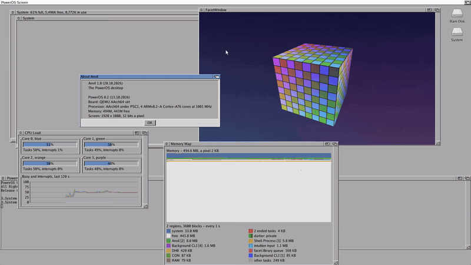
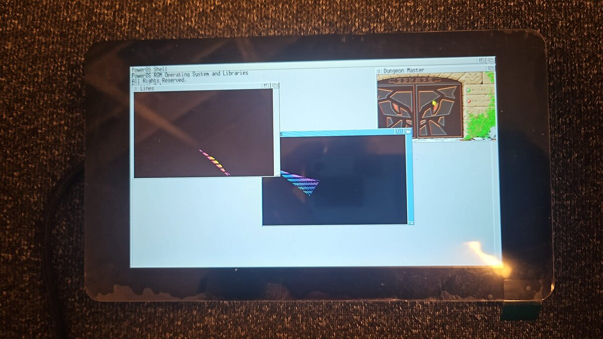
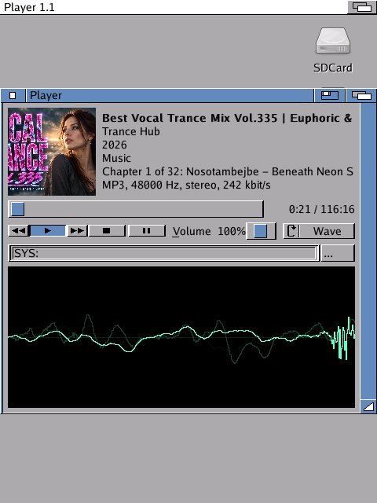
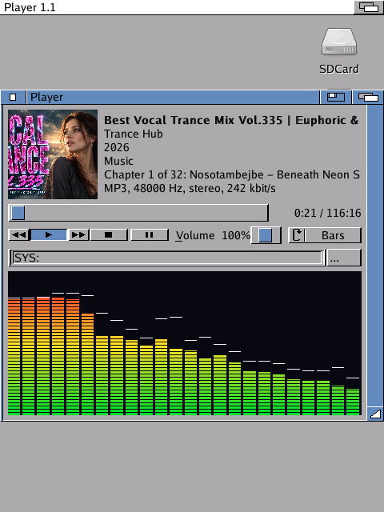
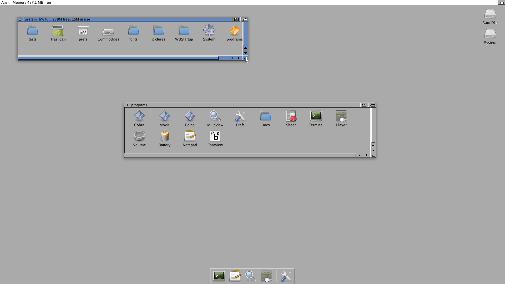
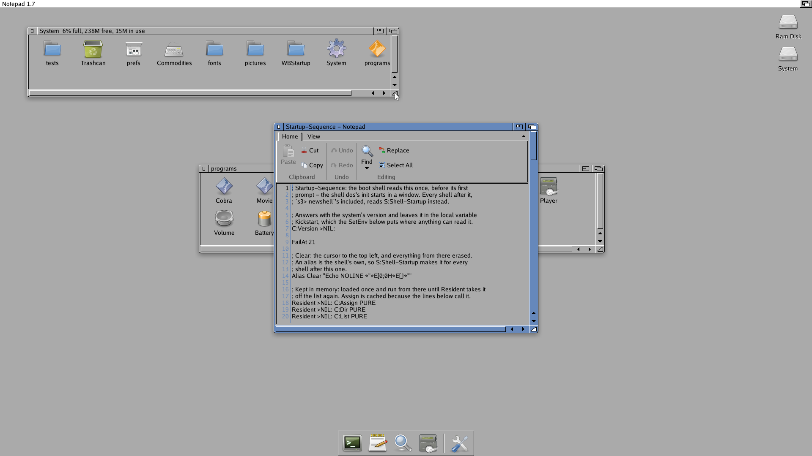
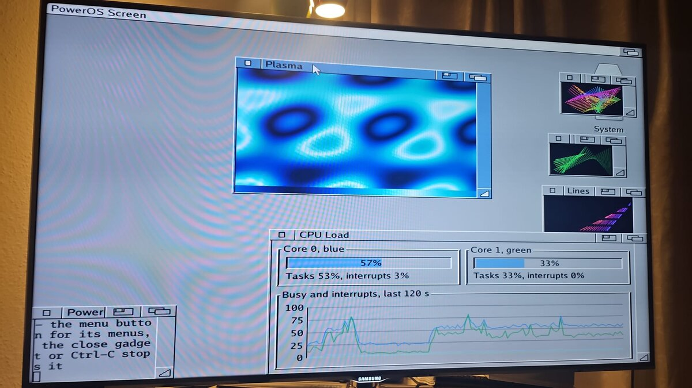
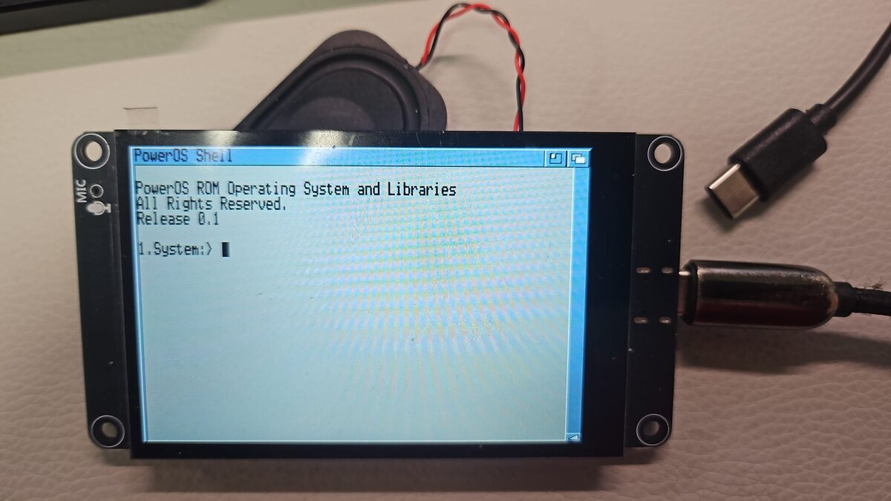
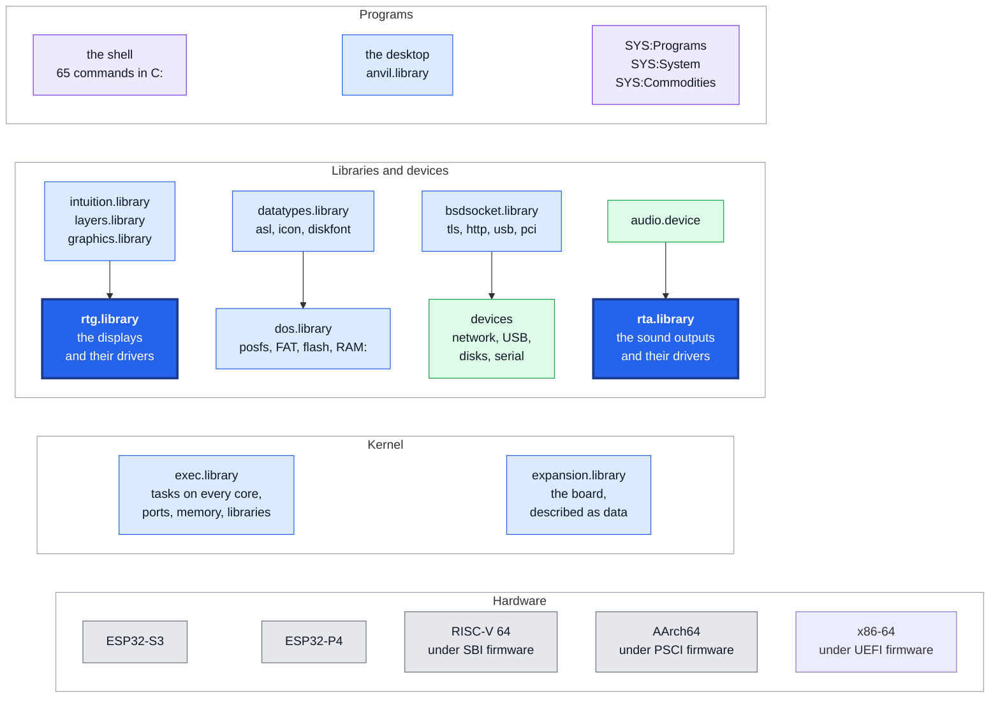

# PowerOS

PowerOS is an operating system for Espressif's ESP32 microcontrollers and
for 64-bit RISC-V, AArch64 and x86-64 machines, written in Zig. It boots
straight from an ESP32's ROM loader, from a RISC-V machine's SBI firmware,
from a Raspberry Pi's bootloader or from a PC's UEFI firmware, and brings
up a complete little system: a
multitasking kernel with libraries and devices, a DOS with file systems
and a shell, a TCP/IP stack, and a windowed desktop on the board's
display. Programs are loaded from disk at run time and built against a
separate SDK.

**Status: release 0.21** ([the archives to
download](https://github.com/cycl0ne/poweros_esp32/releases/latest)). It runs on two ESP32-S3 boards, on two
ESP32-P4 boards, on StarFive's VisionFive 2 (RISC-V 64), on a Raspberry Pi
Compute Module 5 (AArch64), in Espressif's QEMU, in QEMU's RISC-V 64 and
AArch64 `virt` machines and in its x86-64 q35 machine.

[](docs/screenshots/README.md#four-cores-the-desktop-on-aarch64)

[](docs/screenshots/README.md#on-the-board)

<p>
<a href="docs/screenshots/README.md#music-sysprogramsplayer"></a>
<a href="docs/screenshots/README.md#music-sysprogramsplayer"></a>
</p>
<p>
<a href="docs/screenshots/README.md#the-desktop-anvil"></a>
<a href="docs/screenshots/README.md#notepad-sysprogramsnotepad"></a>
</p>
<p>
<a href="docs/screenshots/README.md#on-the-board"></a>
<a href="docs/screenshots/README.md#on-the-board"></a>
</p>

## Contents

| | |
|---|---|
| [Screenshots](docs/screenshots/README.md) | four cores on AArch64, the desktop at rest and at work, the Player, the shell, Notepad, HDToolBox, CPU load, drawing, a game, fonts, menus, gadgets, on the boards |
| [What PowerOS is - and what it is not](#what-poweros-is---and-what-it-is-not) | the idea, and what is in it |
| [Quick start](#quick-start) | boards, building, [QEMU the first time](#first-time-in-qemu), flashing, [the RISC-V machines](#the-risc-v-machines), [the AArch64 machine](#the-aarch64-machine), [the x86-64 machine](#the-x86-64-machine), [onto a card or an SSD](#onto-a-card-or-an-ssd) |
| [Writing programs](sdk/docs/guides/programs.md) | examples: hello in the shell, a window, buttons |
| [Debugging](sdk/docs/guides/debugging.md) | what a failure prints, from an address to a line, the ROM debugger, `s3>`, memory debugging, JTAG |
| [The SDK](sdk/) | the package a program builds against |
| [Autodocs](sdk/docs/README.md) | every call, and every module by kind |
| [Guides](sdk/docs/README.md#guides) | how the calls work together: [exec](sdk/docs/guides/exec.md), [dos](sdk/docs/guides/dos.md), [posfs](sdk/docs/guides/posfs.md), [utility](sdk/docs/guides/utility.md), [intuition](sdk/docs/guides/intuition.md), [desktop](sdk/docs/guides/anvil.md), [icons](sdk/docs/guides/icons.md), [fonts](sdk/docs/guides/fonts.md), [styles](sdk/docs/guides/styles.md), [motion](sdk/docs/guides/motion.md), [datatypes](sdk/docs/guides/datatypes.md), [network](sdk/docs/guides/network.md), [USB](sdk/docs/guides/usb.md), [disks](sdk/docs/guides/rdb.md), [installing](sdk/docs/guides/install.md), [Modbus](sdk/docs/guides/modbus.md), [sound](sdk/docs/guides/audio.md), [displays](sdk/docs/guides/rtg.md), [locale](sdk/docs/guides/locale.md), [commodities](sdk/docs/guides/commodities.md) |
| [Wi-Fi](docs/esp32s3wifi.md) | the ESP32-S3's radio's device, and how it is built |
| [USB Wi-Fi](docs/aic8800.md) | the AIC8800 stick's device, and how it is built |
| [posfs](docs/posfs.md) | the PowerOS file system: its format on the medium, field by field, and how it works |
| [Colours](docs/colors.md) | the palette the pictures are painted in, how a picture is built up, and examples; [the palette page](docs/malkasten.html) to read without the network |
| [Porting](docs/porting.md) | the checklist for a new CPU, firmware or board: every place a machine has to be named, and what each of the five chips does there |
| [Example programs](src/disk/c/) | every command on the disk, built the same way |
| [Repository layout](#repository-layout) | where things are |
| [License](#license) | MPL-2.0 for the system, MIT for the SDK and programs |

## What PowerOS is - and what it is not

- **It is** a desktop-style operating system small enough to read: kernel,
  DOS, file systems, network, graphics and windows in well under a
  megabyte of code, on a microcontroller that costs a few euros. It is
  built from small modules that talk through message ports and jump
  tables; a library or a device can be replaced, loaded from disk or
  patched at run time.
- **It is** made for the ESP32 family, and runs on 64-bit RISC-V machines
  under SBI firmware, on AArch64 machines under PSCI firmware and on
  x86-64 machines under UEFI firmware too. It
  drives the hardware itself, register by register: on an ESP32 everything
  between power-on and the desktop is in this tree, on the others
  everything after their firmware hands over.
- **It is** young. 0.21 works end to end, but the API may change before
  1.0, and not every part has run on every board.
- **It is not** a Linux, a POSIX system or an RTOS in the usual sense:
  programs use the system's own API - libraries opened by name, tag lists,
  messages - with no `libc` and no `fork`.
- **It is not** an AmigaOS clone or emulator. It takes AmigaOS's ideas -
  exec's libraries, devices and message ports, dos with handlers and
  packets, screens, windows and gadget classes - and builds them anew for
  this machine: no BCPL pointers or strings, 32- and 64-bit data,
  retargetable true-colour graphics, boards described as data. It runs no
  Amiga software.
- **It is not** a protected system. All tasks share one address space; it
  is a machine for one person at a time.
- **It does not (yet)** have Bluetooth.

### What is in it



Each layer uses the ones below it; libraries are blue, devices green.
Two libraries stand between the hardware and everything a program shows
and plays:

**rtg.library** keeps the displays. Each is a board of a driver, and
graphics.library, layers and intuition draw into its buffers without
knowing what panel is behind them, so one program draws on a 3.5" SPI
panel and on a 1080p monitor alike. A board's engine takes the fills,
copies, blends and scales: the ESP32-P4's PPA and 2D-DMA, the four cores
of the VisionFive 2 and the Compute Module 5, whose displays read their
picture out of RAM ([displays guide](sdk/docs/guides/rtg.md)).

| Driver | Display |
|---|---|
| `rgb` | the Waveshare 7B's 1024×600 RGB panel |
| `dcs` on `qspi` | the ES3C35P's 480×320 SPI panel |
| `dsi` | the ESP32-P4's MIPI DSI panels, and HDMI through the Olimex's LT8912B |
| `fb` | the VisionFive 2's HDMI at 1920×1080, the Compute Module 5's first HDMI port in the monitor's own mode, QEMU's virtio GPU - on a memory-mapped transport (`virtio-gpu-device`) or on PCI (`virtio-gpu-pci`), the pointer the host's own - its `ramfb`, and the framebuffer a UEFI firmware lit |
| `qemu` | Espressif QEMU's display |

**rta.library** keeps the sound outputs and ways in. Each is a sink or a
source of a driver, made from the parts the board's description names,
or when a USB speaker is plugged in. `audio.device` mixes up to sixteen
streams, each in its own form, rate, volume and pan, into one sink; the
output preferred takes over when it is plugged in, each keeps its own
volume (`C:Audio`, Prefs, `SYS:Programs/Volume`) - a USB speaker's at
its own control - and its own ten-band equalizer, with presets by name
(`C:Audio`, Prefs, `SYS:Programs/Volume`, the Player), a click plays at
once as a trigger, and unit 1 records (`C:Record`). `LIBS:audiocodec.library`
decodes WAV, MP3, FLAC and Ogg Vorbis as they play - a chained Ogg
stream song by song, each with its own rate and tags - from a file or
from a program's own reader - `SYS:Programs/Player`'s internet stations,
kept on its Radio page or found in radio-browser.info's list, with the
station's picture and the song's when the station names one; the Player
reads and writes M3U playlists and reads PLS, and draws the sound as a
plasma, its wave, the spectrum's bars, left against right or a meter
for each side, in its window or over the whole screen; `C:Play` plays a
file or a station's address in the shell, each title said as it changes
([sound guide](sdk/docs/guides/audio.md)).

| Driver | Output |
|---|---|
| `es8311` | the ES8311 codec, and its microphone input |
| `i2samp` | I2S amplifiers, as the CrowPanel's two speakers |
| `hdmi` | the VisionFive 2's and the Compute Module 5's HDMI ports, 48000 Hz stereo |
| `hda` | a PC's high definition audio controllers on PCI: its speakers, its jacks, and HDMI to a monitor's speakers behind an AMD display engine |
| `uac` | USB speakers and headsets (`DEVS:usb/uac.device`) |
| `file` | a WAV file, written in time |
| `null` | in the emulators, an output into nothing that keeps time |

The libraries: exec, utility, expansion, dos, rtg, rta, graphics,
layers, intuition, keymap and motion are in the ROM, the rest are loaded
from `LIBS:` when first opened. Every module, with its reference, is in
[the SDK's documentation](sdk/docs/README.md).

| Area | Libraries |
|---|---|
| Kernel | `exec` tasks on every core, ports, memory, libraries and devices; `utility` tag lists, hooks, dates, the zone the clock keeps, UTF-8 strings with Unicode's case and widths, text between UTF-8 and Latin-1, URLs and arrays sorted; `expansion` the board's parts |
| Files | `dos` processes, files, handlers, the shell's `ReadArgs`, files read whole, trees made and deleted, passwords typed without their echo; `rdb` partitions on any drive; `compression` DEFLATE, zlib and gzip |
| Languages | `locale` countries' dates, numbers and money, languages' words and order of letters, characters classed and sorted by Unicode, programs' texts translated in catalogs |
| Displays | **`rtg`**; `graphics` drawing, text in UTF-8; `layers`; `intuition` screens, windows, gadgets, styles; `keymap` keys into UTF-8; `motion` animations and timers |
| Sound | **`rta`**; `audiocodec` WAV, MP3, FLAC, Ogg Vorbis |
| Video | `videocodec` films - their pictures, sound and subtitles; `media` MP4, MOV and Matroska; `videoparse` H.264, H.265, VP9 and AV1 streams read for a decoder |
| Desktop | `anvil` the desktop; `asl` requesters; `commodities` hotkeys and filters on the input stream; `icon`; `datatypes` pictures, text (plain, Markdown, HTML), animations and sounds by what is in them, from a file or from memory; `iffparse`; `diskfont` and `truetype` fonts, an outline's characters rendered as they are first drawn, and fallback fonts for the characters one lacks, `truetypeshaping` a text's glyphs with a font's ligatures, kerning and marks; `facet` 3D in Vulkan's model, on the cores or a GPU - on every disk but the ESP32-S3's, whose 14 MB of flash the rest of the system has |
| Network | `bsdsocket` TCP/IP, IPv4 and IPv6; `tls` 1.3 and 1.2; `http` HTTP/1.1 requests, connections kept, a failure said in the user's language; `crypto`; `wpa` WPA2; `filter` a packet filter |
| Buses | `usb` the USB host stack; `pci` PCI Express; `modbus` RTU and TCP |

Beside them:

- **File systems:** posfs, journaling, copy-on-write, checksummed, with
  snapshots ([posfs guide](sdk/docs/guides/posfs.md)); FAT32 and exFAT
  on cards and sticks; the flash file system (`DH0:`), `RAM:`, `PIPE:`;
  a share on an SMB 2 or 3 server, read and written as a volume, signed
  and encrypted, mounted at boot from its file in `DEVS:Shares/` and
  connected again after a server restart; a server asked what shares it
  has and one of them mounted from the screen (`SYS:System/Shares`,
  `C:net/MountShare`, [network
  guide](sdk/docs/guides/network.md#a-share-as-a-volume-smb-handler));
  partitions from an RDB or a GPT on any drive, laid out in
  `SYS:System/HDToolBox` ([disks guide](sdk/docs/guides/rdb.md)); a
  system put onto a card or an SSD by one command, from the running
  system or from a release package (`C:Install`), and brought up to date
  from a package afterwards, only what differs fetched, the kernel with a
  way back from one that does not come up (`C:Update`,
  `SYS:System/Update`, `C:Reboot`).
- **Devices:** timer, serial, console, input from keyboards, mice and
  touch, flash, SD card, NVMe, I2C, RS-485, clipboard; USB hosts on the
  ESP32s' OTG and on xHCI, there up to SuperSpeed (5 Gbit/s), bulk
  streams and links resting in U1 and U2, a device plugged in or pulled
  out told to the windows that ask, with class drivers for keyboards,
  mice, sticks and disks (Bulk-Only and UAS), serial and Ethernet
  adapters, Wi-Fi sticks, and on xHCI speakers and headsets
  ([USB guide](sdk/docs/guides/usb.md)); Ethernet up to 1000 Mbit/s, the
  ESP32-S3's Wi-Fi and SLIP, and a shell over Telnet or SSH
  ([network guide](sdk/docs/guides/network.md)).
- **The shell:** 65 commands in `C:`, test programs in `C:test`, network
  tools in `C:net` - among them a git client that clones, fetches,
  commits and pushes over HTTPS and SSH (`C:net/Git`,
  [network guide](sdk/docs/guides/network.md#git-cnetgit)); scripts,
  output and errors redirected apart, line editing and file name
  completion in UTF-8 on a console that places each character in the
  cells Unicode gives it, files hashed and checked against a list of digests
  ([dos guide](sdk/docs/guides/dos.md)).
- **Languages:** 21 countries and 9 languages besides English in
  `LOCALE:`, the one chosen on Prefs' Region page with the time zone,
  or in `ENV:Sys/locale.prefs`; dates, dos's
  error texts and the shell's messages in it - German shipped - its
  money and quotes as the files write them (`€`, `„“`), the characters
  of every script classed and sorted by Unicode with a language's own
  letters where it puts them (`Å`, `Ä`, `Ö` after `Z` in Swedish), and a
  program's own texts from its catalog, built from a descriptor and
  checked by `sdk/tools/catcomp`: the desktop's, Notepad's, Sheet's,
  the Player's, Movie's and the Clock's in German
  ([locale guide](sdk/docs/guides/locale.md)).
- **Programs:** in `SYS:Programs` MultiView - any file the datatypes
  know, a page's links followed to files and to the web - Notepad,
  Sheet, Terminal, Player, FontView, Battery, Prefs and Volume; in
  `SYS:System` the Shell, HDToolBox, Shares, Update, CPULoad, NetLoad,
  MemMap and Clock - the time on a dial or in figures, which the dock's clock opens; in
  `SYS:Commodities` Exchange, which lists the commodities running and
  makes each active or inactive, shows or hides its window, or ends it,
  and the commodities
  themselves - Blanker, a screen that darkens when nothing happens;
  FKey, functions on freely chosen keys; AutoPoint, the window under the
  pointer activated; ClickToFront, a double click that brings a window
  up; MouseBlanker, the pointer out of the way while typing; NoCapsLock;
  and NumericPad, a keypad on a keyboard that has none
  ([commodities guide](sdk/docs/guides/commodities.md)).
- **When something fails:** a Guru and a ROM debugger on the serial
  port, memory debugging, the system log, and a program that fails held
  for Suspend, Kill or Reboot
  ([debugging guide](sdk/docs/guides/debugging.md)).

And under all of it the hardware, driven from this tree register by
register: a board is data - its parts and their wiring in
`src/boards/<board>/`, which expansion.library hands out, and the drivers
it names - so a chip is brought up once and every board of it follows.
What each board runs is in [Boards](#boards).

| Chip | Machines | Driven here |
|---|---|---|
| ESP32-S3, two Xtensa LX7 cores | Waveshare 7B, ES3C35P, Espressif QEMU | the caches and the MMU, flash and PSRAM, the interrupt matrix, GDMA, RGB and QSPI panels, I2S, SPI, I2C, UART, the USB serial port, USB OTG, the SD slot, and the radio with its vendor libraries |
| ESP32-P4, two RISC-V 32 cores | Olimex ESP32-P4-PC, Elecrow CrowPanel Advanced 10.1", esp-emulator | the same, and MIPI DSI, the PPA and 2D-DMA engines, the JPEG codec, the SDMMC host, 10/100 Ethernet, and USB OTG with the ports behind a hub |
| RISC-V 64 under SBI firmware, four cores - StarFive's JH7110 | VisionFive 2, QEMU's `virt` | its display controller behind HDMI, PCI Express with an NVMe SSD and the VL805's USB, gigabit Ethernet, the SDMMC host, the random number generator, the video decoder, DMA, the RTC, and sound over HDMI and on the jack |
| x86-64 under UEFI firmware, as many cores as the machine has | QEMU's q35, a PC | the descriptor and interrupt tables, the task state with its own stack for a fault, the local interrupt controller and the machine's I/O controller in front of it, the timestamp counter measured against the power-management timer, the controller's own timer as the tick, the page tables, the firmware's tables read for the memory, the cores, the controllers and PCI Express's configuration space, messages from a PCI function as interrupts of the local controller's own, a 16550 console in the I/O port space, the other cores started by their own controllers - held, then let go at a page below the first mebibyte, which brings each through the two mode changes the firmware had already made for the boot core - and the core's own random numbers |
| AArch64 under PSCI firmware, four cores - Broadcom's BCM2712 | Compute Module 5, QEMU's `virt` | HDMI 0 - the video scaler, a pixel valve, the HDMI controller, the monitor read and set over DDC/CI - PCI Express with an NVMe SSD, the V3D GPU, the RP1's two USB controllers, Ethernet and UART over its PCI Express link, the radio on the second SD host, the RTC and the core clocks through the VideoCore's firmware, the chip's temperature, and the IO board's fan turned as it asks |

## Quick start

### Boards

| `-Dboard=` | Board | State |
|---|---|---|
| `waveshare_7b` (default) | Waveshare ESP32-S3-Touch-LCD-7B: 7" 1024×600 RGB panel, GT911 touch, 16 MB flash, 8 MB PSRAM, microSD slot on SPI, RS-485, CAN, battery charger | runs: panel, touch, Wi-Fi, the card slot; not yet tried on the board: RS-485, the battery's voltage, a USB host on its USB-C socket; CAN not driven |
| `es3c35p` | LCDwiki ES3C35P: 3.5" 480×320 QSPI panel, touch, ES8311 audio codec, SD card slot | runs: panel, touch, speaker, card; not yet tried on the board: audio.device 2's streams, recording from the microphone, playing into a file, the battery's voltage, a USB host |
| `qemu` | Espressif QEMU's ESP32-S3, with display, keyboard and a mouse with a wheel, an RS-485 port on its second serial port, and a USB controller with what `-Dusb` plugs in | runs, USB devices plugged in and out while it does (`-Dusb`, `-Dusb-disk`); sound into an output that goes nowhere |
| `esp32p4_emu` | Espressif's esp-emulator running an ESP32-P4 on the boards' v1.x ROM: both cores, UART0, 32 MB PSRAM (`./zig build emu`) | the shell on UART0, dos with the flash disk and its RISC-V commands, a Guru with the ROM debugger; `-Dselftest` checks the chip; no screen |
| `olimex_p4pc` | Olimex ESP32-P4-PC: ESP32-P4NRW32 (16 MB flash, 32 MB PSRAM), console on the chip's USB port, 10/100 Ethernet (IP101GRR), HDMI, a MIPI-DSI connector (here Olimex's MIPI-LCD2.8, 480×640), four USB host ports, ES8311 audio, microSD | runs: the USB console, Ethernet, the desktop on the DSI panel or over HDMI, in the largest of 1360×768, 1280×720, 1024×768 and 800×600 the monitor names ([photo](docs/screenshots/README.md#on-the-board)), both cores, PSRAM at 200 MHz, the 2D engine and the JPEG codec, USB keyboards, mice and sticks through its hub, the microSD card, sound on the jack (the codec's one output on both sides) - the [Player](docs/screenshots/README.md#music-sysprogramsplayer) on its panel; an AIC8800 USB Wi-Fi stick, joined to WPA2 networks; the battery once its solder jumpers are closed; not yet tried on the board: recording, playing into a file |
| `crowpanel_p4` | Elecrow CrowPanel Advanced 10.1": ESP32-P4NRW32, console on UART0 through a CH340K, 1024×600 MIPI-DSI panel, GT911 touch, ESP32-C6 for Wi-Fi, two speakers on NS4168 I2S amplifiers, two PDM microphones, SD slot | runs: the shell on UART0, the desktop on its panel with touch, both cores, PSRAM at 200 MHz, the 2D engine and the JPEG codec, stereo on its speakers; not yet tried on the board: audio.device 2's streams, playing into a file, the UART1 and UART3-IN connectors |
| `qemu_virt` | QEMU's RISC-V 64 `virt` machine under OpenSBI: four harts, 512 MB, a 16550 console; with QEMU's options a 1920×1080 display (`virtio-gpu-device` or `ramfb`), an xHCI controller and NVMe drives on its PCI Express | runs (`./zig build virt`): the shell on the serial console, four cores, dos started from an NVMe SSD, a work disk that keeps what is saved to it beside it, a whole system installed onto a second SSD in one command (`C:Install`), from the running system or from a release package on a stick; with `-device virtio-gpu-device` or `-device ramfb` the desktop, with `-device qemu-xhci` USB keyboards, mice and sticks, a stick at SuperSpeed, a disk over UAS on streams, with more `nvme` devices more SSDs; sound through QEMU's USB speaker on the host's sound (`-Daudio` names QEMU's backend, `wav,path=out.wav` a file, sample for sample), which every virt step plugs in and its system disk prefers, pulled out and put back as it plays; with `-device usb-net` the network, through `usb/ecm.device` (the display steps plug one in) |
| `visionfive2` | StarFive VisionFive 2 (v1.3B): JH7110 with four U74 RISC-V cores, 8 GB LPDDR4, HDMI, two gigabit Ethernet ports, four USB-A on a VL805 on PCI Express, an M.2 slot, microSD; started by the board's own OpenSBI and U-Boot | runs: the console on the debug UART, the desktop over HDMI at 1920×1080, four cores, all of its RAM, starting from the microSD card, the first Ethernet port at 1000 Mbit/s, USB keyboards and mice, an NVMe SSD in the M.2 slot, the random number generator, reboot, the four cores as the 2D engine, facet.library's 3D in a window at 60 frames a second, sound over HDMI; not yet tried on the board: a system installed onto its card or an SSD (`C:Install`), sound through a USB speaker or headset, USB 3 devices at SuperSpeed, a disk over UAS; not driven yet: the second Ethernet port, the eMMC socket |
| `qemu_virt_a64` | QEMU's AArch64 `virt` machine with four Cortex-A76 cores and a GICv2, as the Raspberry Pi CM5's BCM2712 has them, everything below 4 GiB: 512 MB, a PL011 console; with QEMU's options a 1920×1080 display (`virtio-gpu-device` or `ramfb`), an xHCI controller and NVMe drives on its PCI Express | runs (`./zig build virt64`): the shell on the serial console, four cores, dos started from an NVMe SSD, a work disk beside it, the ROM debugger with breakpoints, watchpoints and steps; entered at EL1 or, with `virtualization=on`, at EL2 (`./zig build virt64-el2`); with `-device virtio-gpu-device` or `-device ramfb` the desktop and facet.library's 3D, with `-device qemu-xhci` USB keyboards and tablets, with more `nvme` devices more SSDs, with `-device usb-net` the network, through `usb/ecm.device` (the display steps plug one in); sound through QEMU's USB speaker, as on `qemu_virt`. The CM5 is `rpi_cm5` |
| `qemu_q35` | QEMU's x86-64 q35 machine started by its UEFI firmware: 512 MB, a 16550 console on port 0x3F8, the framebuffer its firmware lights on whatever display the machine is given, and what `-device` adds on its PCI Express | runs (`./zig build q35`): the shell on the serial console, every core the machine has (the step gives it eight; 16 and 32 run on the same image), dos started from an NVMe SSD with a work disk beside it, its controller on an MSI-X vector of its own (64 MiB read in 8 ms, which is the emulator's own file cache answering and says nothing about a disk), PCI Express from the firmware's tables with everything left where the firmware placed it, a Guru with the core's registers and a backtrace; with the machine's window (`./zig build q35-display`) the desktop at 1920×1080 on the framebuffer the firmware lit, drawn into where it stands, with a USB keyboard and a tablet on `-device qemu-xhci`; the same on a virtio GPU where the machine has one (`./zig build q35-virtio`, `-device virtio-gpu-pci`), which is the same display driver over virtio's PCI transport; Ethernet from an Intel 82576 on PCI (`networks/intelnet.device`, `-device igb`, which both q35 steps give it) at 1000 Mbit/s on its own MSI-X vector, its address read from the controller, the link negotiated by its PHY, DHCP and IPv6 autoconfiguration, the controller working a packet's checksums out both ways so that the sockets library need not, and 128 MiB pulled through it with nothing dropped and nothing damaged; the date from the machine's own battery-backed clock; the machine turned off - by `C:Shutdown`, or by its power button, which stops the drives first so that what they hold is written out; sound from the machine's own high definition audio controller (`rta-hda`, `-device ich9-intel-hda -device hda-output`, which both q35 steps give it), its codec read for what it has and a sink made for each way out of it, a tone played and read back from the emulator's WAV backend as 2.000 seconds at 439.5 Hz with nothing dropped |
| `rpi_cm5` | Raspberry Pi Compute Module 5 on its IO board: BCM2712 with four Cortex-A76 cores and a GIC-400, up to 16 GB, eMMC, the console on the RP1's UART0 (pins 8 and 10 of the 40-pin header); started by the bootloader in its EEPROM, in the order its `BOOT_ORDER` setting gives - the SSD, the eMMC, or over USB with `rpiboot` | runs: the shell on the console, four cores, all of RAM, dos with the disk image the bootloader loads; the console on its interrupt, an MSI-X message from the RP1 that the board routes to the GIC; USB on the two USB 3 sockets, the RP1's DWC3 controllers through xhci.device (a mouse and a hub found); an NVMe SSD in the M.2 slot, PCI Express port 1 through pci.library, read at 432 MiB/s on its INTx line, dos started from its posfs `DH0:` (System) with `DH1:` (Work) beside it, and the kernel from the SSD's own boot partition, which `C:Install` writes beside them - the whole machine on the one medium, with the eMMC behind it in the boot order as the way back in; Wi-Fi from the module's CYW43455 (`networks/cyw43455.device`, WPA2, joined at the start); the date from its RTC through the VideoCore's firmware; the cores at 2.4 GHz, asked of the same firmware, on a supply that holds them there - PoE+ here (`CpuClock` says the clock, the chip's temperature and what holds the cores back); the chip's temperature through thermal.resource (`Temperature`), the IO board's fan turned as it asks - in Linux's steps, at speeds this fan turns at; HDMI 0 driven by the kernel - the HVS, a pixel valve and the HDMI controller - in the monitor's mode from its EDID, as HDMI with its infoframes (DVI to a monitor without HDMI's block), 1920×1080 and 2560×1440 at 60 Hz shown, and the display brought up where the firmware set none up at all - a machine starting from its own medium reaches the driver in the first second after the power comes on, before the firmware has set up any display, so the driver starts the HVS's clock itself - with the pointer and a dragged icon each in a plane of its own, the picture mirrored either way, the monitor put to sleep and woken, and its brightness set over DDC/CI; a monitor plugged in after the start or swapped while it runs; 4K at 60 Hz sent scrambled to a monitor that says it takes it (not tried yet: no such monitor here); the monitor's speakers in stereo at 48 kHz through `rta-hdmi` and audio.device; facet.library's 3D at 60 frames a second, in a window and on a screen of its own - there its pictures read by the display as they were drawn, nothing copied; Ethernet from the RP1's MAC (`networks/emac.device`) at 1000 Mbit/s, 200 MiB read from a NAS at 105 MiB/s and written at 95; a system installed onto the SSD in one command (`C:Install`), the boot pair on it, and the machine starting from the medium with no host attached; not driven yet: the RP1's GPIO, message-signalled interrupts on the M.2 slot, and - much later - HDMI 1 |

`C:ShowConfig` lists what the running board has, and `ShowConfig DEVICES`
every device by what it speaks - serial lines, block devices, network
devices, ... (`SPEAKS=serial`) - with its units on this board, none of
them opened or loaded to find out.

You need Linux or macOS, `esptool` (v5) to flash, and for the emulator
Espressif's QEMU; for the 64-bit machines `qemu-system-riscv64`,
`qemu-system-aarch64` and, with x64 UEFI firmware beside it,
`qemu-system-x86_64`, on the VisionFive 2 the U-Boot it comes with, and
on the Compute Module 5 its own bootloader or Raspberry Pi's `rpiboot`. Always build with the `./zig`
wrapper: it fetches the Espressif Zig toolchain (`0.16.0-xtensa`) into
`toolchain/` on first use, and it holds the build cache to a size. The
compiler's cache keeps every step it has ever built - a changed source
leaves the old entry behind, and a test binary alone is a quarter of a
gigabyte - so the wrapper runs `scripts/prune-cache.sh` before the build
and drops the oldest entries once `.zig-cache` passes 64 GiB. What goes
is built again when it is next needed; `ZIG_CACHE_LIMIT=120G` moves the
limit, `ZIG_CACHE_NO_PRUNE=1` leaves the cache to grow, and the script
takes any cache of its own:

```sh
scripts/prune-cache.sh --dry-run                      # what would go, and why
scripts/prune-cache.sh --limit 32G                    # this tree's cache, now
scripts/prune-cache.sh --dir ~/.cache/zig --limit 8G  # the global one
```

```sh
./zig build                  # the kernel and a flash disk: zig-out/bin/flash.bin
./zig build test             # host tests; every board and every program compiles
./zig build qemu             # boot in QEMU on the serial console (quit: Ctrl-A X)
./zig build qemu-display     # the same with the display in a window
./zig build emu              # the ESP32-P4 kernel in esp-emulator (quit: Ctrl-C)
./zig build virt             # the RISC-V 64 kernel in QEMU's virt machine (quit: Ctrl-A X)
./zig build virt-display     # the same with its display, a USB keyboard, a tablet and network
./zig build virt-ramfb       # the same with the ramfb as its display
./zig build virt64           # the AArch64 kernel in QEMU's virt machine (quit: Ctrl-A X)
./zig build virt64-display   # the same with its display, a USB keyboard, a tablet and network
./zig build virt64-ramfb     # the same with the ramfb as its display
./zig build q35              # the x86-64 kernel in QEMU's q35 machine under UEFI (quit: Ctrl-A X)
./zig build q35-display      # the same with its window on the firmware's framebuffer, a keyboard, a tablet and network
./zig build q35-virtio       # the same with a virtio GPU as its display
./zig build flash-all -Dport=/dev/ttyACM0   # kernel and a fresh disk onto a board
./zig build stick -Dboard=qemu_q35          # a bootable USB stick's image in release/, for a UEFI machine
./zig build package -Dboard=visionfive2     # a release package in release/package-visionfive2/
./zig build serve -Dboard=visionfive2       # hand that package out over HTTP (quit: Ctrl-C)
./zig build archive -Dboard=visionfive2     # what that board is handed over in
./zig build release -Ddisk-tree=false       # every board's archive and package, in release/
./zig build sums                            # release/SHA256SUMS over the archives that are there
```

Fetched once into `toolchain/`, pinned and checked, never committed:

| Script | For |
|---|---|
| `scripts/build-qemu.sh` | QEMU with the 1024×600 display, keyboard, mouse and wheel, and the USB controller, at 240 MHz (an older QEMU runs too, without what it lacks - run the script again for the wheel and USB) |
| `scripts/fetch-wifi.sh` | the radio's vendor libraries for `DEVS:networks/esp32s3wifi.device` |
| `scripts/fetch-aic8800.sh` | the AIC8800 USB Wi-Fi stick's firmware, which `DEVS:usb/aic8800.device` loads into it (the ESP32-P4's disk) |
| `scripts/fetch-fonts.sh` | the fonts in `FONTS:` (Spleen, Go, and Liberation on the 64-bit machines' disks), and two fonts only the host tests read (Noto Sans Devanagari, Noto Color Emoji) |
| `scripts/fetch-certs.sh` | Mozilla's root certificates, made into the trust store `SYS:Certificates/Roots` |
| `scripts/fetch-cyw43455.sh` | the Compute Module 5's radio firmware, which `DEVS:networks/cyw43455.device` loads into it (the AArch64 disk) |
| `scripts/fetch-vpu.sh` | the JH7110's video decoder firmware, which `videodec.resource` loads (the RISC-V 64 disk) |
| `scripts/fetch-amdgpu.sh` | an AMD graphics device's video decoder firmware and its security processor's table of contents, which `amdgpu.resource` loads (the x86-64 disk) |
| `scripts/fetch-pciids.sh` | the PCI ID Repository's list, `DEVS:pci.ids` on the 64-bit machines' disks, which `C:PCIInfo` names vendors and devices from - the host's copy where it has one, the current list otherwise: not pinned |
| `scripts/fetch-icons.sh` | the pictures of the disk's icons (Tango, public domain), drawn at the boards' sizes |
| `scripts/fetch-novnc.sh` | noVNC, the VNC client that runs in a browser, which `scripts/qemu-web.sh` serves beside a QEMU machine to show its display in a browser tab |
| `scripts/fetch-esp-emu.sh` | Espressif's esp-emulator, which runs the ESP32-P4: both cores, its interrupt controller, UART0 on the terminal, the system timer, flash, PSRAM, the Ethernet MAC and a GDB stub, from the chip's own ROM; no display. With it the v1.x chips' ROM (Espressif's ROM ELFs), which `./zig build emu` boots |

Without them the disk has everything but that part. On an ESP32 board
the serial console is the chip's USB port (e.g. `tio /dev/ttyACM0`); the
display comes up with the desktop, which S:Startup-Sequence starts at its end
before it puts its own shell window away - `SYS:System/Shell` opens
another. A desktop that cannot start leaves that shell on the display.

### First time in QEMU

From a fresh clone to the desktop in a window:

```sh
scripts/build-qemu.sh        # once: QEMU with the display, into toolchain/qemu
scripts/fetch-icons.sh       # optional: the desktop's icons
scripts/fetch-fonts.sh       # optional: the fonts
./zig build qemu-display     # the first run also fetches the Zig toolchain
```

`scripts/build-qemu.sh` runs on Linux. It needs a C compiler, git,
Python 3, ninja, pkg-config, and the development files of glib, pixman,
SDL2, libgcrypt and libslirp:

```sh
# Debian, Ubuntu
sudo apt install build-essential git python3 python3-venv ninja-build pkg-config \
    libglib2.0-dev libpixman-1-dev libsdl2-dev libgcrypt20-dev libslirp-dev
# Arch
sudo pacman -S --needed base-devel git python ninja glib2 pixman sdl2 libgcrypt libslirp
```

`scripts/fetch-icons.sh` draws the icons at each board's size with
`rsvg-convert` (`librsvg2-bin`, `librsvg`); without it they are the
release's 32-pixel pictures.

The window shows the boot and then the desktop; `SYS:System/Shell` opens
a shell on it. The terminal QEMU runs in is the serial console: `s3>`
there is the ROM's debug shell, `newshell` starts a CLI (`List`, `Info`,
...), and Ctrl-A X quits QEMU. `qemu-display` also forwards host port
2323 to the machine's Telnet port and 2222 to its SSH port, for
`C:net/ShellServer`. The steps run both of the S3's cores on one host
thread (`-accel tcg,thread=single`): with a thread for each, Espressif's
QEMU damages its own memory early in a boot and stops in up to half of
them, so QEMU started by hand needs the same option.

### The RISC-V machines

`-Dboard=qemu_virt` and `-Dboard=visionfive2` build a kernel for a
64-bit RISC-V machine under SBI firmware, which enters it in supervisor
mode: `zig-out/bin/kernel` (the ELF), `kernel.bin` (the same from its
first address, 0x80200000, with the header U-Boot's `booti` reads) and
`disk-rv64.bin`, the disk as an image of its whole 32 MB. There is no
flash: on the VisionFive 2 the loader puts the image in RAM beside the
kernel and names it in the device tree, flash.device serves it as
`DH0:`, and what is written to it is gone when the machine stops.
Nothing is flashed: the `flash*` steps are the ESP32 boards'.

`./zig build virt` boots QEMU's virt machine on the serial console with
four harts and 512 MB, and two NVMe SSDs, each with a GPT whose PowerOS
container holds one posfs partition. The machine starts from the system
disk, `DH0:` (`System`, 256 MB), which the build makes with the disk
image's files (`zig-out/bin/system-rv64.bin` with `-Dboard=qemu_virt`):
what a run writes to it goes with the run (QEMU's `snapshot=on`), and
the next build or run starts from it as it was made. The work disk,
`DH1:` (`Work`, 1 GB), is made blank the first time, as
`work/virt.bin`, and keeps what is saved to it from then on; delete the
file for a blank one. QEMU passes its flushes on to nobody
(`cache=unsafe`), since each would sync the image file on the host,
milliseconds apiece: what the machine wrote stays when QEMU quits or is
killed, and only a crash of the host can lose the last of it. Both
files take on the host only what has been written to them. The ROM
holds pci.library, nvme.device and posfs-handler, and nvme.device
starts at cold start and hands the SSDs'
partitions to dos ([disks guide](sdk/docs/guides/rdb.md#starting-from-an-ssd)).
QEMU locks the work disk while it runs, so one machine of each kind runs
at a time. Every virt step plugs QEMU's USB speaker into an xHCI
controller, and the system disk's `ENVARC:Sys/audio.prefs` prefers it,
so what plays is heard on the host - through the first of QEMU's audio
backends it has, or the one `-Daudio` names (`pa`, `pipewire`, `alsa`,
`sdl`; `wav,path=out.wav,out.frequency=48000,out.channels=2,out.format=s16`
into a file); `speaker` in the monitor. A QEMU with no backend but
`none` plays into nothing: the backends come as packages of their own
on some hosts (`qemu-audio-pa`, `qemu-audio-pipewire`). `./zig build
virt-display` adds the display (QEMU's virtio GPU, 1920×1080 as the
VisionFive 2's HDMI) and USB with a keyboard, a tablet and an Ethernet
adapter (`usb-net`, the machine's network: DHCP hands out 10.0.2.15 on
QEMU's user network, as in `qemu`), the console still on the terminal:
the desktop, and `C:test/FacetCube` drawn through facet.library as on
the board. The GPU is told each rectangle drawn, and
its cursor is the machine's pointer, which the window shows as the
host's own; `-device virtio-gpu-device` without `xres` and `yres` comes
up at QEMU's 1280×800. `./zig build virt-ramfb` shows the same on the
`ramfb`, which reads the picture out of RAM itself, the pointer drawn
into it. The window is QEMU's GTK one at the picture's size, a pixel
for a pixel (`zoom-to-fit=off`; Arch packages it apart, as
`qemu-ui-gtk`). `-Dvirt-ui=` gives QEMU another `-display`:
`default,show-cursor=off` takes SDL where there is no GTK
(`qemu-ui-sdl`), and without either serves the display over VNC on
`localhost:5900`; the `virt64` display steps are the same. Arch
packages the virtio GPU apart as well, as `qemu-hw-display-virtio-gpu`:
without it QEMU says `'virtio-gpu-device' is not a valid device model
name`, and only the `ramfb` steps run. QEMU run by hand adds the rest -
another SSD, sound:

```sh
./zig build -Dboard=qemu_virt
qemu-system-riscv64 -M virt -m 512M -smp 4 -bios default \
    -kernel zig-out/bin/kernel \
    -drive if=none,id=system,format=raw,snapshot=on,file=zig-out/bin/system-rv64.bin \
    -device nvme,serial=system,drive=system \
    -device virtio-gpu-device,xres=1920,yres=1080 \
    -device qemu-xhci -device usb-kbd -device usb-tablet \
    -drive if=none,id=ssd,format=raw,file=ssd.img -device nvme,serial=1,drive=ssd
```

`-device usb-audio,audiodev=snd -audiodev pa,id=snd` adds a USB speaker
(`-audiodev wav,id=snd,path=out.wav,out.frequency=48000,out.channels=2,out.format=s16`
plays into a file instead), which the system disk prefers, as in the
virt steps. A stick (`-device usb-storage,drive=...`)
goes on a USB 3 port and runs at SuperSpeed; its image holds a partition
table with a FAT32 or exFAT partition, as a stick is sold
([USB guide](sdk/docs/guides/usb.md)). `-device usb-uas,id=uas -device
scsi-hd,bus=uas.0,drive=...` is a disk over UAS, on streams.

A host with no screen of its own - one developed on over the network -
shows the display in a browser instead. `scripts/qemu-web.sh` boots a
display step with `-Dvirt-ui="vnc=localhost:0,websocket=on"`, so QEMU
serves the picture over VNC and over VNC in a WebSocket beside it, which
is what a browser speaks, and serves noVNC - the client that runs in the
browser, fetched by `scripts/fetch-novnc.sh` - from a Python web server
next to it; it prints the address to open, and the console stays on this
terminal. All three ports listen on the loopback alone, as the display
takes no password: reach them from elsewhere through an SSH tunnel (`ssh
-L 6080:localhost:6080 -L 5700:localhost:5700 host`), or, under
code-server, through its own proxy, whose address the script prints as
well. Every display step takes `-Dvirt-qmp=<socket>` for QEMU's QMP
monitor, which `scripts/qemu-shot.py` writes a PNG of the running
machine through - and clicks and types into it first when asked, so a
machine nobody sits at can still be driven and shown:

```sh
scripts/qemu-web.sh                     # the AArch64 machine in a browser tab
scripts/qemu-web.sh virt-display        # the RISC-V one
scripts/qemu-shot.py desktop.png        # what is on its display now
scripts/qemu-shot.py --click 832,1057 --settle 2 dock.png
```

On the VisionFive 2, U-Boot loads `kernel.bin` and starts it with
`booti`, with `disk-rv64.bin` as its ramdisk and U-Boot's device tree.
The console is the debug UART on pins 8 and 10 of the 40-pin header,
115200 8N1 (a 3.3 V serial adapter). The ROM holds sdcard.device and the
FAT handler, so the machine can also start from its microSD card: a
partition in the card's RigidDiskBlock, or in the one in the PowerOS
container of its GPT, that is bootable at a higher priority than `DH0:`
is `SYS:`, and a card sold with a PC partition table keeps it, so one
FAT32 volume can be both U-Boot's and PowerOS's
([disks guide](sdk/docs/guides/rdb.md)).

### The AArch64 machine

`-Dboard=qemu_virt_a64` builds a kernel for an AArch64 machine under
PSCI firmware (chip `a64psci`): `zig-out/bin/kernel` (the ELF, for a
debugger), `kernel.bin` (the same from its first address, 0x40200000,
with the arm64 `Image` header QEMU and the Pi's firmware read),
`disk-a64.bin`, the disk as an image of its whole 32 MB for a loader to
put in RAM as on the VisionFive 2, and `system-a64.bin`, the same files
as the system disk the `virt64` steps start from. The kernel runs at EL1
with its MMU on: an identity map, RAM normal cacheable memory, page 0
left out so a null pointer faults, the kernel's code read-only. A core
that comes in at EL2 drops to EL1 first.

`./zig build virt64` boots QEMU's virt machine with four Cortex-A76
cores, a GICv2 and 512 MB, all below 4 GiB, on the serial console, and
its own two SSDs as `virt` has them - the system disk, and the work disk
in `work/virt64.bin` - and QEMU's USB speaker, preferred;
`./zig build virt64-display` adds the display (the virtio GPU;
`virt64-ramfb` the ramfb) and USB with a keyboard, a tablet and an
Ethernet adapter, as `virt-display` has them, and `./zig build
virt64-el2` enters the kernel at EL2, PSCI by SMC, as the CM5's firmware
does. QEMU run by hand adds another SSD:

```sh
./zig build -Dboard=qemu_virt_a64
qemu-system-aarch64 -M virt,gic-version=2,highmem=off -cpu cortex-a76 -m 512M -smp 4 \
    -kernel zig-out/bin/kernel.bin \
    -drive if=none,id=system,format=raw,snapshot=on,file=zig-out/bin/system-a64.bin \
    -device nvme,serial=system,drive=system \
    -device virtio-gpu-device,xres=1920,yres=1080 \
    -device qemu-xhci -device usb-kbd -device usb-tablet \
    -drive if=none,id=ssd,format=raw,file=ssd.img -device nvme,serial=1,drive=ssd
```

QEMU loads `kernel.bin`, not the ELF: only for an `Image` does it pass
the device tree, and name an initrd in it (`-initrd`, the flash disk
image).

`-Dboard=rpi_cm5` builds the same for the Compute Module 5. Its eMMC
wants a FAT partition with `src/boards/rpi_cm5/config.txt` as
`config.txt`, `kernel.bin`, `disk-a64.bin` and Raspberry Pi's device
tree for the module, `bcm2712-rpi-cm5-cm5io.dtb`. The bootloader loads
nothing above RAM's first GiB: it puts `kernel.bin` at 2 MiB, and the
kernel copies itself up to 0x40200000. With the IO board's nRPIBOOT
jumper fitted - the module's EMMC-DISABLE line, the chip's GPIO 20,
pulled low - `rpiboot` from Raspberry Pi's
[usbboot](https://github.com/raspberrypi/usbboot) starts the same files
over USB from a directory holding usbboot's `bootfiles.bin`, a
`config.txt` saying `boot_ramdisk=1`, and the partition's image as
`boot.img`; its `mass-storage-gadget64` makes the eMMC a USB disk to
write the partition to. The console is the RP1's UART0 at 115200 8N1,
on which the firmware's second stage logs too (`uart_2ndstage=1`); which
places its bootloader tries before that, and how that order is set, is in
`tools/bootpackage/bundle.md`. The RP1's
interrupts come over its PCI Express link as MSI-X messages, which the
BCM2712's MIP raises on the GIC: `src/boards/rpi_cm5/rp1.zig` sets that
up as the kernel starts, and RP1 source n is exec interrupt 160 + n -
the console's, source 25, is 185. The RP1's devices reach RAM through
the same link, at the processor's addresses: its two USB controllers
are xhci.device's units 0 and 1, which `C:USB AUTO` starts at boot.
The M.2 slot is the BCM2712's PCI Express port 1, which the bootloader
leaves alone: pci.library brings it up as Linux does
(`src/disk/libs/pci/host/bcm2712.zig`) and, as on the VisionFive 2, is
in the ROM with nvme.device and posfs-handler, so an SSD's partitions
are boot nodes when dos starts. Its functions reach RAM at the
processor's addresses too, and interrupt on the slot's INTA to INTD,
GIC interrupts 251 to 254. An SSD there partitioned and given the
system as the [disks guide](sdk/docs/guides/rdb.md#from-the-shell)
shows is what dos starts from, while the bootloader still loads
`kernel.bin`, which holds everything up to posfs, from the eMMC: it
reads FAT, not posfs.


### The x86-64 machine

`-Dboard=qemu_q35` builds a kernel for an x86-64 machine started by UEFI
firmware (chip `x64uefi`): `zig-out/bin/kernel` (the ELF, for a
debugger), `kernel.bin` (the same from its first address, 0x00200000),
`system-x64.bin`, the system as a disk for the machine to start from, and
`disk-x64.bin`, the same files as an image of 32 MB for a loader to put in
RAM, which is what a machine with no disk of its own runs on. The kernel runs on a map of its own: an
identity map, 1 GiB blocks where the core has them, page 0 left out so
that a null pointer faults, the kernel's code read-only, and anything the
firmware did not call memory uncached.

Between the firmware and the kernel there is nothing but a stub of the
system's own, `EFI/BOOT/BOOTX64.EFI` (`src/boot/uefi/stub.zig`). It asks
the firmware for the memory map, for the framebuffer it has already lit
and for the root of its tables; reads `kernel.bin` off the partition it
was started from - into the pages its own header names, since the image
runs where it was linked - and a `disk-x64.bin` beside it where there is
one, which is how a machine with no disk gets a system; leaves the
firmware; and calls the kernel with all of it in one structure, which is
to this machine what a device tree is to the other two. Its own lines go
out of the serial port by hand, so they and the kernel's first lines come
out of the same place and a machine that stops between them can be read.

The screen is the framebuffer the firmware has already lit. It chose a
mode on whatever is plugged in, said where the pixels are and how far
apart the rows are, and the kernel writes that into the board's
description as its panel; the fb display driver takes it as a display
whose address cannot be moved and copies the picture into it, which is
what the desktop is drawn on. Those pages are mapped so that the writes
to them are gathered into bursts rather than each reaching the machine on
its own. No mode is set, and a firmware that lit none leaves the machine
on its serial console, which is what `./zig build q35` runs it as. Behind
an AMD display engine (`rtg_driver/fbboard/dcn.zig`) the driver writes
two parts of it. The audio side of the link the firmware lit, which the
firmware leaves switched off, so that a monitor's speakers can be played
over HDMI. And where the display reads: from start-up it is flipped
between the firmware's framebuffer and a frame of the device's own
memory, each picture made in the frame it is not reading and taken at
the pipe's next update, between two frames, which the pipe's interrupt
says - so a window moved or a picture over the whole screen never shows
half of the one before. The pointer is laid into those pictures. A flip
the display does not take puts it back on the firmware's framebuffer for
good, said on the boot's lines.

**An AMD graphics device is held by `amdgpu.resource`.** Such a device
is one function on PCI with several machines behind it - the display
engine, the video decoder, a power manager, a security processor, the hub
their memory traffic goes through - and a function is one driver's, so
the resource claims it, reads the table the device's firmware leaves of
its blocks, and answers each part's driver with where that part's
registers are (`GetGPUInfo`, `FindGPUBlock`). The display driver finds
its engine that way. At boot it says what the device has: each block's
version and addresses, the memory hub as the firmware left it, whether
the security processor's system runs, and the power manager's firmware
version, asked through its mailbox. Beside that it powers a block up and
down through that mailbox (`SetGPUPower`) and hands out pieces of the
device's own memory, which the device's blocks read and write
(`AllocGPUMemory`, `FreeGPUMemory`). A block that runs firmware of its
own runs it from a protected region only the security processor writes:
the resource makes that processor's ring of commands, gives it the table
of contents its firmware comes with and the region it asks for
(`StartGPUSecurity`), and has it check and load a file, or apply a list
of a block's register writes (`LoadGPUFirmware`). Every block's
interrupts come through the device's interrupt block, which writes an
entry for each into a ring and sends the device's message on PCI: the
resource starts that ring with the first server a driver adds for a
block's interrupt, and hands each entry to the servers for its client
and source (`AddGPUIntServer`, `RemGPUIntServer`). `C:test/Gpu WATCHDOG
15000` loads the video decoder's firmware from `DEVS:firmware/amdgpu/`:
on the Radeon 780M the processor asks for a 64 MiB region and takes the
decoder's firmware into it with nothing else loaded. `C:test/Gpu FRAMES
WATCHDOG 4000` counts the display's interrupt at each frame for three
seconds - sixty a second there, as many as the pipe counts frames - and
`C:test/Gpu FLIP WATCHDOG 4000` has the display read a copy of the
screen in the device's memory for three seconds and back, the flip
taken at the next frame each way.

**The video decoder is videodec.resource's on such a device.** The first
decoder opened while the watchdog is armed starts it: the firmware
loaded, the start's register writes applied by the security processor,
the ring of commands checked. Each decoder opened is a stream the
firmware keeps a context for, made and ended by a message. H.264 is
decoded there - baseline without slice groups, main and high, 8-bit
4:2:0, up to 4096 x 4096 - and H.265 - main, main 10 and main still
picture, up to 8192 x 4352: videoparse.library reads the stream, each
picture goes to the firmware as one message with its slices and the
surfaces of its references, and the frame is copied out into system
memory through write-combining reads, a 10-bit picture's samples
rounded to 8 bits by the decoder as it writes them. VP9 - profile 0,
and profile 2's 10 bits, up to 8192 x 4352 - goes there a frame at a
time, its uncompressed header read by videoparse.library and the
probabilities kept in the stream's context by the firmware; a stream
is made for 1920 x 1088 at least, so a frame whose size changes within
it is decoded there, predicted from references of other sizes, and
profiles 1 and 3 fall to vp9.vcodec. AV1 - main, 8 and 10 bits, up to
8192 x 4352 - goes there a temporal unit at a time: the frame header
read by videoparse.library, each tile's place handed over, the default
CDFs laid out for the firmware from the SDK's tables when the system is
built, and the film grain's noise worked out for each frame and laid
over it by the decoder, on frames shown from hidden ones too. On the
Radeon 780M a 1920 x 1080
picture takes 1.1 ms on the decoder and 0.45 ms to copy out - some 600
frames a second through `C:test/Film` (VP9 some 550, in 10 bits 340,
AV1 some 600) - and a 10-bit 3840 x 2160 one 3.7 ms and 2.1 ms, some 160
a second (AV1 130 to 165);
each frame compared, after a seek too, is ffmpeg's to the byte (10-bit
ones rounded to 8 bits as the software decoder does), VP9's libvpx's,
on its test streams for tiles, intra-only frames, size changes and
spatial layers too, and AV1's libaom's, on its test streams for sizes,
intra block copy, motion fields, size changes, spatial and temporal
layers and film grain in 8 and 10 bits.
`C:test/VideoDec <file> WATCHDOG 15000` feeds it an elementary stream
or VP9 or AV1 in an IVF file;
films reach it through chip.vcodec, so the Player plays on it once a
program has armed the watchdog since the start.

**The JPEG decoder beside its video decoder is jpeg.resource's codec.**
A file is copied into the device's memory without the segments the
decoder has no use for, decoded there through the decoder's ring of
commands, and the samples copied out and turned into blue, green and
red - grey, 4:4:4, 4:2:2 and 4:2:0, at least 64 pixels each way. The
decoder is started by the first decode and only while the watchdog is
armed, so until a program arms it every JPEG is decoded in software.
`C:test/Jpeg SYS:Tests/datatypes/Desktop.jpg WATCHDOG 15000` times it
against software: on a PC with a Radeon 780M (device 1002:15BF) a
1024 x 600 photograph takes 3.1 ms there - 4.7 ms through the datatype -
and 14.6 ms in software. The part of the device's memory that is handed
out is write-combining to the CPU (platform.resource's `SetMemoryType`,
which marks a range of the kernel's map uncached, write-combining or
cached while the system runs), and the samples are read back by
streaming loads: read word by word, the same picture took 17 ms.

**AES, GCM and SHA run on the core's own instructions.** crypto.library
asks `cpuid` once, when it is made, for AES-NI, PCLMULQDQ and the SHA
extensions, and where the core has them a cipher's blocks go through the
core's AES rounds - eight at a time where the mode allows it - GCM's hash
through its carry-less products, four blocks summed before one
reduction, and SHA-1, SHA-224 and SHA-256 through its SHA rounds. They
work on the 128-bit registers a task switch already saves. On a Ryzen 7
7840HS AES-128-GCM seals about 3.5 GB/s, where the software managed
22 MB/s, SHA-256 hashes 2.4 GB/s against 137 MB/s, and an HTTPS
download keeps up with a 1 Gbit/s link (`C:net/HTTPGet`: 256 MiB at
115 MB/s, the same as plain HTTP). SHA-384 and SHA-512, which the core
has nothing for, and a core without them run the software, which the
other 64-bit machines use. The curves and RSA, which no instruction
helps, are worked in 64-bit limbs on every 64-bit machine, multiplied 64
by 64 bits into 128: on the same core an X25519 key agreement takes
62 us where it took 143, a P-256 one 154 us where it took 360, and an
RSA-2048 signature check 53 us where it took 146.

**A virtio GPU is taken where the machine has one.** The display driver
speaks virtio over two transports now: a block of registers at an address
a board names, which is what the two `virt` machines have, and a function
on PCI, which is what a machine of this kind has - the same registers,
spread over windows the function's configuration space names, and found
by walking its capabilities. The board lists such a display before the
firmware's framebuffer, so a machine started with `-device
virtio-gpu-pci` draws on the GPU - where the pointer is a plane of its
own and nothing is copied twice - and one started without it falls
through to the framebuffer the firmware lit. Arch packages that device
apart, as `qemu-hw-display-virtio-gpu-pci`; without it QEMU says
`'virtio-gpu-pci' is not a valid device model name`.

**Ethernet is a card on PCI**, which is what a machine of this kind has
where the other boards have a MAC of the chip's own.
`DEVS:networks/intelnet.device` drives Intel's controllers: the 82576 and
the parts built like it at a gigabit, the I225 and I226 at 2.5. They are
found by their PCI IDs rather than by anything a board says, so a card in
a slot is driven wherever the machine has PCI - a machine of any of these
architectures, not only this one. The two generations differ in where the
first interrupt register block sits, in how its four registers are spaced
inside it, and in the third speed the newer parts report; the descriptor
rings, the receive filter, the extended interrupt registers, the advanced
descriptors and the PHY are the same, so one driver covers both. A
controller is claimed, reset, given a ring of 128 receive and 64 send
descriptors with a buffer for each, and asked for an interrupt vector of
its own; the link is brought up by telling the PHY to negotiate and read
back out of the status register, and the controller raises a cause when
that changes, so a cable going in or out takes the interface up and down
with nothing polled. On the emulated 82576: DHCP and IPv6
autoconfiguration, 3 of 3 pings answered in 0.3 ms, and 128 MiB fetched
over TCP at about 140 MB/s with nothing dropped and nothing damaged - an
emulator's figure, which says the rings and the interrupt keep up, not
what a machine does.

**A second kind of card** is driven beside it:
`DEVS:networks/realnet.device` is Realtek's 2.5 gigabit controllers on
PCI - the RTL8125 in its three revisions and the RTL8126, which is the
Ethernet a mini PC of this kind usually has. They share one PCI device ID
between them, so which one a function is comes from the revision field of
its send configuration register. A controller is claimed, taken away from
whatever drove it before the machine started, given a ring of 128 receive
and 64 send descriptors with a buffer for each, and asked for an
interrupt vector of its own. Its interface is `DEVS:NetInterfaces/ETH1`,
beside `ETH0` for the Intel card; a machine has one kind or the other,
and the interface whose card is not there is not added. What it checks
for itself is the checksums of an arriving packet. **Not yet on such a
card**: the driver is built and the parts that can be proved without one
are - the walk that finds a Realtek function, the revision it reads, the
descriptors and the receive filter's hash - but no machine here has one.

**The checksums are the controller's**, both ways. An arriving packet it
has checked is handed up marked, and the sockets library then skips its
own sums; a write asks it to finish the transport checksum, which saves
the one sum that covers every byte of a payload. What it works out on the
way out is seeded from the checksum field it finds, so the pseudo-header's
sum goes in first and the IP header's checksum with it - a dozen bytes and
twenty against fifteen hundred. That arithmetic is proved on the host,
against what the controller then does to the frame, because an emulated
controller works a checksum out from scratch and would let a wrong seed
pass: a run with one deliberately wrong finished the same transfer.

**The other cores** are started by the machine itself. There is no
firmware call for it here: a core is held in reset by a message from
another core's interrupt controller and then let go at a page named by a
number of one byte - so the page is below the first mebibyte - and it
comes up as the architecture's oldest processor did, in sixteen bits with
no paging. What it finds on that page is a few instructions of the
kernel's (`src/arch/x64uefi/start.S`), copied there with that core's
figures written into the copy, which put it through the two mode changes
the firmware had already made for the boot core and send it into the
kernel. The page is the stub's to find, since the memory list leaves the
whole first mebibyte out and only the stub sees the firmware's map.
**How many cores there are is the machine's to say**, and nothing here
is built for a number of them. The kernel reads the count out of the
firmware's tables and lays every core's own tables out for that many, in
one block taken from RAM before exec is built - the blocks GS points at,
the words a dispatcher leaves behind, the descriptors and task segments,
a stack each for a fault, the trap, timer and controller figures - and
exec's own per-core state is cut beside its base the same way. The board
names no number at all (`SYSTAG_Cores` 0), so the same image runs on
whatever it is started on: `./zig build q35` gives the machine eight
cores, and 16 and 32 come up on that image unchanged, with
`C:test/cores` passing on each with its tasks pinned to the cores in
turn. `C:ShowInfo TASKS` shows an idle task and a cache worker on every
one of them.

**What the cores cost each other** is what `C:test/cores` measures: 64
worker tasks pass a token round and hold one another off through
`Disable`, a semaphore and a spinlock, for five seconds. The chain is
serial, so more cores cannot make it faster - the figure says how much
the machine loses to its own scheduling as cores are added. Each core has
ready and waiting lists of its own under a lock of its own, and a core
with nothing worth running takes the best task it may run from another
core's list, so a signal waits only for the core that owns the task it
wakes and a dispatcher waits for no handler and for no other core: 32
cores do 61% of what one core does, and the longest a core waits for a
lock grows from 1.0 ms at two cores to 3.4 ms at 32. What a core pays for
lists it may be the only one on is about 2.4% of the work done, measured
with the emulator's clock tied to instructions so that the host's own
load cannot move the figure. The figures are an emulator's and a real
machine's are the ones to design against, but the shape of them is the
system's own.

**The machine's power** is its firmware's as well. A UEFI firmware keeps
half of itself in memory for the system that follows it, and that half is
asked both to restart the machine - which it does better than the
chipset's reset register, since it puts its own hardware back as it
expects to find it - and to turn it off, which nothing else can do here:
what a machine of this architecture is written to in order to be off is
described in the firmware's tables in a language this system does not
interpret, and the firmware wrote that description. `C:Shutdown` stops
every drive, so that what a file system holds is written out, and turns
the machine off; a machine that cannot is told so rather than left
looking hung.

Its power button is the machine's power management hardware, whose
registers and interrupt line the firmware's fixed description names and
the kernel writes into the board's description. power.resource takes the
press there: a program that wants it asks with `AddPowerNotify` and
decides what a press means - whether to ask whoever is sitting in front
of the machine first - and where nobody is asking, the resource does the
plain thing, which is what `C:Shutdown` does.

A machine whose chipset is AMD's has that chipset's watchdog, which
watchdog.resource drives: a count of seconds in the chipset that resets
the machine once it runs out, however stopped its cores are. At start
the resource says whether the last restart was the watchdog's, and
nothing switches it on until a program arms it, so a machine nobody is sitting at can be given a time
to come back by before anything risky is tried on it. `C:test/watchdog
ARM 15000` arms it for 15 s, `FEED` starts that over, `OFF` stops it;
`C:test/Jpeg ... WATCHDOG 15000` arms it around its decodes, and
`C:test/Gpu WATCHDOG 15000` around its commands to the graphics
device's security processor and its writes to the display engine, and `C:test/VideoDec ... WATCHDOG 15000`
around the video decoder's start and its pictures.

`./zig build q35` boots QEMU's q35 machine with 512 MB on the serial
console, under the firmware the system has (`-Dovmf-code=` and
`-Dovmf-vars=` name another; what that firmware remembers is kept in
`work/q35-vars.fd`). It runs it with `-cpu max`, which is what the kernel
is built against: the emulator's default core is older than the
architecture's second generation and has neither the instructions the
compiler emits nor 1 GiB pages. It gives the machine the two drives both
other emulated 64-bit machines have - the system disk it starts from, on
which what is written is dropped when it stops, and a work disk beside it
that keeps what is saved to it in `work/q35.bin` - and an xHCI
controller. The machine reaches the shell on the console, with dos
started from the system disk's `DH0:`. `./zig build q35-display` opens
the machine's window as well, where the desktop comes up at 1920×1080 on
the framebuffer the firmware lit, with a USB keyboard, a tablet and a USB
Ethernet adapter on QEMU's user network - `-Dnet=`, `-Dnet-dump=`,
`-Dtelnet=` and `-Dssh=` as the virt steps read them, and `-Dvirt-ui=`
and `-Dvirt-qmp=` for the window and a monitor to drive it through.
`./zig build q35-virtio` is that machine with QEMU's virtio GPU on PCI as
its display instead, which the board lists before the firmware's
framebuffer: the emulated VGA goes with it, and the same driver draws
over virtio's PCI transport. Both steps name their display as a device
(`-vga none -device VGA,xres=…` for the firmware's one), which is what
gives it a size: the display a machine brings with it takes none, and the
firmware then lights the 1280×800 its EDID offers. Both steps give the machine its own audio
controller - QEMU's ICH9 with an output codec behind it - which `rta-hda`
finds on PCI and plays through; `-Daudio=` names the backend it goes out
on, `wav,path=out.wav` for a file to look at afterwards.

```sh
./zig build -Dboard=qemu_q35
./zig build q35
```

### Archives to download, and a release

`./zig build archive -Dboard=<board>` packs what somebody needs to run the
system on that machine without building it, and `./zig build release`
packs every board's at once. Both write into `release/` - a directory of
its own beside `zig-out`, kept out of the repository, so that what is
uploaded is in one place and nothing else is in it. What an archive holds
differs with the machine:

| For | `release/poweros-<board>.tar.gz` holds |
|---|---|
| QEMU's two `virt` machines | the kernel, the system disk, a blank work disk, and a `run.sh` that starts QEMU on them ([qemupackage](tools/qemupackage/README.md)) |
| the four ESP32 boards | the kernel, the flash disk, and a `flash.sh` that writes both over USB with esptool ([espackage](tools/espackage/README.md)) |
| the VisionFive 2 and the Compute Module 5 | the kernel, the disk image the system runs from, `config.txt` where the board reads one, and a `write.sh` that copies them onto the partition its firmware loads from ([bootpackage](tools/bootpackage/README.md)) |

Each archive is 6 to 10 MB. The QEMU one takes 18 MB on a disk unpacked,
though its two images are 1.3 GB long - `tools/mkfs` writes only the
blocks it touches, and the archive keeps the holes as holes. The two
emulators have no archive: neither Espressif's QEMU nor esp-emulator is a
machine anybody has by downloading one.

**Already built, for the newest release:** each archive is at
`https://github.com/cycl0ne/poweros_esp32/releases/latest/download/poweros-<board>.tar.gz`,
with `SHA256SUMS` beside it under the same address, so

```sh
curl -LO https://github.com/cycl0ne/poweros_esp32/releases/latest/download/poweros-rpi_cm5.tar.gz
curl -LO https://github.com/cycl0ne/poweros_esp32/releases/latest/download/SHA256SUMS
sha256sum -c --ignore-missing SHA256SUMS
tar -xzf poweros-rpi_cm5.tar.gz && poweros-rpi_cm5/write.sh --help
```

is the whole of it. On a machine that already runs the system, `C:Hash
CHECK SHA256SUMS` reads the same list. Two pieces of firmware are not in
these archives, since passing them on is not ours to do - the CYW43455's,
which the Compute Module 5's radio runs, and the WAVE511's, which the
VisionFive 2's video decoder runs (`scripts/fetch-vpu.sh`,
`scripts/fetch-cyw43455.sh` fetch them from their owners for a build of
one's own).

`./zig build sums` writes `release/SHA256SUMS` over the archives that are
in that directory - the digest in lower-case hex, two spaces, the name -
which is what `sha256sum -c SHA256SUMS` reads, and what the system's own
`C:Hash CHECK` reads on a machine that has no such command. It sums what
is there rather than what one build made, because a whole set of archives
is not one build's: the files a firmware loads go into a disk image's
`SYS:Storage/Boot` for the machine the build is for, so each 64-bit
board's archive comes from a build of its own. So it is run last, over the
finished directory, and it builds and replaces nothing in it.

The scripts in them ask the host what it has rather than assuming:
`run.sh` a display backend, the virtio GPU or the ramfb, an audio driver
and QEMU's user-mode network, leaving out what is missing and saying so;
`flash.sh` esptool under either of its names and the board's port;
`write.sh` whether what it was given is a directory it may write to, and
whether the room is there. Each has a `--help` and a `--print` that shows
what it would do without doing it, and `run.sh --serial` runs the machine
with no window.

`./zig build release -Ddisk-tree=false` is a release: an archive for every
board, and a package for each machine that installs itself onto a medium.
The `disk/` tree in this root is the builder's own files, and the network
settings in it hold a passphrase, so `archive` and `release` refuse to
pack them unasked: `-Ddisk-tree=false` leaves
that tree off the images, `-Ddisk-tree=true` packs it deliberately. One
thing a release cannot do for every machine at once: the
`SYS:Storage/Boot` of a disk image is filled for the board the build was
for and empty for the others, since one image serves both boards of a chip
- build the release with `-Dboard=` set to the machine you care about, or
once for each.


### Onto a card or an SSD

The 64-bit machines' disk image lives in RAM: what is written to it is
gone at power off. A microSD card or an NVMe SSD keeps it, and both are
driven - sdcard.device, nvme.device with pci.library and posfs-handler -
so a partition on one is where the system starts from and stays.

**From the host.** `system-rv64.bin` and `system-a64.bin` are a whole
installed disk: a GPT, a PowerOS container with a RigidDiskBlock in its
first block, and one bootable posfs partition holding the disk's files
(`tools/mkfs --gpt`). The virt boards' builds install them
(`-Dboard=qemu_virt`, `-Dboard=qemu_virt_a64`), each 256 MB of which only
the written blocks take room, and written to a card or an SSD with `dd` it
is a system to start. It carries the icons and the sound setting of the
build that made it, so a board gets its own from the second way.

**From the machine.** `C:Install` does the whole of it in one command,
on a machine with nothing but a console:

```
Install                            the units it can go onto, and what each holds
Install nvme.device                a system onto unit 0 of it, after one question
Install nvme.device 1 SIZE 16G     unit 1, 16 GB of it for the system
Install nvme.device FROM WORK:package FORCE    from a release package, asking nothing
```

It writes a GPT with the partition the firmware reads - two where the
board's firmware starts from either of a pair - and a PowerOS container
over the rest with the system and a work partition on posfs in it; gives
each an empty volume; copies the files, from `SYS:` and `SYS:Storage/Boot`
or from a package, checking each one against the sum its list gives; and
leaves `SYS:Storage/installed.manifest` and `ENVARC:Sys/install.prefs` behind, which
say what was installed and from where. The
[install guide](sdk/docs/guides/install.md) has each keyword, both
sources, the package's list and what each board's firmware reads. The
same thing by hand is eight lines of shell - `RDB INIT GPT`, `RDB ADD`,
`Format`, `Copy SYS: TO ... ALL CLONE`,
`RDB CHANGE ... BOOTABLE BOOTPRI` - which the
[disks guide](sdk/docs/guides/rdb.md#from-the-shell) has with what each
is for, and `SYS:System/HDToolBox` does the table in a window.

**Up to date.** `C:Update` reads a package over a system that is
installed already - from a stick, a share or an `http://` address - and
takes from it what differs; `BOOT` writes the kernel with it. Three things are compared for every path:
the list the machine was given, the list in the package, and the file
itself, so what the build changed is fetched, what it dropped is deleted,
and what was changed on this machine is kept and said by name rather than
written over. Where the two lists agree the file is looked for and not
read, which is why an update over a 50 MB package that differs in two
files fetches 4.7 KB. `CHECK` says what would happen and writes nothing,
and its return code tells a script whether there is anything to do. The
system volume is given a snapshot before the first file is written.
`SYS:System/Update` does the same in a window: a check as it opens, the
package's drawer picked from a requester and kept in `update.prefs`, a
row for every path, a gauge while it writes, Stop, Restart, and Keep for
a kernel that came up on its try. The work is
`LIBS:update.library`'s, which a program calls the same way
(`sdk.update`).

**By itself.** `ENVARC:Sys/update.prefs` says where a machine looks for
a newer system, whether it looks at every start, and whether what it
finds is written without being asked: `C:Update AUTO` runs from
`S:Network-Startup` once the network is up, puts what it found in the
system log and offers it in a requester where there is a desktop. Without
that file nothing looks anywhere. The **Update** page in
`SYS:Programs/Prefs` writes it.

**A kernel with a way back.** `Update BOOT` writes what the firmware
reads into the partition it reads it from, after the system volume's
files. Where the firmware starts from either of a pair of partitions, the
one not in use is written and `autoboot.txt` points at it for a single
start: `C:Reboot TRYBOOT` starts the machine on it, a kernel that does
not come up costs one start, and the system that did come up keeps it
with `Update CONFIRM`. Where the firmware reads one partition, the file
being replaced is kept beside the new one as `<name>.old`. `C:Reboot`
holds every drive a device feeds still before the reset, so that what a
file system is holding is written out.

**What starts it.** Of the bootable partitions of every disk, dos starts
from the one with the highest boot priority; an install gives the system
partition 5, and a disk image's `DH0` has none, so the medium wins. The
loader can leave the disk image out altogether, and the machine then
starts from the medium alone, as QEMU's virt machines do.

**The kernel** is what the firmware loads, from a FAT partition it reads
itself: on the VisionFive 2 the card's, which the machine writes too
(sdcard.device and FAT's handler are in its ROM); on the Compute Module 5
the eMMC's, which no driver here reaches, so its kernel is written from
another machine. Beside it lies the disk image, which is only the system
to fall back on once a medium holds one. A machine carries that kernel
itself, in `SYS:Storage/Boot` with `SYS:Storage/manifest` over it - the
list says which chip and board the files are for - so a boot partition
can be written from the running system with nothing else at hand.

**A release package.** `./zig build package -Dboard=<board>` gathers
everything a machine is installed from into one directory,
`release/package-<board>/`: the volume's files under `system/`, what that
board's firmware loads under `boot/` - the kernel, the disk image, the
board's `config.txt` - and a `manifest` over both halves, a line for each
drawer and file with the file's length and the CRC-32 of its bytes
([mkpackage](tools/mkpackage/README.md)). The list says which chip and
which board the files are for: every machine's package holds the same
paths, and two boards of one chip share them all while their kernels
differ in what the board has and where it is. `-Dboot=[<name>=]<file>`
adds a file this tree does not hold - the Compute Module 5's device tree
is Raspberry Pi's - and it goes into the manifest with the rest. The same
tool reads a package back against its own manifest (`--check`), which the
step does over what it has just gathered.

`./zig build serve -Dboard=<board>` gathers the package and hands it out
over HTTP ([serve](tools/serve/README.md), `-Dserve-port=`, 8080 by
default): GET and HEAD and nothing else, no listing of a directory, and
only the paths a manifest may name. In QEMU's user network the host is
10.0.2.2, so a machine there reaches `http://10.0.2.2:8080/`. On the
machine, `C:Install` makes a medium from such a package and `C:Update`
brings one that is installed already up to date from a later one.

**Keeping the files current.** Besides the image, each build writes the
disk's files as a tree (`zig-out/disk-rv64/`, `zig-out/disk-a64/`) and a
list of them - CRC-32, size and path per file
(`zig-out/bin/disk-rv64.manifest`) - for a medium that is `SYS:` to be
brought up to date file by file. `C:Hash` sums the files on the machine
the same way (`ALGO=CRC32`), and `Hash CHECK` reads back a list it wrote.

More build steps and options:

| Command | What it does |
|---|---|
| `./zig build -Dboard=es3c35p` | any step for another board |
| `./zig build flash` | the kernel only; the disk is kept |
| `./zig build flash-disk` | a fresh, empty file system on the board's disk |
| `./zig build qemu-disk` | QEMU on an image whose disk keeps what is written |
| `./zig build fd` | regenerate the SDK's interfaces from its `.fd` files |
| `./zig build autodoc` | regenerate the SDK's autodocs from the doc comments |
| `./zig build modchart` | regenerate the charts of which module uses which (`sdk/docs/modules.md`) |
| `./zig build stick -Dboard=qemu_q35` | the medium a UEFI machine starts from, into `release/stick-<board>.img`: a GPT with an EFI System partition holding the loader, the kernel and the disk image ([the install guide](sdk/docs/guides/install.md#the-medium-a-machine-is-first-reached-with)) |
| `-Dstick-size=320` | how many mebibytes that medium is |
| `./zig build archive -Dboard=olimex_p4pc` | what that board is handed over in, into `release/` |
| `./zig build release` | every board's archive and package at once, into `release/` |
| `./zig build sums` | `release/SHA256SUMS` over the archives in `release/`, in the form `sha256sum -c` and `C:Hash CHECK` read |
| `./zig build posfsck -- [--data] flash.bin` | check the posfs volumes of a flash dump or a card's image on the host ([posfs guide](sdk/docs/guides/posfs.md#checking-a-volume)) |
| `-Ddisk-tree=false` | leave the `disk/` tree in this root off the disk images: what `archive` and `release` want for something to hand out, since those files are the builder's own |
| `-Dboot=/boot/firmware/bcm2712-rpi-cm5-cm5io.dtb` | a file this tree does not hold in a release package's `boot/` and in `SYS:Storage/Boot`, under its own name or the one before a `=`: what a board's firmware reads besides the kernel |
| `-Dserve-port=8080` | the port `./zig build serve` hands a package out on |
| `-Dextra=c/hello=path/to/hello.seg` | put a file built elsewhere on the disk images; with a chip before the path (`rv64sbi:c/hello=...`) on that chip's only, with `virt:` on the virt machines' system disks only - room for files the flash disks cannot hold |
| `-Dgames` | put what `games/` in the tree's root holds in the `Games` drawer of the virt machines' system disks: `games/x/x.a64psci.seg` is `SYS:Games/x/x` on the AArch64 one's, any other file on all of them |
| `-Ddh0-size=8192` | `DH0:` that many KiB, the rest of the flash disk left for partitions made later (HDToolBox, `C:RDB ADD`) |
| `-Drdb-size=1024` | the flash disk's partition table area before `DH0:`, in KiB (default 64): room for file systems kept in the table (HDToolBox, `C:RDB ADDFS`) |
| `-Dnet=none` | the `qemu*` and virt display steps without a network, or another QEMU network backend (`tap,ifname=tap0,script=no,downscript=no`) |
| `-Dnet-dump=net.pcap` | every frame of the `qemu*` and virt display steps' network, for Wireshark |
| `-Dtelnet=2323` | forward that host port to the machine's port 23 (`C:net/ShellServer`) |
| `-Dssh=2222` | forward that host port to the machine's port 22 (`C:net/ShellServer SSH`); qemu-display forwards 2222 itself |
| `-Drs485=tcp::5020,server,nowait` | the `qemu*` steps' RS-485 port (`rs485.device`) on that QEMU serial backend |
| `-Dslip=tcp::5021,server,nowait` | the `qemu*` steps' UART1 (`serial.device` unit 1, a SLIP line) on that QEMU serial backend; not with `-Drs485` |
| `-Dusb=usb-hub,usb-kbd,usb-mouse` | the `qemu*` steps' USB devices, QEMU's names (`usb-tablet`, `usb-serial` on a pty, `usb-net` on a network of its own, 10.0.3.0/24, too); an item with `=` is a property of the one before (`usb-kbd,id=kb1`, for `device_del kb1` in the monitor) |
| `-Dusb-disk=stick.img` | a USB stick in the `qemu*` steps, its contents that image |
| `-Daudio=pa,out.frequency=48000` | the virt steps' USB speaker on that QEMU audio backend - its driver and options, `wav,path=out.wav` for a file, `none` for nothing (default: the first QEMU has, at 44.1 kHz); at 48000 QEMU does not resample the speaker's 48 kHz |
| `-Dcores=1` | the cores the kernel runs on: 1 or 2, up to 4 on a 64-bit board (default: what the board says - two on the ESP32 boards and in `qemu`, four on the 64-bit boards) |
| `-Dselftest` | the ESP32-P4's boot task checks the chip (its blocks, DMA, PSRAM, the flash) and runs test tasks on both cores, rather than the shell |
| `-Dmemdebug=true` | memory debugging on from exec's start, so the blocks the system makes as it comes up are walled too (`C:MemDebug` and `s3> memdebug` switch it while running) |
| `-Dlogdebug` | the log keeps its debug lines from exec's start, and the cold start names each module as it starts it: what a boot that stops before the picture is read with (`Log LEVEL debug` switches it while running) |

## Repository layout

```
src/arch/      the chips (esp32s3, esp32p4, rv64sbi, a64psci, x64uefi): boot, exceptions, clock, MMU, memory, interrupts
src/rom/       what is in the ROM: libraries, devices, handlers, resources, shell
src/boards/    one folder per board: its parts and wiring, and its drivers
src/disk/      what goes on the disk: commands, test programs, disk-loaded
               libraries, devices and handlers, startup scripts (a package)
sdk/           the SDK: types, constants, jump tables, autodocs, tools (a package)
tools/         build helpers: mkfs, mkpackage, serve, ressize, ramimage, padimage, mkicon, the autodocs, the module charts, checks
release/       what a release is made of, written by the packaging steps and kept out of the repository
scripts/       the QEMU build and its patches, the pinned fetches (Wi-Fi libraries and firmware, fonts, certificates, icons, esp-emulator, noVNC), a serial terminal, the display in a browser and pictures of it
```

## License

Copyright (c) 2026 Claus Herrmann and the PowerOS contributors.

- **The system** - everything outside `sdk/` and `src/disk/` - is under
  the [Mozilla Public License 2.0](LICENSE): a changed file stays under it
  and its source is published with what ships it; new files of one's own,
  such as a driver or a board, may be under any license.
- **The SDK** (`sdk/`) and **the disk's programs** (`src/disk/`) are under
  the [MIT license](sdk/LICENSE), so a program built against the SDK is
  its author's to license as they like.
- The patches in `scripts/qemu/` change QEMU and are under QEMU's
  license, GPL-2.0-or-later.
- `C:test/BsdSockTest` (`src/disk/c/test/bsdsocktest/`) is Thomas Dye's
  bsdsocktest in Zig and under its license,
  [GPL-3.0-only](src/disk/c/test/bsdsocktest/LICENSE); the disk image
  holds it as a program of its own.

Every source file names its license in its first line
(`SPDX-License-Identifier`).
