# Screenshots

PowerOS 0.2 on the boards, in Espressif's QEMU and in QEMU's AArch64
machine. Most screenshots
are QEMU's (`./zig build qemu-display`, with the QEMU from
`scripts/build-qemu.sh`), on the 1024×600 display the Waveshare 7" board
has; the Player's were taken on the Olimex with `C:ScreenDump`, and the
photos are the boards'. Every program shown is on the flash disk and
runs from there.

## Four cores: the desktop on AArch64

PowerOS in QEMU's AArch64 `virt` machine (`-Dboard=qemu_virt_a64`),
four Cortex-A76 cores at 1920×1080. `C:test/FacetWindow` turns its
textured cube in a window on the desktop, drawn through facet.library;
CPU Load shows each of the four cores about half busy, Memory Map what
holds the 494 MB, and the desktop's About names the machine. The same
as a video: [desktop-a64.mp4](desktop-a64.mp4).

## Music: `SYS:Programs/Player`

The Player on the Olimex ESP32-P4-PC's 2.8" 480×640 panel, playing a
two-hour DJ mix from the SD card. Beside the cover - the picture the
MP3's ID3 tag holds - its title, artist, year and genre, the chapter of
the mix that is playing, and what kind of file it is; then where the
song is, the tape deck, the volume and which picture. Under them the
sound itself, in step with what is heard: the wave, held still where it
rises through zero, or the spectrum from 40 Hz to 16 kHz with a mark
where each band's peak was. A press on the picture goes to the next, a
plasma among them. Taken on the board with
`Run ScreenDump RAM:player.png DELAY 25` before the Player was started.

## Graphics: `C:test/Anim`

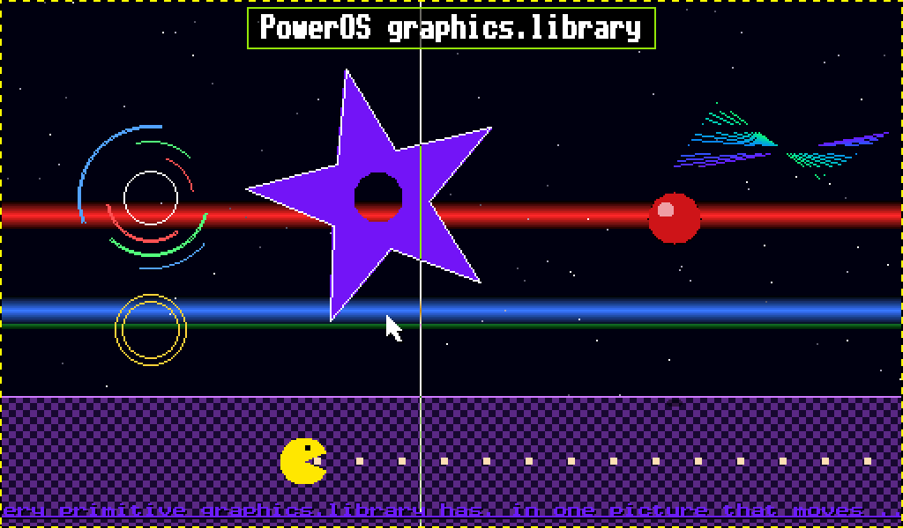

graphics.library in one moving picture: filled polygons with a hole
(the star), circles and arcs, lines with patterns, a ball blitted through a
mask, gradients, a tiled background, text measured and drawn in bold, and a
scroller in italic and underlined - everything in one RastPort, redrawn
every frame. It fills a screen of its own; `WINDOW` puts it in a window
on the default screen instead, which may be sized.

## On the board

Multitasking on the Waveshare ESP32-S3-Touch-LCD-7B: the shell, two
`Lines` windows drawing at the same time, and Dungeon Master at its door -
four programs, each in a window of its own, on the 7" 1024×600 panel.

The LCDwiki ES3C35P, an ESP32-S3 with a 3.5" 480×320 panel, running
PowerOS 0.1: the shell window just after boot, on the system's own font.
The speaker beside it is the board's; the machine is powered and its
serial console reached over the USB cable.

The Olimex ESP32-P4-PC, an ESP32-P4 board, on a television over HDMI at
800×600, with a USB keyboard and mouse in the sockets of its hub:
`C:test/Plasma` running its colours through the picture, three
`C:test/Lines` windows, CPU Load with both cores at work, and the shell
that started them. The pointer, on Plasma's title bar, is the USB
mouse's.

## A game: Dungeon Master

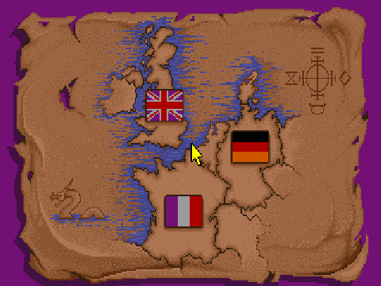

A minute of play, full screen: the language, the door, into the dungeon
and a few steps. The same as a video: [dm.mp4](dm.mp4).

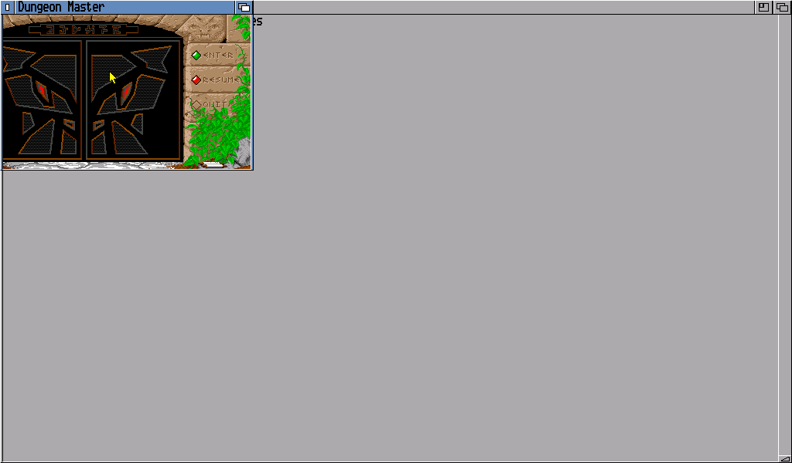

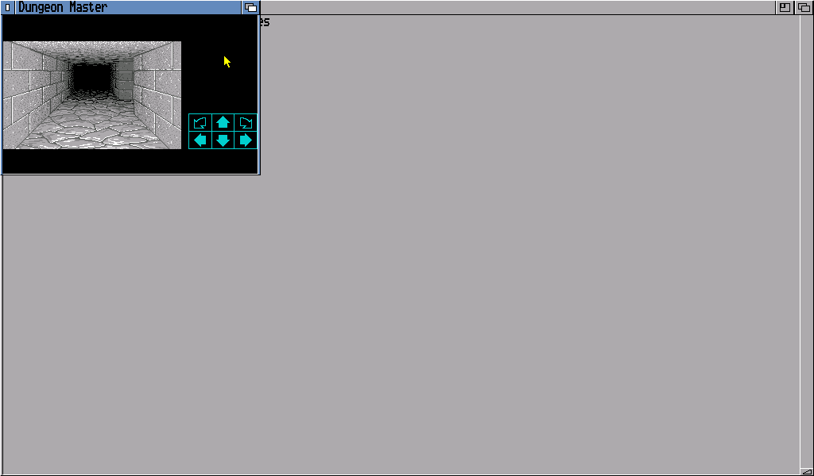

Dungeon Master, built against the SDK in a repository of its own and put
on the disk with its data files, running in a window of its own beside the
shell: the title with its door, and the first corridor of the dungeon. It
is started from the shell with `cd SYS:dm`, `Stack 65536` and
`Run dm window`.

## The desktop: Anvil

The machine comes up on the desktop: an icon for each disk, the free
memory in the screen's title, and here the flash disk `System` opened,
showing its drawers with icons and the Trashcan, and its Programs. A
double click opens a drawer or starts a program; icons are dragged
between windows, into drawers and onto programs. See the
[desktop guide](../../sdk/docs/guides/anvil.md).

## Two screens: the desktop in front of `C:test/Styles DARK`

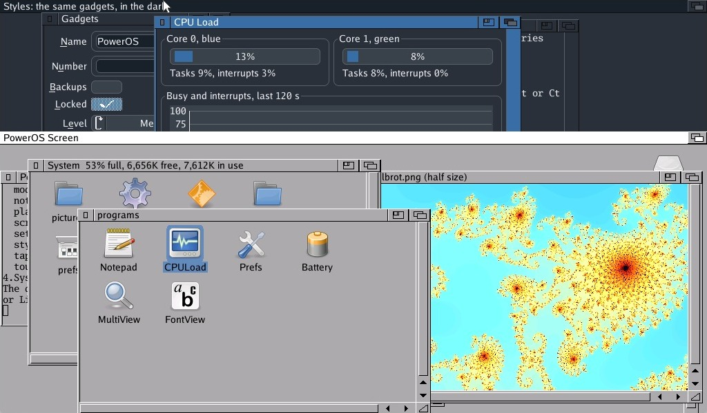

`C:test/Styles DARK` opens a screen with a dark style of its own and
makes it the default public screen: `C:test/Gadgets` and CPU Load,
started after it, open there and are drawn dark, with nothing in either
changed. The desktop's screen is in front - the System disk and its
Programs drawer, MultiView with `SYS:Pictures/Mandelbrot.png`, and a
shell - pulled down by its title bar to show the dark screen behind it.

## The shell

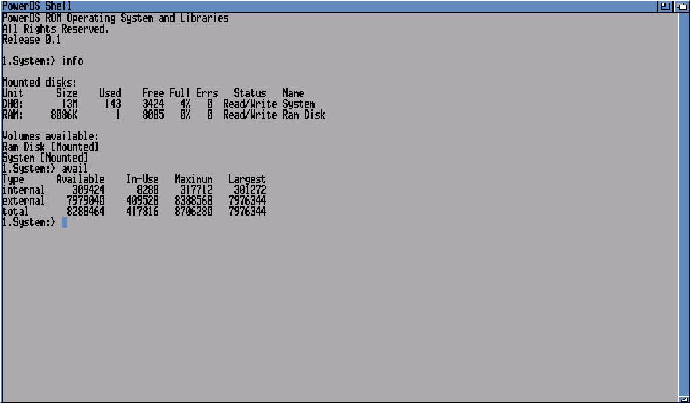

A shell window, from `SYS:System/Shell`. `Info` lists the mounted disks -
the flash disk `DH0:` named `System`, and `RAM:` - and `Avail` the memory:
internal SRAM and the 8 MiB of PSRAM. The blue block is the cursor.

## Notepad: `SYS:Programs/Notepad`

`Notepad S:Startup-Sequence`: the boot script in a window that is all
textedit.gadget, with line numbers - the cursor's line in black - and the
scroll bars in the window's border. The menus open and save, undo, cut
and paste, find and replace; View turns word wrap and the line numbers
on and off. The mouse wheel scrolls it, a double press selects a word and
a third the whole line, and Return keeps a line's indentation.

## Partitions: `SYS:System/HDToolBox`

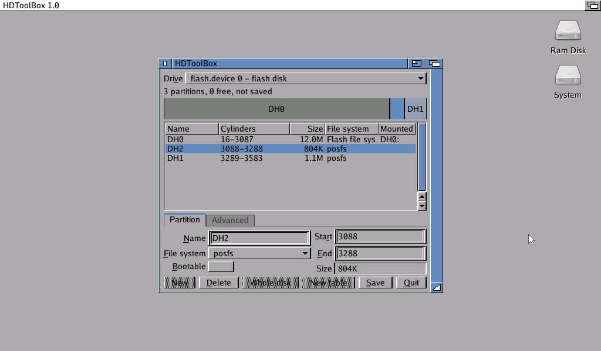

The flash disk's partition table, before it is saved: DH0, the system's
own, and two posfs partitions made in the free space behind it. The bar
is the drive from its first usable cylinder to its last; a partition is
moved by its middle and made larger or smaller by an edge, and a click
on a free run and New fills it. The list says what each one is and which
drive it is mounted as now. DH0 holds SYS:, so its place and its file
system stay as they are. Save says which partitions lose their data and
which drives stop, writes the table, and mounts the new partitions at
once.

## CPU load: `SYS:System/CPULoad`

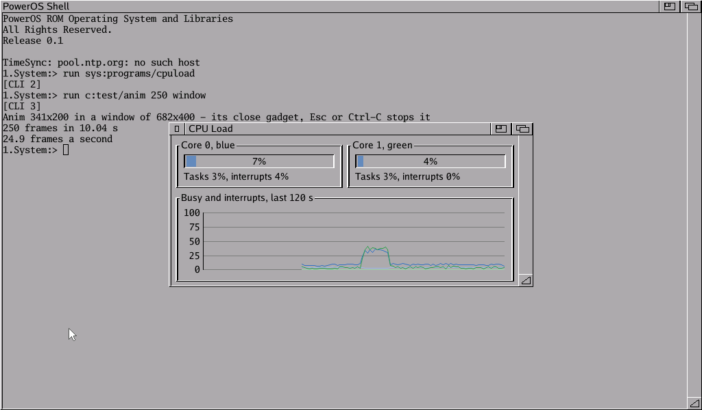

How busy each core is, from exec's own count of the time each one spends
in tasks, idle and in interrupts: a bar per core for the last second, and
a chart of the last two minutes. The rise in the middle is
`Run C:test/Anim 250 WINDOW` - 250 frames in ten seconds, its window gone
again when it ended - over the system's load at rest. QEMU runs both
cores, so both are drawn.

## Fonts: `C:test/Fonts`

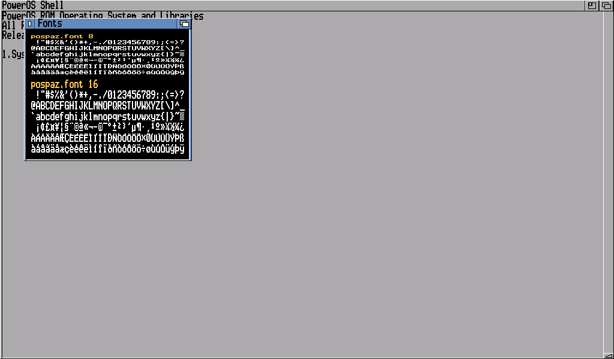

The system's font, `pospaz.font`, at 8 and 16 rows: every character from
32 to 255. The 16-row size is the 8-row one with every row drawn twice,
and it is the screen's default.

## Menus: `C:test/Intuition MENUS`

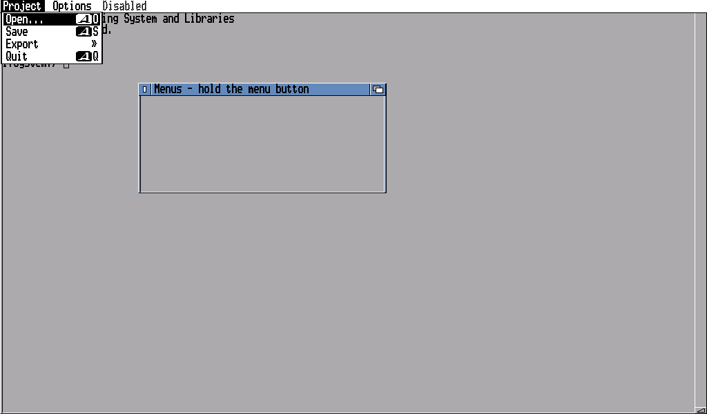

A window's menus, shown in the screen's title bar while the menu button is
held: items with keyboard shortcuts, an item that opens a submenu (»), and
a menu that is disabled.

## A requester: `C:test/Intuition REQUESTER`

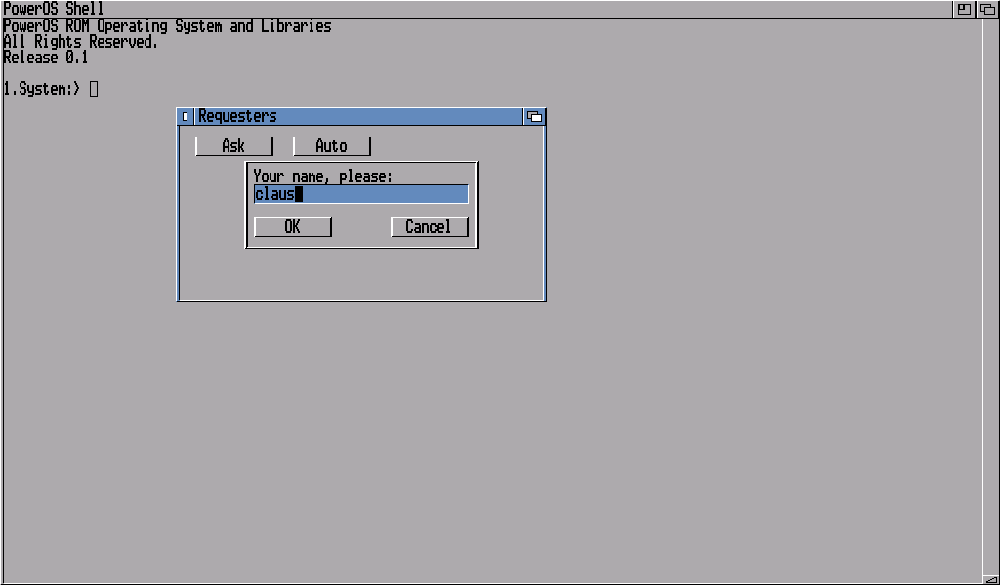

A requester inside a window: text, a string field being typed into, and
two buttons that end it.

## Gadgets: `C:test/Intuition SLIDERS`

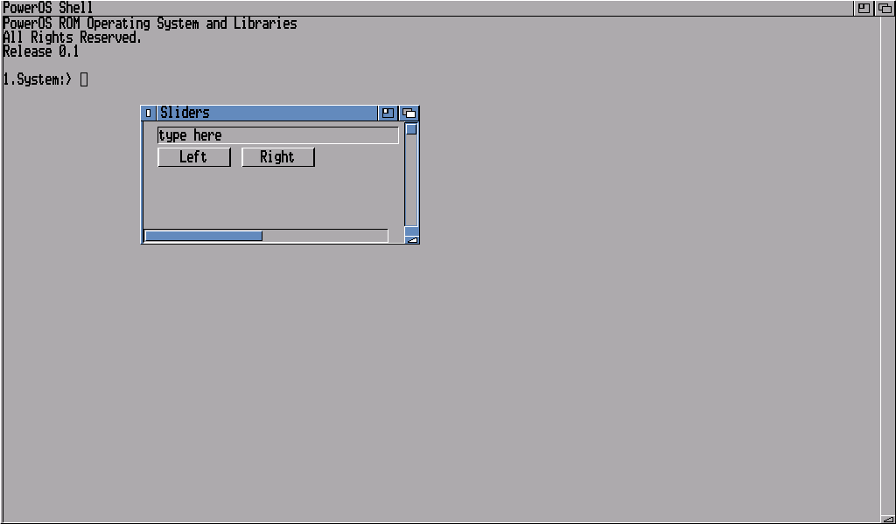

Sliders in the window's borders, a string field, and two framed buttons in
a group gadget - each an object of one of intuition's gadget classes.
